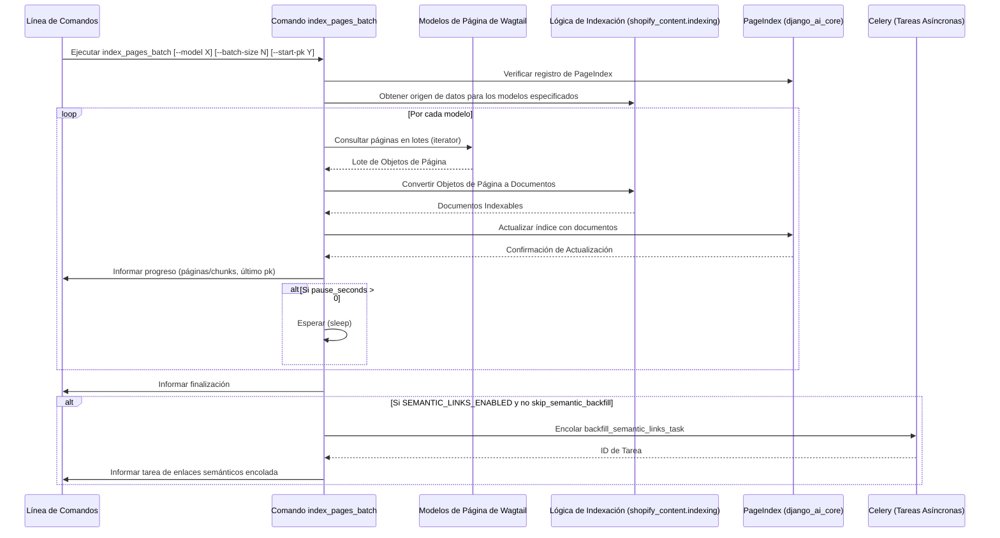

# Comandos de Gestión para Indexación y Búsqueda

Este módulo, `Management_Commands_Indexing_Search`, alberga una colección de comandos de gestión de Django diseñados para mantener actualizados los índices de contenido y los enlaces semánticos dentro del sistema de gestión de contenido de Shopify. Estos comandos son fundamentales para garantizar la capacidad de búsqueda, la navegación y la detectabilidad general del contenido en la tienda Shopify.

## Funcionalidad Principal

El módulo incluye los siguientes comandos de gestión:

*   **`index_pages_batch`**: Un comando para indexar páginas de Wagtail en `PageIndex` en pequeños lotes, lo que ayuda a evitar picos de memoria. También puede iniciar el rellenado de enlaces semánticos.
*   **`rebuild_blog_index`**: Reconstruye los metacampos de las listas del índice del blog en los blogs gestionados por Shopify Page.
*   **`rebuild_content_url_index`**: Reconstruye el mapeo de `ContentUrlIndex` a partir de páginas Wagtail en vivo con `shopify_id`, que es crucial para la resolución de URL.
*   **`rebuild_glossary_index`**: Reconstruye el índice del glosario en las entradas del metaobjeto `root_page` (una por cada configuración regional).
*   **`rebuild_location_index`**: Reconstruye el índice de ubicación en las entradas del metaobjeto `root_page` (una por cada configuración regional).
*   **`refresh_semantic_links_batch`**: Genera enlaces internos semánticos automáticos para todas las páginas en vivo enlazables.

## Arquitectura y Relaciones entre Componentes

Los comandos de este módulo interactúan con varias partes del sistema de gestión de contenido de Shopify, así como con componentes externos como Wagtail y Shopify.

### Diagrama de Componentes de Comandos de Gestión

```mermaid
graph TD
    subgraph Módulo de Comandos de Gestión
        A[Command: index_pages_batch] --> B{PageIndex (django_ai_core)}
        A --> C[model_source_for (shopify_content.indexing)]
        A --> D{backfill_semantic_links_task (shopify_content.tasks)}

        E[Command: rebuild_blog_index] --> F[sync_blog_index_listings (shopify_content.sync.blog_index)]
        E --> G[ShopifyRootPage (slug=blogs)]

        H[Command: rebuild_content_url_index] --> I[rebuild_full_index / rebuild_index_for_page (shopify_content.content_url_index)]
        H --> J[Wagtail Page Models]

        K[Command: rebuild_glossary_index] --> L[sync_glossary_index_pages (shopify_content.sync.glossary_index)]
        K --> M[ShopifyRootPage (slug=glossary)]

        N[Command: rebuild_location_index] --> O[sync_location_index_pages (shopify_content.sync.location_index)]
        N --> P[ShopifyRootPage (slug=local-us)]

        Q[Command: refresh_semantic_links_batch] --> R[run_semantic_links_backfill (shopify_content.semantic_links.backfill)]
        Q --> J
    end

    subgraph Shopify Content Management
        G((Páginas de Wagtail))
        J((Modelos de Página de Wagtail))
        S[Modelos de Índice de Contenido] --> B
        T[Modelos de URL de Contenido] --> I
        U[Modelos de Enlaces Semánticos] --> D
        U --> R
        V[Configuración de Exportación (export_config)] --> G
        V --> M
        V --> P
    end

    subgraph Plataforma Shopify
        W[Shopify Storefront]
        X[Shopify Metaobjects]
    end

    B --> W
    F --> X
    L --> X
    O --> X
    I --> W

    G --> V
    M --> V
    P --> V

    S -- "Almacena índices" --> J
    T -- "Almacena URLs" --> J
    U -- "Almacena enlaces" --> J

```

*   **`index_pages_batch`**: Este comando se conecta al registro de índices (`django_ai_core`) para obtener la instancia de `PageIndex`. Utiliza `shopify_content.indexing.INDEX_MODELS` y `model_source_for` para iterar sobre los modelos de página de Wagtail (artículos, productos, colecciones, glosarios) y transformarlos en documentos indexables. Después de la indexación, puede activar la tarea asíncrona `backfill_semantic_links_task` (ubicada en `shopify_content.tasks`) para generar enlaces semánticos, lo que demuestra una integración con Celery Beat si `SEMANTIC_LINKS_ENABLED` está configurado.

*   **`rebuild_blog_index`, `rebuild_glossary_index`, `rebuild_location_index`**: Estos comandos siguen un patrón similar para reconstruir índices específicos. Dependen de los metacampos `export_config` definidos en sus respectivas páginas raíz de Wagtail (`ShopifyRootPage`) (por ejemplo, con slugs "blogs", "glossary", "local-us"). Utilizan funciones de sincronización específicas (`sync_blog_index_listings`, `sync_glossary_index_pages`, `sync_location_index_pages`) para construir cargas útiles JSON y, opcionalmente, enviarlas a Shopify como metaobjetos, actualizando así la representación de la tienda.

*   **`rebuild_content_url_index`**: Este comando interactúa directamente con los modelos de página de Wagtail para construir un índice de todas las URL de contenido en vivo con un `shopify_id` asociado. Esto es vital para que el frontend de Shopify resuelva las URL de contenido correctamente.

*   **`refresh_semantic_links_batch`**: Este comando utiliza la lógica de `run_semantic_links_backfill` (del módulo `shopify_content.semantic_links.backfill`) para analizar y generar enlaces internos semánticos. Funciona con los modelos de página de Wagtail y puede crear o actualizar revisiones de Wagtail según las opciones.

## Flujo de Datos para la Indexación de Páginas por Lotes



## Cómo encaja en el sistema general

Este módulo es un componente crítico dentro de la arquitectura de `Shopify_Content_Management`, sirviendo como el puente para que el contenido de Wagtail sea utilizable y descubrible tanto por las capacidades de búsqueda interna como por los componentes externos de Shopify. Al proporcionar comandos de gestión robustos, garantiza que:

1.  **Indexación de Contenido Central**: Las páginas de Wagtail (artículos, productos, colecciones, glosarios) se indexan eficientemente para su uso en la búsqueda y el procesamiento de IA a través de `django_ai_core.contrib.index.base.registry`.
2.  **Sincronización con Shopify**: Los índices específicos del dominio (blogs, glosarios, ubicaciones) se mantienen sincronizados con los metaobjetos de Shopify, lo que permite que el frontend de Shopify acceda a datos de listado enriquecidos.
3.  **Resolución de URL**: Un índice completo de las URL de contenido garantiza que las referencias internas y externas a las páginas de Wagtail se resuelvan correctamente.
4.  **Optimización SEO y UX**: La generación de enlaces semánticos automáticos mejora la interconectividad del contenido, lo que beneficia tanto al SEO como a la experiencia del usuario.

Los comandos de este módulo a menudo se ejecutan como tareas programadas (posiblemente a través de Celery Beat, como se insinúa en `index_pages_batch` con `backfill_semantic_links_task`), o manualmente por los administradores para mantener la frescura y precisión del contenido y los índices. Proporciona las herramientas necesarias para la gestión del ciclo de vida del contenido posterior a la publicación en un entorno integrado Wagtail-Shopify.

Para la configuración del entorno, la disponibilidad de `PageIndex` depende de la activación de `WAGTAIL_AI_PGVECTOR` y `GEMINI_API_KEY`, como se menciona en `index_pages_batch`. Estos se pueden definir en el archivo de configuración de Django, por ejemplo, `shopify.web.toml` (ver `Build,_Test,_and_Configuration` para más detalles sobre los archivos de configuración).