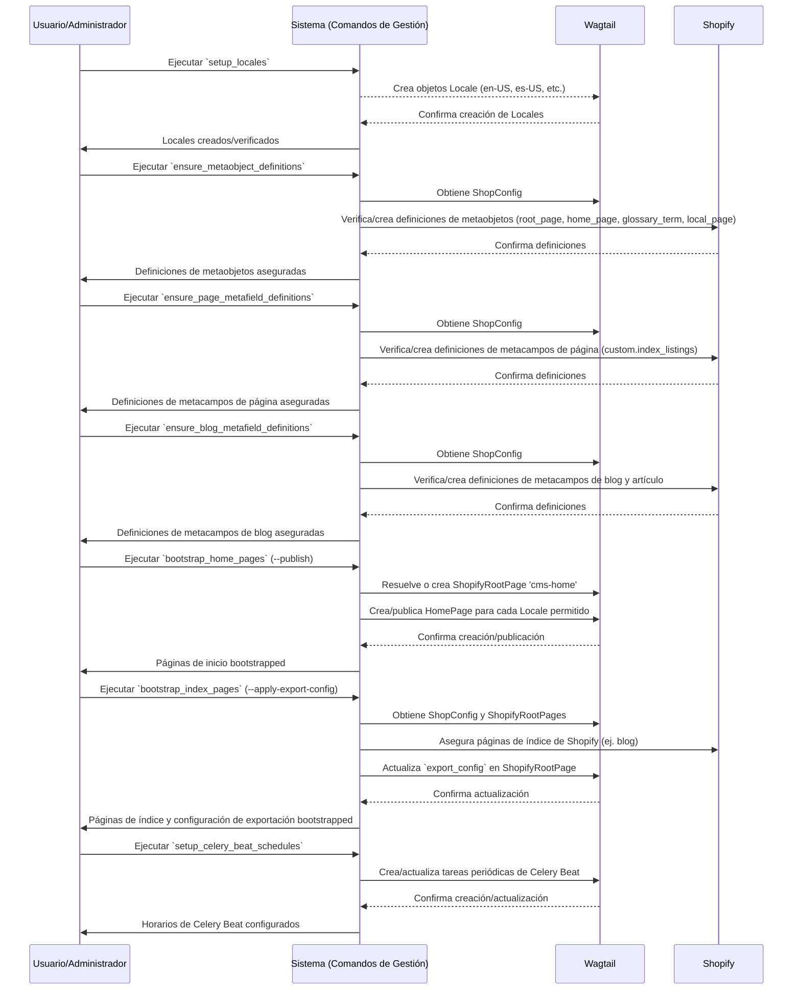

# Comandos de Inicialización y Configuración

El módulo `Management_Commands_Initialization_Configuration` agrupa un conjunto de comandos de gestión de Django esenciales para la configuración inicial y el mantenimiento de las definiciones de metacampos y objetos meta en la integración de Shopify Content Management. Estos comandos automatizan tareas repetitivas y aseguran que tanto la instancia de Wagtail como la tienda de Shopify estén correctamente configuradas para la gestión y sincronización de contenido.

## Propósito y Funcionalidad Principal

Este módulo tiene como objetivo principal facilitar la puesta en marcha y la configuración continua del sistema de gestión de contenido. Las funcionalidades clave incluyen:

*   **Inicialización de Estructura de Contenido:** Creación de páginas raíz y de inicio para diferentes configuraciones regionales en Wagtail.
*   **Gestión de Definiciones de Metacampos y Metaobjetos:** Asegurar que las definiciones de metacampos y metaobjetos personalizados necesarios para la sincronización de contenido existan en Shopify.
*   **Configuración de Tareas Programadas:** Establecimiento de tareas periódicas para la importación y sincronización automática de contenido.
*   **Configuración Regional (Locales):** Creación de objetos `Locale` en Wagtail para soportar la internacionalización y `hreflang`.

## Arquitectura y Relaciones de Componentes

Los comandos de este módulo interactúan con varios componentes del sistema, incluyendo los modelos de Wagtail (como `ShopifyRootPage`, `HomePage`, `Locale`), la configuración de la tienda (`ShopConfig`), y directamente con la API de Shopify para gestionar metacampos y metaobjetos a través de la [Conexión de Metaobjetos de Shopify](../../Shopify_Platform_Integrations/Shopify_Metaobjects_Connector.md).

### Diagrama de Flujo de Inicialización del Sistema

El siguiente diagrama de secuencia ilustra el flujo recomendado para ejecutar los comandos de inicialización y configuración en un nuevo entorno:



### Diagrama de Dependencias de Metafield y Metaobject

Este diagrama ilustra las dependencias entre los comandos que aseguran las definiciones en Shopify y el componente `ShopConfig` del módulo [Shopify_App_Core](../../Shopify_App_Core.md).

```mermaid
graph TD
    subgraph Comandos de Inicialización
        A[Command: setup_locales]
        B[Command: ensure_metaobject_definitions]
        C[Command: ensure_page_metafield_definitions]
        D[Command: ensure_blog_metafield_definitions]
        E[Command: ensure_index_metafield_definitions]
        F[Command: bootstrap_home_pages]
        G[Command: bootstrap_index_pages]
        H[Command: setup_celery_beat_schedules]
    end

    subgraph Shopify_App_Core
        SC[core/models.py::ShopConfig]
    end

    subgraph Shopify
        SMD[Definiciones de Metaobjetos de Shopify]
        SPF[Definiciones de Metacampos de Página de Shopify]
        SBMF[Definiciones de Metacampos de Blog de Shopify]
    end

    subgraph Wagtail
        WL[wagtail.models::Locale]
        WHP[shopify_content.models::HomePage]
        WSRP[shopify_content.models::ShopifyRootPage]
        WPT[django_celery_beat.models::PeriodicTask]
        WCS[django_celery_beat.models::CrontabSchedule]
    end

    B --> SC
    B --> SMD
    C --> SC
    C --> SPF
    D --> SC
    D --> SBMF
    E --> SC
    E --> SPF
    E --> SBMF

    F --> SC
    F --> WHP
    F --> WSRP

    G --> SC
    G --> WSRP
    G --> SPF
    G --> SBMF

    A --> WL
    H --> WPT
    H --> WCS
```



## Componentes del Módulo

A continuación, se describen los componentes principales de este módulo:

### `shopify_content/management/commands/bootstrap_home_pages.py::Command`

Este comando se encarga de asegurar la existencia de la `ShopifyRootPage` con el slug `cms-home` y de crear una `HomePage` por cada configuración regional permitida en `settings.ALLOWED_LOCALE_CODES`.

*   **Funcionalidad:**
    *   Verifica o crea la página raíz `ShopifyRootPage`.
    *   Itera sobre las configuraciones regionales definidas y crea una `HomePage` para cada una, si no existe.
    *   Permite la publicación inmediata de las páginas creadas mediante el argumento `--publish`, lo que puede desencadenar una sincronización con Shopify si está habilitada.
    *   Ofrece un modo `dry-run` para previsualizar las acciones sin realizar cambios.
*   **Uso:**
    ```bash
    python manage.py bootstrap_home_pages
    python manage.py bootstrap_home_pages --publish
    python manage.py bootstrap_home_pages --dry-run
    ```
*   **Dependencias clave:**
    *   [shopify_content/models/home_page.py::HomePage](../Content_Page_Models/Content_Page_Models_Home_Pages.md)
    *   [shopify_content/models/root.py::ShopifyRootPage](../Content_Page_Models/Content_Page_Models_Shopify_Root_Page.md)
    *   `wagtail.models.Locale`

### `shopify_content/management/commands/bootstrap_index_pages.py::Command`

Este comando gestiona la creación de páginas de índice en Shopify (como la página de índice del blog) y aplica configuraciones de exportación para índices de glosarios y ubicaciones.

*   **Funcionalidad:**
    *   Asegura las definiciones de metacampos de índice antes de proceder, a menos que se use `--skip-metafield-definitions`.
    *   Crea las páginas de índice de Shopify para el blog y, opcionalmente, para las páginas heredadas de glosarios y ubicaciones.
    *   Genera configuraciones de exportación para glosarios, ubicaciones y blogs.
    *   Permite aplicar estas configuraciones directamente a las `ShopifyRootPage` correspondientes en la base de datos de Wagtail mediante `--apply-export-config`.
    *   El argumento `--legacy-pages` permite crear páginas de índice de glosarios y ubicaciones deprecadas.
*   **Uso:**
    ```bash
    python manage.py bootstrap_index_pages
    python manage.py bootstrap_index_pages --apply-export-config
    python manage.py bootstrap_index_pages --skip-metafield-definitions
    python manage.py bootstrap_index_pages --legacy-pages
    ```
*   **Dependencias clave:**
    *   [core/models.py::ShopConfig](../../Shopify_App_Core.md)
    *   [shopify_content/models/root.py::ShopifyRootPage](../Content_Page_Models/Content_Page_Models_Shopify_Root_Page.md)
    *   [shopify_content/sync/index_pages_bootstrap.py::IndexPageSpec](../Content_Synchronization_Specifications.md)
    *   [shopify_content/sync/resource_metafield_definitions.py::ResourceMetafieldDefinitionSpec](../Content_Synchronization_Specifications.md)

### `shopify_content/management/commands/ensure_blog_metafield_definitions.py::Command`

Este comando se asegura de que las definiciones de metacampos necesarias para los listados de índice de blog (tipo PAGE) y las configuraciones regionales disponibles (`available_locales`) en recursos BLOG y ARTICLE existan en Shopify.

*   **Funcionalidad:**
    *   Conecta con Shopify para verificar y crear las definiciones de metacampos específicas para blogs y artículos.
    *   Reporta las estadísticas de creación, omisión y errores.
*   **Uso:**
    ```bash
    python manage.py ensure_blog_metafield_definitions
    ```
*   **Dependencias clave:**
    *   [core/models.py::ShopConfig](../../Shopify_App_Core.md)
    *   [shopify_content/sync/resource_metafield_definitions.py::ResourceMetafieldDefinitionSpec](../Content_Synchronization_Specifications.md)

### `shopify_content/management/commands/ensure_index_metafield_definitions.py::Command`

Este comando es una versión más completa para asegurar las definiciones de metacampos. Garantiza la existencia de `custom.index_listings` (para tipo PAGE) y las definiciones de `available_locales` para blog y artículo.

*   **Funcionalidad:**
    *   Asegura las definiciones de metacampos para `PAGE`, `BLOG` y `ARTICLE`.
    *   Incluye una opción `--legacy` para asegurar definiciones de metacampos de índice por configuración regional deprecadas.
    *   Reporta las estadísticas de creación y omisión.
*   **Uso:**
    ```bash
    python manage.py ensure_index_metafield_definitions
    python manage.py ensure_index_metafield_definitions --legacy
    ```
*   **Dependencias clave:**
    *   [core/models.py::ShopConfig](../../Shopify_App_Core.md)
    *   [shopify_content/sync/page_metafield_definitions.py::PageMetafieldDefinitionSpec](../Content_Synchronization_Specifications.md)
    *   [shopify_content/sync/resource_metafield_definitions.py::ResourceMetafieldDefinitionSpec](../Content_Synchronization_Specifications.md)

### `shopify_content/management/commands/ensure_metaobject_definitions.py::Command`

Este comando es fundamental para inicializar las definiciones de metaobjetos de Shopify que son propiedad del comerciante y utilizadas por la aplicación.

*   **Funcionalidad:**
    *   Verifica y crea las definiciones de metaobjetos para `local_page`, `root_page`, `home_page` y `glossary_term` en Shopify.
    *   Es seguro ejecutarlo varias veces, ya que solo crea las definiciones faltantes o añade campos a los tipos existentes.
*   **Uso:**
    ```bash
    python manage.py ensure_metaobject_definitions
    ```
*   **Dependencias clave:**
    *   [core/models.py::ShopConfig](../../Shopify_App_Core.md)
    *   [metaobjects/shopify_metaobjects/client.py::MetaobjectClient](../../Shopify_Platform_Integrations/Shopify_Metaobjects_Connector.md)
    *   [metaobjects/shopify_metaobjects/exceptions.py::DefinitionError](../../Shopify_Platform_Integrations/Shopify_Metaobjects_Connector.md)

### `shopify_content/management/commands/ensure_page_metafield_definitions.py::Command`

Este comando se enfoca específicamente en asegurar la definición del metacampo `custom.index_listings` para el tipo `Page` en Shopify.

*   **Funcionalidad:**
    *   Verifica o crea la definición del metacampo `custom.index_listings` en Shopify para recursos de tipo `Page`.
    *   Ofrece una opción `--list-only` para listar solo las definiciones existentes sin crear nuevas.
    *   Se recomienda usar `ensure_index_metafield_definitions` en su lugar, ya que incluye las definiciones de blog/artículo.
*   **Uso:**
    ```bash
    python manage.py ensure_page_metafield_definitions
    python manage.py ensure_page_metafield_definitions --list-only
    ```
*   **Dependencias clave:**
    *   [core/models.py::ShopConfig](../../Shopify_App_Core.md)
    *   [shopify_content/sync/page_metafield_definitions.py::PageMetafieldDefinitionSpec](../Content_Synchronization_Specifications.md)

### `shopify_content/management/commands/setup_celery_beat_schedules.py::Command`

Este comando configura las tareas periódicas predeterminadas de `django-celery-beat` para la sincronización de Shopify.

*   **Funcionalidad:**
    *   Crea o actualiza una tarea periódica para importar contenido nuevo desde Shopify (deshabilitada por defecto).
    *   Crea o actualiza una tarea periódica para la retroalimentación de enlaces semánticos internos (habilitada si `SEMANTIC_LINKS_ENABLED` y `SEMANTIC_LINKS_BACKFILL_SCHEDULE_ENABLED` están configurados).
    *   Las tareas se programan con `CrontabSchedule`.
*   **Uso:**
    ```bash
    python manage.py setup_celery_beat_schedules
    ```
*   **Dependencias clave:**
    *   `django_celery_beat.models.CrontabSchedule`
    *   `django_celery_beat.models.PeriodicTask`
    *   `django.conf.settings`

### `shopify_content/management/commands/setup_locales.py::Command`

Este comando crea los objetos `wagtail.models.Locale` necesarios para el soporte de `hreflang` y la gestión de contenido multilingüe en Wagtail.

*   **Funcionalidad:**
    *   Asegura la existencia de los locales `en-US`, `es-US`, `en-CA` y `fr-CA`.
*   **Uso:**
    ```bash
    python manage.py setup_locales
    ```
*   **Dependencias clave:**
    *   `wagtail.models.Locale`
