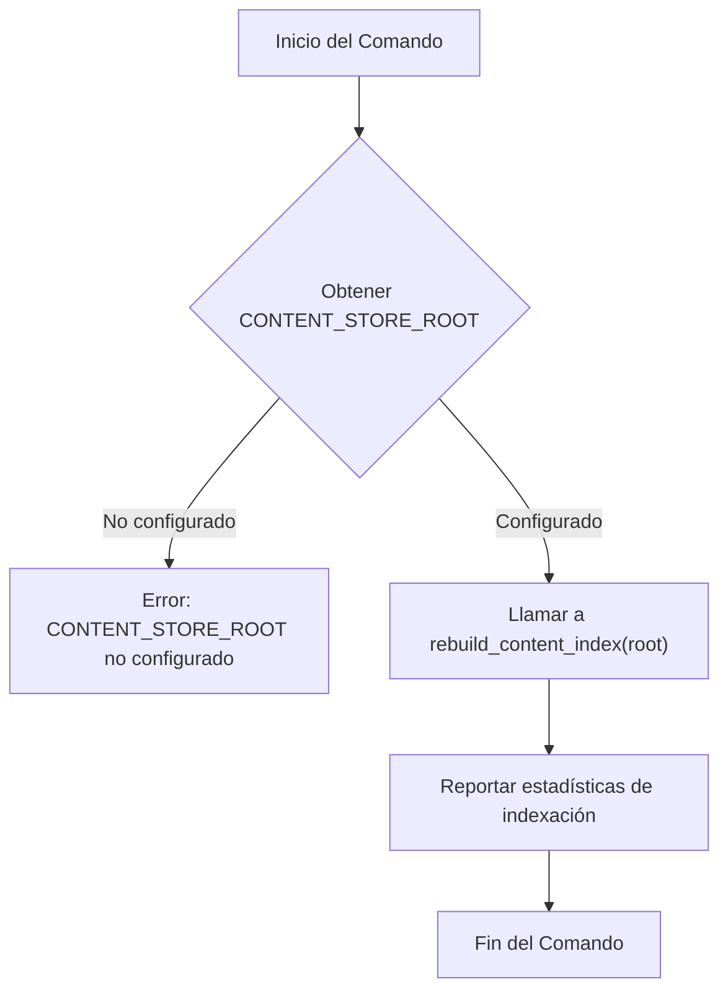
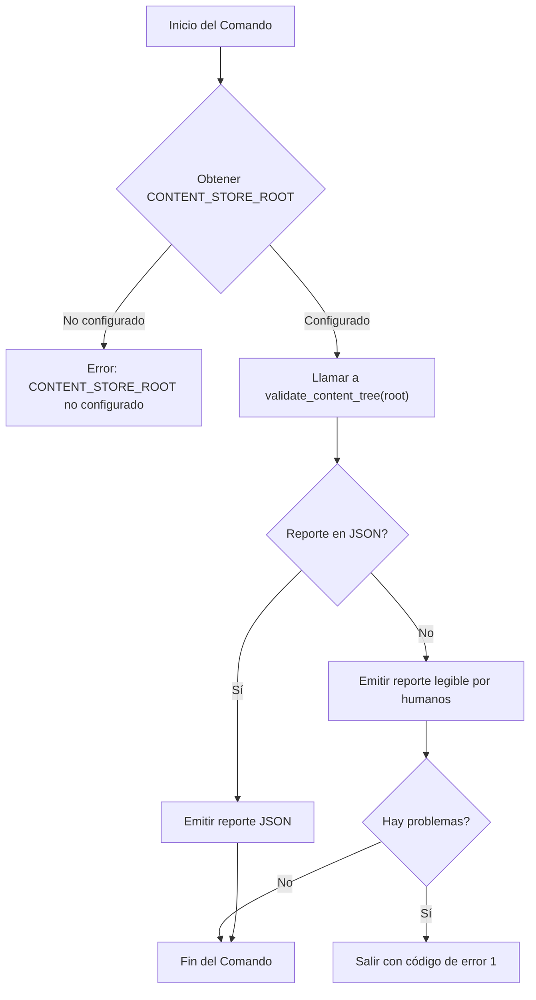
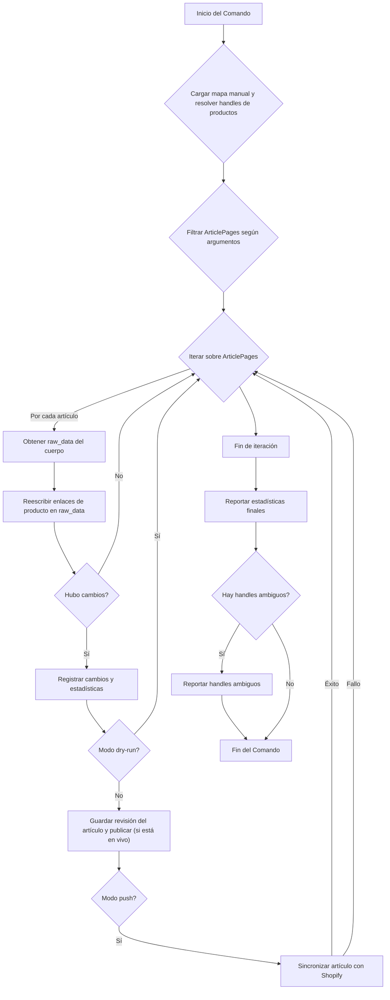

# Comandos de Gestión: Mantenimiento y Validación

Este módulo contiene comandos de gestión de Django utilizados para tareas de mantenimiento y validación relacionadas con el contenido de Shopify. Estos comandos son esenciales para asegurar la integridad, exactitud y coherencia de los datos de contenido dentro del sistema.

## Comandos de Mantenimiento y Validación

### `content_index_rebuild`

El comando `content_index_rebuild` se encarga de reconstruir las tablas de `ContentIndex` y `ContentReferenceIndex` a partir del árbol de contenido desplegado. Esto es crucial para mantener los índices de búsqueda y referencia actualizados después de cambios en el contenido.

**Propósito:** Reconstruir los índices de contenido para asegurar que el sistema pueda buscar y referenciar el contenido correctamente.

**Uso:**

```bash
python manage.py content_index_rebuild [--root <ruta_raiz>]
```

**Argumentos:**

*   `--root <ruta_raiz>`: Opcional. Permite sobrescribir la configuración de `CONTENT_STORE_ROOT` para esta ejecución específica, especificando la ruta raíz del almacén de contenido.

**Flujo del Comando:**



### `content_validate`

El comando `content_validate` se utiliza para validar el contenido editorial respaldado por Git. Realiza una validación de solo lectura y determinista para detectar cualquier problema o error en el contenido markdown sin realizar escrituras en Git o en la base de datos.

**Propósito:** Validar la exactitud y el formato del contenido editorial markdown, identificando problemas sin modificar el contenido.

**Uso:**

```bash
python manage.py content_validate [--json] [--root <ruta_raiz>]
```

**Argumentos:**

*   `--json`: Opcional. Emite un informe en formato JSON legible por máquina a la salida estándar.
*   `--root <ruta_raiz>`: Opcional. Permite sobrescribir la configuración de `CONTENT_STORE_ROOT` para esta ejecución específica, especificando la ruta raíz del almacén de contenido.

**Flujo del Comando:**



### `fix_article_product_links`

Este comando reescribe los enlaces rotos de `/products/{handle}` en el HTML de los campos `StreamField` de las `ArticlePage` para que apunten a los `ProductPage` con `handle`s activos. Por defecto, los enlaces no mapeados se desenvuelven (se eliminan las etiquetas `<a>`).

**Propósito:** Corregir y normalizar los enlaces de productos en el contenido de los artículos para asegurar que apunten a páginas de productos válidas y activas.

**Uso:**

```bash
python manage.py fix_article_product_links \
    [--dry-run] \
    [--blog-handle <handle_blog>] \
    [--page-id <id_pagina>] \
    [--map-file <archivo_mapa>] \
    [--push] \
    [--no-unwrap-missing] \
    [--include-drafts]
```

**Argumentos:**

*   `--dry-run`: Opcional. Reporta los cambios sin guardarlos ni sincronizarlos con Shopify.
*   `--blog-handle <handle_blog>`: Opcional. Limita la corrección a artículos bajo un `BlogPage.handle` específico (ej. `sex-toys-artisans`).
*   `--page-id <id_pagina>`: Opcional. Corrige solo la `ArticlePage` con el ID especificado (puede repetirse).
*   `--map-file <archivo_mapa>`: Opcional. Archivo JSON que mapea `legacy_handle` a `live_handle` para casos ambiguos.
*   `--push`: Opcional. Después de guardar, sincroniza cada artículo modificado con Shopify (saliente). Requiere que `--dry-run` NO esté presente.
*   `--no-unwrap-missing`: Opcional. Deja los enlaces de productos no mapeados sin cambios en lugar de desenvolver las etiquetas `<a>`.
*   `--include-drafts`: Opcional. Incluye artículos no publicados (por defecto, solo artículos en vivo).

**Flujo del Comando:**



### `fix_location_richtext`

Este comando repara el HTML malformado en los campos `RichTextField` de los registros `LocationPage`.

**Propósito:** Limpiar y corregir el HTML de los campos de texto enriquecido en las páginas de ubicación para asegurar que el contenido sea válido y se muestre correctamente.

**Uso:**

```bash
python manage.py fix_location_richtext [--page-id <id_pagina>] [--dry-run]
```

**Argumentos:**

*   `--page-id <id_pagina>`: Opcional. Corrige solo la página de ubicación con el ID especificado (puede repetirse).
*   `--dry-run`: Opcional. Reporta los cambios sin guardarlos en la base de datos.

**Flujo del Comando:**

```mermaid
graph TD
    A[Inicio del Comando] --> B{Filtrar LocationPages según argumentos}
    B --> C{Iterar sobre LocationPages}
    C -- Por cada página --> D{Iterar sobre campos RichTextField}
    D -- Por cada campo --> E{Obtener HTML raw}
    E --> F{HTML vacío o válido?}
    F -- Sí --> D
    F -- No --> G[Sanitizar HTML]
    G --> H{HTML limpio es diferente y válido?}
    H -- Sí --> I[Registrar campo reparado]
    I --> J{Modo dry-run?}
    J -- Sí --> D
    J -- No --> K[Establecer campo con HTML limpio]
    K --> D
    H -- No --> L[Reportar fallo de auto-reparación]
    L --> D
    D --> M[Fin de campos]
    M --> N{Página cambió y no es dry-run?}
    N -- Sí --> O[Guardar página]
    N -- No --> P[Página cambió (dry-run)]
    O --> C
    P --> C
    C --> Q[Fin de páginas]
    Q --> R[Reportar estadísticas finales]
    R --> S[Fin del Comando]
```
