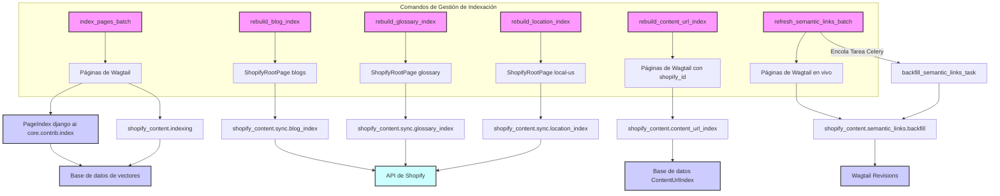

# Comandos de Gestión de Indexación

Este módulo contiene comandos de gestión de Django diseñados para la indexación y reconstrucción de varios índices de contenido dentro del sistema de gestión de contenido de Shopify. Estos comandos son cruciales para mantener la integridad y la capacidad de búsqueda del contenido, así como para la sincronización con la plataforma Shopify.

## Propósito y Funcionalidad Principal

El módulo `Management_Commands_Management_Commands_Indexing` proporciona una suite de comandos CLI para:

*   Indexar páginas de Wagtail en lotes, optimizando el uso de memoria.
*   Reconstruir el índice de listados de blogs en los metaobjetos de Shopify.
*   Reconstruir el índice de URLs de contenido para mapear páginas de Wagtail a URLs de Shopify.
*   Reconstruir el índice de glosario en las entradas de metaobjetos de la página raíz, específico por localidad.
*   Reconstruir el índice de ubicaciones en las entradas de metaobjetos de la página raíz, específico por localidad.
*   Generar y actualizar enlaces internos semánticos para páginas en vivo.

Estos comandos aseguran que el contenido de Wagtail esté correctamente indexado para búsquedas internas, que las URL sean resolubles, y que los listados de blogs, glosarios y ubicaciones se sincronicen con Shopify, facilitando la integración y el SEO.

## Arquitectura y Relaciones de Componentes

Los comandos de gestión de indexación interactúan con varios componentes del sistema, incluyendo los modelos de página de Wagtail, los servicios de indexación personalizados, los servicios de sincronización de Shopify y las tareas asíncronas.

### Diagrama de Flujo de Comandos de Indexación

### Componentes Clave y Sus Interacciones:

*   **`index_pages_batch`**: Este comando (`shopify_content/management/commands/index_pages_batch.py::Command`) utiliza el registro de índices de `django_ai_core.contrib.index.base` para obtener una instancia de `PageIndex`. Procesa páginas de Wagtail de tipos específicos (artículo, producto, colección, glosario) en lotes, convirtiéndolas en documentos y actualizando el `PageIndex`. Después de la indexación, encola una tarea Celery (`shopify_content.tasks.backfill_semantic_links_task`) para rellenar enlaces semánticos, si la funcionalidad está habilitada.
    *   Depende de: [Content Page Models](../Content_Page_Models.md) (para los tipos de página), el sistema de índice `django_ai_core`, y el servicio de enlaces semánticos.

*   **`rebuild_blog_index`**: El comando (`shopify_content/management/commands/rebuild_blog_index.py::Command`) se encarga de sincronizar los listados del índice de blogs con Shopify. Utiliza `shopify_content.sync.blog_index.sync_blog_index_listings` para construir el JSON del índice de blogs y enviarlo a la API de Shopify. Requiere una `ShopifyRootPage` con el slug "blogs" y una configuración `export_config` válida.
    *   Depende de: [Content Page Models/Shopify Root Page](../Content_Page_Models/Content_Page_Models_Shopify_Root_Page.md), [Content Indexing & Export Configuration](../Content_Indexing___Export_Configuration.md) (para `RootIndexConsumer`).

*   **`rebuild_content_url_index`**: Este comando (`shopify_content/management/commands/rebuild_content_url_index.py::Command`) se utiliza para reconstruir el mapeo `ContentUrlIndex`, que asocia las páginas de Wagtail con sus URLs de Shopify. Puede reconstruir el índice completo o solo para una página específica. Se basa en funciones de `shopify_content.content_url_index`.
    *   Depende de: [Content Page Models/Content URL Index Models](../Content_Page_Models/Content_Page_Models_Content_URL_Index_Models.md).

*   **`rebuild_glossary_index`**: Similar al índice de blogs, este comando (`shopify_content/management/commands/rebuild_glossary_index.py::Command`) gestiona la reconstrucción del índice del glosario. Sincroniza las entradas del índice del glosario como metaobjetos de la página raíz en Shopify, con soporte para múltiples localidades. Utiliza `shopify_content.sync.glossary_index.sync_glossary_index_pages`.
    *   Depende de: [Content Page Models/Glossary Term Pages](../Content_Page_Models/Content_Page_Models_Glossary_Term_Pages.md), [Content Indexing & Export Configuration](../Content_Indexing___Export_Configuration.md).

*   **`rebuild_location_index`**: Este comando (`shopify_content/management/commands/rebuild_location_index.py::Command`) es para reconstruir el índice de ubicaciones, funcionando de manera similar a los índices de blogs y glosarios. Sincroniza las entradas del índice de ubicaciones como metaobjetos de la página raíz en Shopify, también con soporte para múltiples localidades. Se apoya en `shopify_content.sync.location_index.sync_location_index_pages`.
    *   Depende de: [Content Page Models/Location Pages](../Content_Page_Models/Content_Page_Models_Location_Pages.md), [Content Indexing & Export Configuration](../Content_Indexing___Export_Configuration.md).

*   **`refresh_semantic_links_batch`**: El comando (`shopify_content/management/commands/refresh_semantic_links_batch.py::Command`) se enfoca en la generación y actualización de enlaces internos semánticos. Invoca `shopify_content.semantic_links.backfill.run_semantic_links_backfill` para procesar páginas, identificar enlaces semánticos y, opcionalmente, guardar las revisiones en Wagtail.
    *   Depende de: [Content Page Models/Semantic Links Models](../Content_Page_Models/Content_Page_Models_Semantic_Links_Models.md), [Semantic Links Service](../../Semantic_Links_Service.md).

## Integración en el Sistema General

Los comandos de indexación son una parte fundamental del ecosistema de gestión de contenido de Shopify, asegurando que el contenido creado y gestionado en Wagtail sea accesible y esté optimizado para la plataforma Shopify y para la búsqueda interna. Se integran con:

*   **Wagtail CMS**: Operan directamente sobre los modelos de página de Wagtail para extraer contenido y metadatos.
*   **Shopify**: Sincronizan datos de índice y metaobjetos directamente con la API de Shopify, lo que es vital para la presentación del escaparate y las funciones de búsqueda.
*   **Sistema de Indexación AI/Vectorial**: `index_pages_batch` utiliza `django_ai_core.contrib.index` para poblar índices vectoriales, lo que habilita capacidades de búsqueda semántica y recuperación de información avanzada.
*   **Celery**: Para tareas de fondo como el relleno de enlaces semánticos, lo que permite un procesamiento asíncrono y no bloqueante.
*   **Configuración del Proyecto**: La funcionalidad de estos comandos a menudo depende de la configuración definida en `settings.py` (por ejemplo, `SEMANTIC_LINKS_ENABLED`) y la configuración de `export_config` en las páginas raíz de Wagtail.

En conjunto, estos comandos cierran la brecha entre el contenido editorial gestionado en Wagtail y los requisitos operativos y de presentación de la plataforma Shopify, manteniendo el contenido actualizado y optimizado para una experiencia de usuario enriquecida.