# Comandos de Gestión para Inicialización y Configuración

Este módulo (`Management_Commands_Initialization_Configuration`) agrupa varios comandos de gestión de Django esenciales para la configuración inicial y el mantenimiento de la aplicación de gestión de contenido de Shopify. Estos comandos automatizan tareas cruciales como la creación de páginas raíz, la definición de metafields en Shopify y la configuración de tareas programadas.

## Propósito y Funcionalidad Principal

El módulo facilita la puesta en marcha y la correcta operación del sistema de gestión de contenido al proporcionar herramientas para:

*   **Inicializar la estructura básica de páginas en Wagtail**: Asegura la existencia de las páginas principales necesarias para el contenido de Shopify.
*   **Definir y verificar Metafields y Metaobjects en Shopify**: Garantiza que las definiciones de datos personalizados en Shopify estén alineadas con los requisitos del CMS.
*   **Configurar tareas periódicas de Celery Beat**: Establece la programación para la sincronización y el mantenimiento automático del contenido.
*   **Gestionar locales de Wagtail**: Asegura que los idiomas y regiones necesarios estén configurados para el soporte de `hreflang`.

## Arquitectura y Relaciones de Componentes

Los comandos de gestión en este módulo interactúan con varios componentes clave del sistema:

*   **Modelos de Wagtail**: `ShopifyRootPage`, `HomePage`, `Locale`.
*   **API de Shopify**: A través de `MetaobjectClient` para gestionar metafields y metaobjects.
*   **Django-Celery-Beat**: Para la configuración de tareas programadas.
*   **Configuración de Django**: `settings.ALLOWED_LOCALE_CODES`, `settings.TIME_ZONE`.

A continuación, se presenta un diagrama de flujo que ilustra la interacción de estos comandos con los sistemas internos y externos.

```mermaid
graph TD
    subgraph Comandos de Gestión
        A[bootstrap_home_pages] --> B(Crear ShopifyRootPage y HomePage por Locale)
        C[bootstrap_index_pages] --> D(Crear Páginas de Índice en Shopify y Configurar export_config)
        E[ensure_blog_metafield_definitions] --> F(Crear Definiciones de Metafield de Blog en Shopify)
        G[ensure_index_metafield_definitions] --> H(Crear Definiciones de Metafield de Índice y Blog/Artículo en Shopify)
        I[ensure_metaobject_definitions] --> J(Crear Definiciones de Metaobject en Shopify)
        K[ensure_page_metafield_definitions] --> L(Crear Definiciones de Metafield de Página en Shopify)
        M[setup_celery_beat_schedules] --> N(Configurar Tareas Periódicas de Celery Beat)
        O[setup_locales] --> P(Crear Objetos Wagtail Locale)
    end

    subgraph Componentes Internos
        W1[Modelos Wagtail: ShopifyRootPage, HomePage, Locale]
        W2[Configuración de Django: settings.ALLOWED_LOCALE_CODES, TIME_ZONE]
        W3[home_sections_normalization]
        W4[home_serialization]
        W5[sync.import_parents]
        W6[sync.index_pages_bootstrap]
        W7[sync.resource_metafield_definitions]
        W8[sync.page_metafield_definitions]
        W9[sync.outbound]
    end

    subgraph Sistemas Externos
        S1[API de Shopify]
        S2[Django-Celery-Beat]
    end

    B --> W1
    B --> W2
    B --> W3
    B --> W4
    B --> W5
    D --> W1
    D --> W6
    D --> W7
    D --> W8
    D --> W9
    D --> W2
    D --> S1
    F --> S1
    F --> W7
    H --> S1
    H --> W7
    H --> W8
    J --> S1
    J --> W9
    K --> S1
    K --> W8
    N --> S2
    N --> W2
    P --> W1
```



## Componentes del Módulo

### `shopify_content/management/commands/bootstrap_home_pages.py::Command`

Este comando se encarga de asegurar la existencia de una `ShopifyRootPage` con el slug `cms-home` y una `HomePage` para cada locale permitido definido en `settings.ALLOWED_LOCALE_CODES`.

*   **Funcionalidad**:
    *   Crea la `ShopifyRootPage` si no existe.
    *   Para cada locale permitido, crea una `HomePage` si no existe, con un título predeterminado y el locale correspondiente.
    *   Permite publicar las páginas creadas (`--publish`), lo que puede disparar una sincronización con Shopify si está habilitada.
    *   Ofrece una opción de `dry-run` para previsualizar los cambios sin guardarlos.
*   **Dependencias**:
    *   [Shopify_Content_Management/Content_Page_Models/Content_Page_Models_Home_Pages.md](Content_Page_Models/Content_Page_Models_Home_Pages.md): `HomePage`
    *   [Shopify_Content_Management/Content_Page_Models/Content_Page_Models_Shopify_Root_Page.md](Content_Page_Models/Content_Page_Models_Shopify_Root_Page.md): `ShopifyRootPage`
    *   `django.conf.settings` para `ALLOWED_LOCALE_CODES`.
    *   `wagtail.models.Locale`.
    *   `shopify_content.home_sections_normalization`.
    *   `shopify_content.home_serialization`.
    *   `shopify_content.sync.import_parents`.
*   **Uso**:
    ```bash
    python manage.py bootstrap_home_pages
    python manage.py bootstrap_home_pages --publish
    python manage.py bootstrap_home_pages --dry-run
    ```

### `shopify_content/management/commands/bootstrap_index_pages.py::Command`

Este comando se utiliza para inicializar los objetivos de índice de Shopify, creando la página de índice del blog y configurando `export_config` para los índices de glosario y ubicaciones.

*   **Funcionalidad**:
    *   Asegura la creación de las definiciones de metafields de índice necesarias.
    *   Crea la página de índice del blog en Shopify.
    *   Genera y opcionalmente aplica (`--apply-export-config`) la configuración de exportación para glosarios, ubicaciones y blogs a la `ShopifyRootPage` correspondiente en Wagtail.
    *   Incluye una opción para crear páginas de glosario/ubicaciones obsoletas (`--legacy-pages`).
*   **Dependencias**:
    *   [Shopify_App_Core.md](../../../Shopify_App_Core.md): `core.models.ShopConfig`
    *   [Shopify_Content_Management/Content_Page_Models/Content_Page_Models_Shopify_Root_Page.md](Content_Page_Models/Content_Page_Models_Shopify_Root_Page.md): `ShopifyRootPage`
    *   `shopify_content.sync.index_pages_bootstrap`.
    *   `shopify_content.sync.resource_metafield_definitions`.
*   **Uso**:
    ```bash
    python manage.py bootstrap_index_pages
    python manage.py bootstrap_index_pages --apply-export-config
    python manage.py bootstrap_index_pages --legacy-pages
    ```

### `shopify_content/management/commands/ensure_blog_metafield_definitions.py::Command`

Este comando se enfoca en la creación o verificación de las definiciones de metafields de Shopify para el índice del blog y los locales de los recursos de blog/artículos.

*   **Funcionalidad**:
    *   Garantiza que las definiciones de metafields `PAGE` para `custom.index_listings` y `BLOG`/`ARTICLE` para `available_locales` existan en Shopify.
*   **Dependencias**:
    *   [Shopify_App_Core.md](../../../Shopify_App_Core.md): `core.models.ShopConfig`
    *   [Shopify_Content_Management/Content_Synchronization_Specifications.md](Content_Synchronization_Specifications.md): `shopify_content.sync.resource_metafield_definitions.ensure_blog_metafield_definitions`
*   **Uso**:
    ```bash
    python manage.py ensure_blog_metafield_definitions
    ```

### `shopify_content/management/commands/ensure_index_metafield_definitions.py::Command`

Similar al comando anterior, este garantiza la existencia de definiciones de metafields para páginas de índice del CMS y recursos de blog.

*   **Funcionalidad**:
    *   Asegura las definiciones de metafields `custom.index_listings` (para `PAGE`) y `available_locales` (para `BLOG`/`ARTICLE`).
    *   Ofrece una opción `--legacy` para incluir definiciones de metafields de índice por locale que están obsoletas.
*   **Dependencias**:
    *   [Shopify_App_Core.md](../../../Shopify_App_Core.md): `core.models.ShopConfig`
    *   [Shopify_Content_Management/Content_Synchronization_Specifications.md](Content_Synchronization_Specifications.md): `shopify_content.sync.page_metafield_definitions.ensure_page_metafield_definitions`, `shopify_content.sync.resource_metafield_definitions.ensure_index_metafield_definitions`
*   **Uso**:
    ```bash
    python manage.py ensure_index_metafield_definitions
    python manage.py ensure_index_metafield_definitions --legacy
    ```

### `shopify_content/management/commands/ensure_metaobject_definitions.py::Command`

Este comando gestiona las definiciones de metaobjects propiedad del comerciante en Shopify, como las de páginas de ubicación, páginas raíz y páginas de inicio.

*   **Funcionalidad**:
    *   Crea o verifica las definiciones de metaobjects `local_page`, `root_page`, `home_page` y `glossary_term` en Shopify.
    *   Utiliza `metaobjectDefinitionUpdate` para añadir campos faltantes a tipos existentes, lo que lo hace seguro de re-ejecutar.
*   **Dependencias**:
    *   [Shopify_App_Core.md](../../../Shopify_App_Core.md): `core.models.ShopConfig`
    *   [Shopify_Platform_Integrations/Shopify_Metaobjects_Connector.md](../../../Shopify_Platform_Integrations/Shopify_Metaobjects_Connector.md): `metaobjects.shopify_metaobjects.client.MetaobjectClient`, `metaobjects.shopify_metaobjects.exceptions.DefinitionError`
    *   `shopify_content.sync.outbound` para las especificaciones de definición de metaobjects.
*   **Uso**:
    ```bash
    python manage.py ensure_metaobject_definitions
    ```

### `shopify_content/management/commands/ensure_page_metafield_definitions.py::Command`

Este comando crea o verifica la definición del metafield de página de Shopify para `custom.index_listings`.

*   **Funcionalidad**:
    *   Asegura la existencia de la definición del metafield `custom.index_listings` para el recurso `PAGE` en Shopify.
    *   Proporciona una opción `--list-only` para solo listar las definiciones existentes sin crear nuevas.
    *   En caso de errores, sugiere verificar los alcances de permisos de la aplicación ( `write_metaobject_definitions` o `write_metafields`).
*   **Dependencias**:
    *   [Shopify_App_Core.md](../../../Shopify_App_Core.md): `core.models.ShopConfig`
    *   [Shopify_Content_Management/Content_Synchronization_Specifications.md](Content_Synchronization_Specifications.md): `shopify_content.sync.page_metafield_definitions.PAGE_INDEX_METAFIELD_DEFINITIONS`, `shopify_content.sync.page_metafield_definitions.ensure_page_metafield_definitions`
*   **Uso**:
    ```bash
    python manage.py ensure_page_metafield_definitions
    python manage.py ensure_page_metafield_definitions --list-only
    ```

### `shopify_content/management/commands/setup_celery_beat_schedules.py::Command`

Este comando configura las tareas periódicas predeterminadas de `django-celery-beat` para la sincronización con Shopify.

*   **Funcionalidad**:
    *   Crea o actualiza una tarea periódica para "Importar contenido nuevo desde Shopify" (deshabilitada por defecto, se ejecuta diariamente a las 3 AM).
    *   Crea o actualiza una tarea periódica para "Backfill semantic internal links" (habilitada si `SEMANTIC_LINKS_ENABLED` y `SEMANTIC_LINKS_BACKFILL_SCHEDULE_ENABLED` están activos, se ejecuta diariamente a las 4 AM).
    *   Utiliza `settings.TIME_ZONE` para la configuración del `CrontabSchedule`.
*   **Dependencias**:
    *   `django.conf.settings` para `TIME_ZONE`, `SEMANTIC_LINKS_ENABLED`, `SEMANTIC_LINKS_BACKFILL_SCHEDULE_ENABLED`.
    *   `django_celery_beat.models.CrontabSchedule`, `django_celery_beat.models.PeriodicTask`.
    *   Las tareas hacen referencia a `shopify_content.tasks.scheduled_import_new_content` y `shopify_content.tasks.backfill_semantic_links_task`.
*   **Uso**:
    ```bash
    python manage.py setup_celery_beat_schedules
    ```
    *Nota*: Las tareas se crean deshabilitadas y deben activarse manualmente en el panel de administración de Django.

### `shopify_content/management/commands/setup_locales.py::Command`

Este comando asegura que los objetos `Locale` de Wagtail necesarios para el soporte `hreflang` estén presentes en la base de datos.

*   **Funcionalidad**:
    *   Crea los cuatro objetos `Locale` requeridos: `en-US`, `es-US`, `en-CA`, `fr-CA`, si no existen.
*   **Dependencias**:
    *   `wagtail.models.Locale`.
*   **Uso**:
    ```bash
    python manage.py setup_locales
    ```

## Cómo encaja el módulo en el sistema general

Este módulo es fundamental para la inicialización y el mantenimiento del entorno de gestión de contenido. Actúa como el puente entre la configuración del proyecto Django/Wagtail y la plataforma Shopify, asegurando que las definiciones de esquema (metafields, metaobjects) y la estructura de contenido base estén correctamente configuradas. Además, integra el sistema con Celery para automatizar procesos de sincronización y enlace, lo que es vital para mantener la coherencia del contenido y el rendimiento a lo largo del tiempo. Sin estos comandos, la configuración manual del sistema sería compleja y propensa a errores, y las operaciones de sincronización no se ejecutarían de forma programada.
