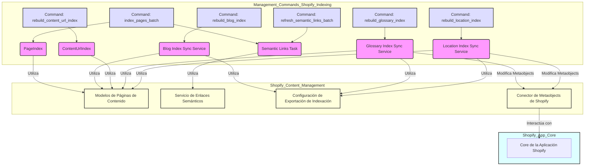

# Comandos de Gestión de Indexación de Shopify

Este módulo contiene una serie de comandos de gestión de Django diseñados para la indexación y reconstrucción de diversos tipos de contenido en el sistema de gestión de contenido de Shopify. Estos comandos son cruciales para mantener los índices de búsqueda actualizados, asegurar la correcta vinculación de URLs y sincronizar los metadatos de las páginas con Shopify.

## Arquitectura y Componentes

Los comandos de indexación interactúan con varios componentes del sistema, incluyendo los modelos de página de Wagtail, los servicios de sincronización de Shopify y la base de datos de índices. A continuación se presenta un diagrama que ilustra la relación entre estos comandos y los módulos principales con los que interactúan.

## Comandos Detallados

### `index_pages_batch`

El comando `index_pages_batch` está diseñado para indexar páginas de Wagtail en el `PageIndex` en pequeños lotes, lo que ayuda a evitar picos de memoria. Es una alternativa segura para la memoria a la reconstrucción completa de índices y puede reanudarse desde un punto de control específico.

*   **Ruta del Componente**: `shopify_content/management/commands/index_pages_batch.py::Command`
*   **Funcionalidad Principal**: Procesa páginas de Wagtail de tipos específicos (`article`, `product`, `collection`, `glossary`, o `all`) en lotes, convirtiéndolas en documentos y actualizando el `PageIndex`.
*   **Argumentos**:
    *   `--model`: Tipo de página a indexar (opciones: `article`, `product`, `collection`, `glossary`, `all`). Por defecto es `all`.
    *   `--batch-size`: Número de páginas por lote. Por defecto es 25.
    *   `--pause`: Segundos de espera entre lotes. Por defecto es 3.0.
    *   `--start-pk`: Reanuda la indexación de páginas con un PK mayor que este valor. Por defecto es 0.
    *   `--skip-semantic-backfill`: No encola la tarea de relleno de enlaces semánticos una vez finalizada la indexación.
*   **Dependencias y Configuración**:
    *   Requiere que `PageIndex` esté registrado, lo que implica que `WAGTAIL_AI_PGVECTOR` y `GEMINI_API_KEY` deben estar habilitados.
    *   Si `SEMANTIC_LINKS_ENABLED` es `True` y `--skip-semantic-backfill` no se usa, encola una tarea `backfill_semantic_links_task` para el servicio de enlaces semánticos ([Semantic_Links_Service](../Semantic_Links_Service.md)).
*   **Relación con Otros Módulos**:
    *   **[Content_Page_Models](../Content_Page_Models.md)**: Interactúa directamente con los modelos de página (e.g., `ArticlePage`, `ProductPage`) para obtener los objetos a indexar.
    *   **[Shopify_Content_Management/Management_Commands/Management_Commands_Initialization_and_Configuration.md](Management_Commands_Initialization_and_Configuration.md)**: La configuración de los metafields para las páginas puede influir en cómo se procesa el contenido durante la indexación.

### `rebuild_blog_index`

Este comando reconstruye los listados de índice de blog (`custom.index_listings`) como metafields en las páginas de blog de Shopify, utilizando la configuración definida en la `ShopifyRootPage` con slug `blogs`.

*   **Ruta del Componente**: `shopify_content/management/commands/rebuild_blog_index.py::Command`
*   **Funcionalidad Principal**: Sincroniza los listados de índice de blog con Shopify. Puede realizar una ejecución en seco (`--dry-run`) para previsualizar el JSON generado sin realizar cambios.
*   **Argumentos**:
    *   `--dry-run`: Construye el JSON y reporta estadísticas sin enviar a Shopify.
*   **Dependencias y Configuración**:
    *   Requiere una `ShopifyRootPage` viva con `slug=blogs`.
    *   La configuración se gestiona a través de `export_config.blog_index` en la `ShopifyRootPage`.
    *   Utiliza `sync_blog_index_listings` para la sincronización y `build_blog_index_listings` para la construcción del JSON del índice.
*   **Relación con Otros Módulos**:
    *   **[Content_Page_Models](../Content_Page_Models.md)**: Se basa en la existencia y configuración de `ShopifyRootPage`.
    *   **[Content_Indexing___Export_Configuration](../Content_Indexing___Export_Configuration.md)**: La lógica de exportación para los listados de blog se define en este módulo.
    *   **[Shopify_Platform_Integrations/Shopify_Metaobjects_Connector.md](../../Shopify_Platform_Integrations/Shopify_Metaobjects_Connector.md)**: Probablemente utiliza este conector para interactuar con los metafields de Shopify.

### `rebuild_content_url_index`

Este comando reconstruye el `ContentUrlIndex`, que mapea las URLs de las páginas de Wagtail en vivo que tienen un `shopify_id`.

*   **Ruta del Componente**: `shopify_content/management/commands/rebuild_content_url_index.py::Command`
*   **Funcionalidad Principal**: Puede reconstruir el índice completo de URLs de contenido o solo las entradas para una página de Wagtail específica.
*   **Argumentos**:
    *   `--page-id`: Reconstruye las filas del índice solo para un ID de página de Wagtail específico.
*   **Dependencias**:
    *   Utiliza `rebuild_full_index` y `rebuild_index_for_page` del módulo `shopify_content.content_url_index`.
    *   Interactúa con los modelos `wagtail.models.Page`.
*   **Relación con Otros Módulos**:
    *   **[Content_Page_Models/Content_Page_Models_Content_URL_Index_Models.md](../Content_Page_Models/Content_Page_Models_Content_URL_Index_Models.md)**: Gestiona el modelo `ContentUrlIndex`.
    *   **[Content_URL_Resolver](../Content_URL_Resolver.md)**: El índice construido por este comando es utilizado por el resolutor de URLs de contenido.

### `rebuild_glossary_index`

El comando `rebuild_glossary_index` reconstruye las entradas de metaobjetos del índice del glosario en la `root_page`, una por cada locale configurado.

*   **Ruta del Componente**: `shopify_content/management/commands/rebuild_glossary_index.py::Command`
*   **Funcionalidad Principal**: Sincroniza el índice del glosario con Shopify, creando o actualizando metaobjetos para cada locale. Permite una ejecución en seco (`--dry-run`) y la limitación por locale.
*   **Argumentos**:
    *   `--dry-run`: Construye el JSON y reporta estadísticas sin enviar a Shopify.
    *   `--locale`: Limita la reconstrucción a uno o más locales específicos (puede repetirse).
*   **Dependencias y Configuración**:
    *   Requiere una `ShopifyRootPage` viva con `slug=glossary`.
    *   La configuración se gestiona a través de `export_config.glossary_index` en la `ShopifyRootPage`.
    *   Utiliza `sync_glossary_index_pages` para la sincronización y `build_glossary_index_json` para la construcción del JSON del índice.
*   **Relación con Otros Módulos**:
    *   **[Content_Page_Models/Content_Page_Models_Glossary_Term_Pages.md](../Content_Page_Models/Content_Page_Models_Glossary_Term_Pages.md)**: Trabaja con las páginas de términos del glosario.
    *   **[Content_Indexing___Export_Configuration](../Content_Indexing___Export_Configuration.md)**: La lógica de exportación para el glosario se define en este módulo, especialmente `GlossaryIndexConsumer`.
    *   **[Shopify_Platform_Integrations/Shopify_Metaobjects_Connector.md](../../Shopify_Platform_Integrations/Shopify_Metaobjects_Connector.md)**: Interactúa con los metaobjetos de Shopify para almacenar el índice.

### `rebuild_location_index`

Similar al comando de glosario, `rebuild_location_index` reconstruye las entradas de metaobjetos del índice de ubicaciones en la `root_page`, una por cada locale configurado.

*   **Ruta del Componente**: `shopify_content/management/commands/rebuild_location_index.py::Command`
*   **Funcionalidad Principal**: Sincroniza el índice de ubicaciones con Shopify, creando o actualizando metaobjetos para cada locale. Soporta ejecución en seco (`--dry-run`) y filtrado por locale.
*   **Argumentos**:
    *   `--dry-run`: Construye el JSON y reporta estadísticas sin enviar a Shopify.
    *   `--locale`: Limita la reconstrucción a uno o más locales específicos (puede repetirse).
*   **Dependencias y Configuración**:
    *   Requiere una `ShopifyRootPage` viva con `slug=local-us`.
    *   La configuración se gestiona a través de `export_config.location_index` en la `ShopifyRootPage`.
    *   Utiliza `sync_location_index_pages` para la sincronización y `build_location_index_json` para la construcción del JSON del índice.
*   **Relación con Otros Módulos**:
    *   **[Content_Page_Models/Content_Page_Models_Location_Pages.md](../Content_Page_Models/Content_Page_Models_Location_Pages.md)**: Trabaja con las páginas de ubicación.
    *   **[Content_Indexing___Export_Configuration](../Content_Indexing___Export_Configuration.md)**: La lógica de exportación para las ubicaciones se define en este módulo, especialmente `LocationIndexConsumer`.
    *   **[Shopify_Platform_Integrations/Shopify_Metaobjects_Connector.md](../../Shopify_Platform_Integrations/Shopify_Metaobjects_Connector.md)**: Interactúa con los metaobjetos de Shopify para almacenar el índice.

### `refresh_semantic_links_batch`

Este comando genera o actualiza enlaces internos semánticos automáticos para todas las páginas en vivo en Wagtail que son enlazables.

*   **Ruta del Componente**: `shopify_content/management/commands/refresh_semantic_links_batch.py::Command`
*   **Funcionalidad Principal**: Realiza un proceso de relleno (`backfill`) de enlaces semánticos. Permite filtrar por tipo de página, ejecutar en modo de prueba (`dry-run`), procesar solo páginas sin enlaces existentes y controlar si se guardan las revisiones de Wagtail.
*   **Argumentos**:
    *   `--model`: Tipo de página a actualizar (opciones: `article`, `product`, `collection`, `glossary`, `all`). Por defecto es `all`.
    *   `--dry-run`: Reporta los recuentos sin escribir enlaces.
    *   `--only-missing`: Omite las páginas que ya tienen al menos un enlace automático.
    *   `--skip-revision-sync`: No guarda/publica revisiones de Wagtail después de actualizar los enlaces.
*   **Dependencias**:
    *   Utiliza `run_semantic_links_backfill` del módulo `shopify_content.semantic_links.backfill`.
*   **Relación con Otros Módulos**:
    *   **[Semantic_Links_Service](../Semantic_Links_Service.md)**: El servicio principal que gestiona la lógica de los enlaces semánticos.
    *   **[Content_Page_Models/Content_Page_Models_Semantic_Links_Models.md](../Content_Page_Models/Content_Page_Models_Semantic_Links_Models.md)**: Interactúa con los modelos de enlaces semánticos (`SemanticPageLink`).

