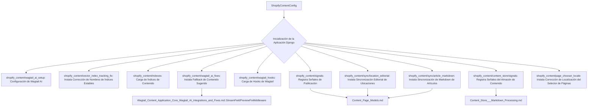

# Configuración de la Aplicación Core de Contenido de Shopify

La `ShopifyContentConfig` en `shopify_content/apps.py` es el punto de configuración central para la aplicación `shopify_content` dentro del sistema. Extiende `django.apps.AppConfig` y se encarga de realizar la configuración necesaria, aplicar parches y registrar señales cuando la aplicación está lista, asegurando que todos los componentes se inicialicen correctamente e interactúen de forma coherente.

## Propósito y Funcionalidad Principal

El propósito principal de `ShopifyContentConfig` es orquestar la configuración inicial de la aplicación `shopify_content`. Esto incluye:
- **Configuración de Modelos**: Establece `default_auto_field` para los modelos.
- **Integraciones y Parches**: Aplica parches y configura integraciones con otros módulos y bibliotecas, como Wagtail AI y Django AI Core.
- **Registro de Señales**: Registra manejadores de señales para eventos de publicación de contenido y eventos del almacén de contenido (content store).
- **Sincronización de Contenido**: Instala lógicas de sincronización para diferentes tipos de contenido, como el contenido editorial de las páginas de ubicación y el Markdown de los artículos.
- **Correcciones de Funcionalidad**: Implementa correcciones específicas, como las relacionadas con la indexación vectorial y la selección de locales en el selector de páginas.

## Arquitectura y Relación con los Componentes

La clase `ShopifyContentConfig` es un componente vital que influye en cómo se inicializa y opera la aplicación `shopify_content` dentro del ecosistema de Django y Wagtail. Su método `ready()` es el encargado de ejecutar todas las configuraciones y registros post-inicialización.

A continuación, se presenta un diagrama que ilustra las interacciones clave de `ShopifyContentConfig` con otros módulos durante su fase de inicialización:

### Componentes Clave y sus Interacciones:

- **shopify_content/wagtail_ai_setup**: Este módulo se importa para inicializar la configuración relacionada con la integración de Wagtail AI.
- **shopify_content/vector_index_tracking_fix**: Contiene la función `install_stable_index_name_fix` que se llama para asegurar nombres de índices estables, crucial para el seguimiento y la consistencia de los índices vectoriales.
- **shopify_content/indexes**: Se importa para cargar las definiciones de índices de contenido, lo que es fundamental para las capacidades de búsqueda y recuperación de contenido.
- **shopify_content/wagtail_ai_fixes**: Aquí se encuentra `install_suggested_content_fallback`, que implementa una lógica de fallback para el contenido sugerido, mejorando la robustez de las integraciones de IA. Para más detalles, consulte la documentación de [Integraciones y Correcciones de Wagtail AI](Shopify_Content_Application_Core_Wagtail_AI_Integrations_and_Fixes.md).
- **shopify_content/wagtail_hooks**: Este módulo se importa para registrar hooks de Wagtail, que permiten personalizar el comportamiento de la interfaz de administración de Wagtail.
- **shopify_content/signals**: La función `register_publish_signals` registra las señales que se disparan cuando el contenido se publica, lo que permite que otros módulos reaccionen a estos eventos. Se relaciona directamente con los modelos de páginas definidos en [Content_Page_Models](Shopify_Content_Management/Content_Page_Models.md).
- **shopify_content/content_store/signals**: `register_content_store_signals` se encarga de registrar señales relacionadas con operaciones dentro del almacén de contenido. Para más información, consulte [Content_Store - Procesamiento de Markdown](Shopify_Content_Management/Content_Store___Markdown_Processing.md).
- **shopify_content/sync/location_editorial**: `install_location_editorial_sync` garantiza que las actualizaciones editoriales de `LocationPage` se sincronicen correctamente, manteniendo la coherencia entre el sistema de contenido y la salida pública. Este proceso interactúa con los modelos definidos en [Content_Page_Models](Shopify_Content_Management/Content_Page_Models.md).
- **shopify_content/sync/article_markdown**: `install_article_markdown_sync` maneja la sincronización del contenido Markdown de los artículos, convirtiéndolo a HTML para Shopify. Esto asegura que el contenido de los artículos sea renderizado correctamente en la plataforma Shopify y se apoya en los modelos de páginas de [Content_Page_Models](Shopify_Content_Management/Content_Page_Models.md).
- **shopify_content/page_chooser_locale**: `install_page_chooser_browse_locale_fix` corrige problemas relacionados con la navegación por localizaciones en el selector de páginas, mejorando la experiencia del usuario y la precisión de la localización.

## Cómo el Módulo Encaja en el Sistema General

`ShopifyContentConfig` actúa como el motor de arranque para la aplicación `shopify_content`, asegurando que todas las piezas móviles se configuren y conecten correctamente al inicio del sistema. Sin esta configuración, las integraciones con Wagtail AI, la indexación de contenido, la sincronización con Shopify y otras funcionalidades críticas no operarían como se espera.

Su método `ready()` se ejecuta una vez que Django ha cargado todas las aplicaciones, lo que lo convierte en el lugar ideal para realizar configuraciones que dependen de que otras aplicaciones o modelos estén ya inicializados. Esto garantiza que el contenido editorial de Shopify se gestione de manera eficiente y se integre sin problemas con otras partes de la plataforma.
