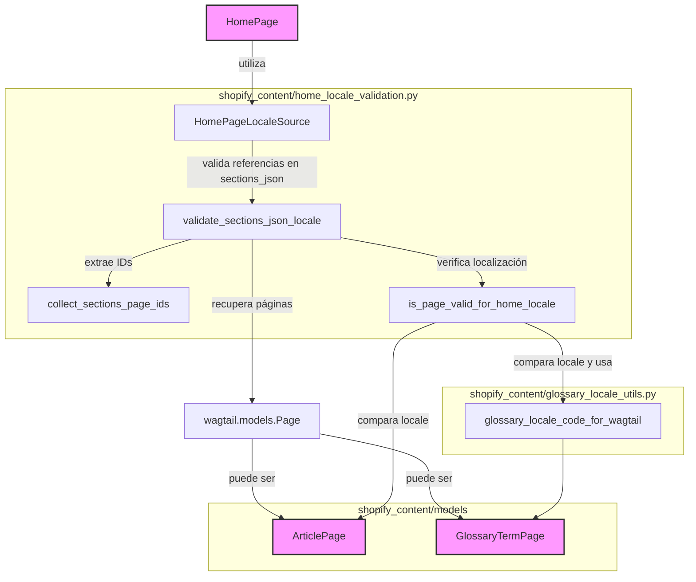

# Validación de Localización para Páginas de Inicio de Shopify

Este módulo, `Shopify_Content_Application_Core_Home_Page_Locale_Validation`, es responsable de garantizar la coherencia de la localización para las referencias de página dentro del campo `sections_json` de una `HomePage`. Su propósito principal es prevenir que una `HomePage` haga referencia a contenido que no coincide con su propia configuración regional.

## Funcionalidad Principal

El módulo proporciona las siguientes funciones y un protocolo para facilitar la validación de la localización:

### `HomePageLocaleSource`

Este es un protocolo (`typing.Protocol`) que define la interfaz esperada para cualquier objeto que represente una página de inicio y que necesite ser validado por este módulo. Requiere que el objeto tenga atributos `locale` y `sections_json`.

```python
class HomePageLocaleSource(Protocol):
    locale: Any
    sections_json: dict | None
```

### Extracción de IDs de Página (`collect_sections_page_ids`)

La función `collect_sections_page_ids` se encarga de recorrer la estructura de datos `sections_json` de una `HomePage` y extraer todos los IDs de página de Wagtail a los que se hace referencia. Analiza diferentes tipos de bloques de contenido, como `featured_collections`, `nav_collection_pills`, `best_sellers`, `shop_by_need`, `educational_hub`, `internal_links` y `promo_gateway`, para recolectar los `page_id`s incrustados.

```python
def collect_sections_page_ids(sections_json: dict | None) -> list[int]:
    # ... implementación ...
```

### Validación de Localización de Página Individual (`is_page_valid_for_home_locale`)

La función `is_page_valid_for_home_locale` verifica si una página referenciada específica es válida para la configuración regional de la página de inicio. Compara el `language_code` del objeto `locale` de la página de inicio con el `language_code` del contenido de la página referenciada. Se manejan casos específicos para `ArticlePage` y `GlossaryTermPage`.

```python
def is_page_valid_for_home_locale(home_page: HomePageLocaleSource, page: Page) -> bool:
    # ... implementación ...
```

### Validación Completa de `sections_json` (`validate_sections_json_locale`)

La función principal `validate_sections_json_locale` orquesta el proceso de validación. Primero, recopila todos los IDs de página referenciados en `sections_json` utilizando `collect_sections_page_ids`. Luego, recupera los objetos `Page` correspondientes de la base de datos y, para cada página referenciada, invoca `is_page_valid_for_home_locale`. Si una página no existe o su localización no coincide con la de la página de inicio, se genera una `ValidationError` apropiada.

```python
def validate_sections_json_locale(home_page: HomePageLocaleSource) -> list[ValidationError]:
    # ... implementación ...
```

## Arquitectura y Relaciones de Componentes

Este módulo se integra con los modelos de página de Wagtail, especialmente con [`HomePage`](../Content_Page_Models.md#HomePage), [`ArticlePage`](../Content_Page_Models.md#ArticlePage) y [`GlossaryTermPage`](../Content_Page_Models.md#GlossaryTermPage). Depende de los atributos `locale` de estos modelos para realizar las comprobaciones de localización. También utiliza `glossary_locale_code_for_wagtail` para estandarizar los códigos de localización de los términos del glosario.



*Diagrama 1: Relaciones de componentes de validación de localización de la página de inicio.*

## Integración en el Sistema General

Este módulo es una parte crítica del proceso de gestión de contenido para las páginas de inicio en el sistema. Asegura que el contenido localizado se gestione correctamente, evitando la visualización de contenido en un idioma incorrecto en una página de inicio específica. La validación se activa típicamente antes de guardar o publicar una `HomePage` dentro de la interfaz de administración de Wagtail, garantizando la integridad de los datos de localización.

Para una comprensión más profunda de los modelos de página referenciados, consulte la documentación de [Modelos de Páginas de Contenido](../Content_Page_Models.md).