# Bloques Wagtail StreamField

Este módulo (`Wagtail_StreamField_Blocks`) define una colección de bloques de contenido de Wagtail `StreamField` utilizados para construir y gestionar el contenido de varias páginas dentro del sistema de gestión de contenido de Shopify. Estos bloques permiten a los editores de contenido crear diseños de página dinámicos y estructurados para productos, colecciones, artículos y la página de inicio.

## Propósito y Funcionalidad

El propósito principal de este módulo es proporcionar un conjunto flexible y extensible de componentes de contenido para el sistema Wagtail CMS, lo que facilita la creación de contenido rico y estructurado que puede sincronizarse con las tiendas Shopify. Al utilizar `StreamField` y sus bloques asociados, los editores pueden ensamblar páginas a partir de componentes prediseñados, garantizando la coherencia de la marca y la funcionalidad al tiempo que se permite la personalización.

Los bloques se clasifican según su uso principal (contenido general, páginas de inicio, medios, metacampos, productos) y se combinan en `StreamBlock`s de nivel superior para definir las estructuras de contenido de diferentes tipos de página.

## Arquitectura

El módulo `Wagtail_StreamField_Blocks` se organiza en varios archivos, cada uno de los cuales contiene bloques de `StreamField` relacionados. El archivo `__init__.py` actúa como el punto de agregación, definiendo los principales `StreamBlock`s para diferentes tipos de páginas (Producto, Colección, Artículo y Página de inicio) utilizando bloques importados de otros archivos.

```mermaid
graph TD
    A[shopify_content/blocks/__init__.py] --> B(ProductBodyStreamBlock)
    A --> C(CollectionBodyStreamBlock)
    A --> D(ArticleBodyStreamBlock)
    A --> E(HomeBodyStreamBlock)

    B --> B1[shopify_content/blocks/content.py::HeadingBlock]
    B --> B2[shopify_content/blocks/content.py::ParagraphBlock]
    B --> B3[shopify_content/blocks/media.py::ImageBlock]
    B --> B4[shopify_content/blocks/media.py::VideoEmbedBlock]
    B --> B5[shopify_content/blocks/product.py::ProductFeatureBlock]
    B --> B6[shopify_content/blocks/content.py::CalloutBlock]
    B --> B7[shopify_content/blocks/content.py::HtmlBlock]
    B --> B8[shopify_content/blocks/metafield.py::MetafieldBlock]

    C --> C1[shopify_content/blocks/content.py::HeadingBlock]
    C --> C2[shopify_content/blocks/content.py::ParagraphBlock]
    C --> C3[shopify_content/blocks/media.py::ImageBlock]
    C --> C4[shopify_content/blocks/content.py::CalloutBlock]
    C --> C5[shopify_content/blocks/content.py::HtmlBlock]

    D --> D1[shopify_content/blocks/content.py::HeadingBlock]
    D --> D2[shopify_content/blocks/content.py::ParagraphBlock]
    D --> D3[shopify_content/blocks/media.py::ImageBlock]
    D --> D4[shopify_content/blocks/media.py::VideoEmbedBlock]
    D --> D5[shopify_content/blocks/content.py::CalloutBlock]
    D --> D6[shopify_content/blocks/content.py::HtmlBlock]
    D --> D7[shopify_content/blocks/content.py::ProductBannerBlock]

    E --> E1[shopify_content/blocks/home.py::PromoGatewayBlock]
    E --> E2[shopify_content/blocks/home.py::NavCollectionPillsBlock]
    E --> E3[shopify_content/blocks/home.py::TrustBarBlock]
    E --> E4[shopify_content/blocks/home.py::FeaturedCollectionsBlock]
    E --> E5[shopify_content/blocks/home.py::EditorialIntroBlock]
    E --> E6[shopify_content/blocks/home.py::BestSellersBlock]
    E --> E7[shopify_content/blocks/home.py::ShopByNeedBlock]
    E --> E8[shopify_content/blocks/home.py::EducationalHubBlock]
    E --> E9[shopify_content/blocks/home.py::BrandValuesBlock]
    E --> E10[shopify_content/blocks/home.py::MarketBlock]
    E --> E11[shopify_content/blocks/home.py::FAQBlock]
    E --> E12[shopify_content/blocks/home.py::InternalLinksBlock]
    E --> E13[shopify_content/blocks/home.py::SEOSchemaBlock]
```

## Sub-módulos

Este módulo se compone de los siguientes sub-módulos, cada uno con un conjunto específico de bloques de contenido:

1. [Bloques de Contenido General](Wagtail_StreamField_Blocks/Wagtail_StreamField_Blocks_Content_Blocks.md)
2. [Bloques de la Página de Inicio](Wagtail_StreamField_Blocks/Wagtail_StreamField_Blocks_Home_Blocks.md)
3. [Bloques de Medios (Imágenes y Vídeos)](Wagtail_StreamField_Blocks/Wagtail_StreamField_Blocks_Media_Blocks.md)
4. [Bloques de Metafields](Wagtail_StreamField_Blocks/Wagtail_StreamField_Blocks_Metafield_Blocks.md)
5. [Bloques de Características del Producto](Wagtail_StreamField_Blocks/Wagtail_StreamField_Blocks_Wagtail_StreamField_Blocks_Product_Blocks.md)