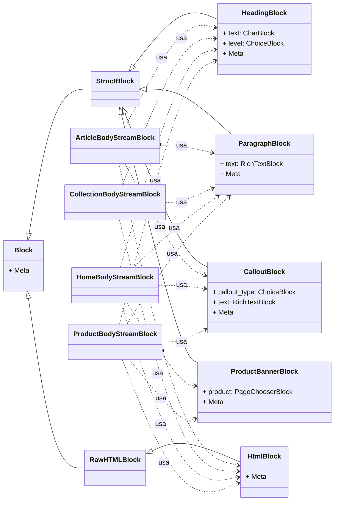

# Bloques de Contenido de Wagtail StreamField

Este módulo, `Wagtail_StreamField_Blocks_Content_Blocks`, define un conjunto de bloques de contenido fundamentales para su uso dentro de los campos `StreamField` de Wagtail. Estos bloques están diseñados para permitir a los editores de contenido construir páginas ricas y estructuradas que pueden ser representadas de forma nativa o sincronizadas con Shopify.

## Propósito y Funcionalidad Principal

El propósito principal de este módulo es proporcionar bloques de contenido básicos y reutilizables para la creación de páginas en el CMS de Wagtail. Estos bloques abstraen la complejidad de la generación de HTML y aseguran la compatibilidad con las capacidades de renderizado de contenido de Shopify. Incluyen elementos comunes como encabezados, párrafos de texto enriquecido, inserciones de HTML puro, cuadros de llamada destacados y banners de productos.

## Componentes del Módulo

Los siguientes bloques de `StreamField` se definen en este módulo:

### HeadingBlock

Un bloque para insertar encabezados de sección. Permite a los editores especificar el texto del encabezado y su nivel (H2, H3 o H4) para estructurar jerárquicamente el contenido. Se renderiza en la salida HTML de Shopify como etiquetas `<h2>`, `<h3>` o `<h4>`.

- **Clase**: `HeadingBlock`
- **Metadatos**: `HeadingBlock.Meta`

### ParagraphBlock

Un bloque de texto enriquecido para párrafos estándar. Ofrece un conjunto limitado de características de formato de texto (negrita, cursiva, enlaces, listas ordenadas y desordenadas, línea horizontal) que son compatibles con Shopify.

- **Clase**: `ParagraphBlock`
- **Metadatos**: `ParagraphBlock.Meta`

### HtmlBlock

Permite la inserción directa de HTML sin formato. Este bloque es crucial para la importación de HTML existente de Shopify sin modificaciones y para enviar contenido HTML complejo directamente a Shopify durante la sincronización.

- **Clase**: `HtmlBlock`
- **Metadatos**: `HtmlBlock.Meta`

### CalloutBlock

Un bloque diseñado para crear cuadros de llamada o recuadros destacados. Los editores pueden elegir un tipo de llamada (información, advertencia, consejo, nota) y proporcionar el texto enriquecido para el contenido. Se renderiza como un `
` estilizado en la salida HTML de Shopify.

- **Clase**: `CalloutBlock`
- **Metadatos**: `CalloutBlock.Meta`

### ProductBannerBlock

Un bloque específico para mostrar un banner de producto. Permite seleccionar un `ProductPage` existente (definido en [Páginas de Producto de los Modelos de Páginas de Contenido](../Content_Page_Models/Content_Page_Models_Product_Pages.md)) para ser representado como una tarjeta de producto en el HTML de Shopify.

- **Clase**: `ProductBannerBlock`
- **Metadatos**: `ProductBannerBlock.Meta`

## Arquitectura y Relación de Componentes

Los bloques de contenido definidos aquí heredan de `wagtail.blocks.StructBlock` o `wagtail.blocks.RawHTMLBlock` (en el caso de `HtmlBlock`), lo que los convierte en componentes modulares que pueden combinarse para formar `StreamField`s más complejos. Estos bloques son componentes básicos que se utilizan en los `StreamField`s principales definidos en `shopify_content/blocks/__init__.py`, como `ArticleBodyStreamBlock`, `CollectionBodyStreamBlock`, `HomeBodyStreamBlock` y `ProductBodyStreamBlock`.

## Cómo encaja el Módulo en el Sistema General

Este módulo es una parte integral del sistema de gestión de contenido de Shopify, específicamente dentro del subsistema [Wagtail StreamField Blocks](../Wagtail_StreamField_Blocks.md). Los bloques definidos aquí sirven como los elementos de construcción fundamentales para el contenido editorial que se crea y administra a través de Wagtail. Cuando un editor crea una página (por ejemplo, un `ArticlePage`, `CollectionPage`, `HomePage`, o `ProductPage`, como se describe en [Content Page Models](../../Content_Page_Models.md)) utilizando un `StreamField`, puede seleccionar y organizar estos bloques para componer el diseño y el contenido de la página.

El contenido estructurado por estos bloques se serializa y se sincroniza con Shopify, donde se renderiza para la tienda en línea. La compatibilidad de las características de texto enriquecido y la estructura HTML de estos bloques asegura que el contenido se muestre correctamente tanto en Wagtail como en Shopify.

Por ejemplo, el `ProductBannerBlock` se vincula directamente a un `ProductPage` (definido en [Páginas de Producto de los Modelos de Páginas de Contenido](../Content_Page_Models/Content_Page_Models_Product_Pages.md)), lo que permite a los editores integrar fácilmente información de productos en el contenido de sus páginas. Los bloques `HeadingBlock`, `ParagraphBlock`, `HtmlBlock` y `CalloutBlock` proporcionan las herramientas necesarias para crear una amplia variedad de contenido informativo y promocional.