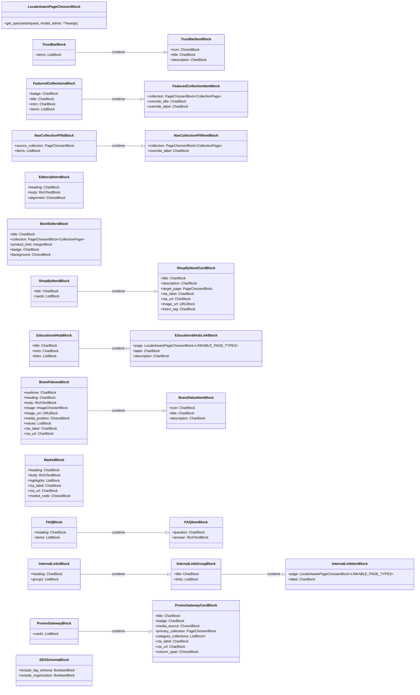

# Bloques Wagtail StreamField para Páginas de Inicio

Este módulo, `Wagtail_StreamField_Blocks_Home_Blocks`, define una colección de bloques de contenido reusables para [Wagtail StreamField](https://docs.wagtail.org/en/stable/topics/streamfield.html). Estos bloques están diseñados específicamente para construir y estructurar el contenido de las páginas de inicio dentro del sistema de gestión de contenido de Shopify, permitiendo a los editores ensamblar páginas dinámicas y ricas en contenido.

## Propósito y Funcionalidad Principal

El objetivo principal de este módulo es proporcionar una biblioteca versátil de componentes de interfaz de usuario para las páginas de inicio. Cada bloque encapsula una porción específica de contenido o funcionalidad, lo que facilita la creación de diseños complejos y coherentes sin necesidad de codificación personalizada. Esto incluye elementos como barras de confianza, colecciones destacadas, secciones editoriales, concentradores educativos, valores de marca, bloques de mercado, preguntas frecuentes, enlaces internos y pasarelas promocionales.

### Componentes de Bloque Principales

A continuación, se detalla cada `StructBlock` y `ListBlock` definido en `shopify_content/blocks/home.py`, junto con su propósito y los campos que lo componen:

#### `LocaleAwarePageChooserBlock`

Un `PageChooserBlock` especializado que filtra los `GlossaryTermPage` por el locale de la página actual, asegurando la consistencia del locale en las secciones de la página de inicio.
Los tipos de página vinculables definidos son: `'shopify_content.ProductPage'`, `'shopify_content.CollectionPage'`, `'shopify_content.ArticlePage'`, `'shopify_content.GlossaryTermPage'`, `'shopify_content.BlogPage'`.

#### `TrustBarItemBlock`

Representa un elemento individual dentro de una barra de confianza.
*   `icon` (ChoiceBlock): Icono visual para el elemento (ej. 'local_shipping', 'verified', 'lock').
*   `title` (CharBlock): Título breve del elemento.
*   `description` (CharBlock): Descripción opcional del elemento.

#### `TrustBarBlock`

Un bloque que agrupa varios `TrustBarItemBlock`s para formar una barra de confianza.
*   `items` (ListBlock): Una lista de hasta 6 `TrustBarItemBlock`s.

#### `FeaturedCollectionItemBlock`

Define un elemento para una colección destacada.
*   `collection` (PageChooserBlock): Enlaza a una `CollectionPage`.
*   `override_title` (CharBlock): Título opcional para sobrescribir el de la colección.
*   `override_label` (CharBlock): Etiqueta opcional para sobrescribir la de la colección.

#### `FeaturedCollectionsBlock`

Muestra una lista de colecciones destacadas.
*   `badge` (CharBlock): Texto de insignia opcional.
*   `title` (CharBlock): Título de la sección de colecciones destacadas.
*   `intro` (CharBlock): Texto introductorio de la sección.
*   `items` (ListBlock): Una lista de hasta 6 `FeaturedCollectionItemBlock`s.

#### `NavCollectionPillItemBlock`

Representa un elemento tipo "píldora" para la navegación por colecciones.
*   `collection` (PageChooserBlock): Enlaza a una `CollectionPage`.
*   `override_label` (CharBlock): Etiqueta opcional para sobrescribir la de la colección.

#### `NavCollectionPillsBlock`

Un bloque para las "píldoras" de navegación rápida de colecciones. No se renderiza como una sección de inicio tradicional.
*   `source_collection` (PageChooserBlock): Una `CollectionPage` opcional para rellenar las píldoras si la lista `items` está vacía.
*   `items` (ListBlock): Una lista opcional de hasta 8 `NavCollectionPillItemBlock`s.

#### `EditorialIntroBlock`

Un bloque para una introducción editorial con texto y alineación.
*   `heading` (CharBlock): Encabezado de la introducción.
*   `body` (RichTextBlock): Contenido de texto enriquecido.
*   `alignment` (ChoiceBlock): Alineación del texto ('left' o 'center').

#### `BestSellersBlock`

Muestra una selección de productos más vendidos.
*   `title` (CharBlock): Título de la sección.
*   `collection` (PageChooserBlock): Colección de la cual obtener los productos más vendidos.
*   `product_limit` (IntegerBlock): Límite de productos a mostrar (entre 4 y 12).
*   `badge` (CharBlock): Texto de insignia opcional.
*   `background` (ChoiceBlock): Estilo de fondo ('default' o 'contrast').

#### `ShopByNeedCardBlock`

Una tarjeta individual dentro de la sección "Comprar por necesidad".
*   `title` (CharBlock): Título de la tarjeta.
*   `description` (CharBlock): Descripción de la tarjeta.
*   `target_page` (PageChooserBlock): Enlaza a una `CollectionPage` o `ProductPage`.
*   `cta_label` (CharBlock): Etiqueta para el botón de llamada a la acción.
*   `cta_url` (CharBlock): URL de llamada a la acción (ruta de la tienda o URL absoluta).
*   `image_url` (URLBlock): URL de la imagen de la tarjeta.
*   `intent_tag` (CharBlock): Etiqueta de intención opcional.

#### `ShopByNeedBlock`

Agrupa varias `ShopByNeedCardBlock`s para crear una sección "Comprar por necesidad".
*   `title` (CharBlock): Título de la sección.
*   `cards` (ListBlock): Una lista de hasta 8 `ShopByNeedCardBlock`s.

#### `EducationalHubLinkBlock`

Un enlace dentro de un concentrador educativo.
*   `page` (LocaleAwarePageChooserBlock): Enlaza a cualquier tipo de página vinculable (producto, colección, artículo, término de glosario, blog).
*   `label` (CharBlock): Etiqueta del enlace.
*   `description` (CharBlock): Descripción del enlace.

#### `EducationalHubBlock`

Una sección que proporciona enlaces a contenido educativo.
*   `title` (CharBlock): Título de la sección.
*   `intro` (CharBlock): Texto introductorio.
*   `links` (ListBlock): Una lista de hasta 6 `EducationalHubLinkBlock`s.

#### `BrandValueItemBlock`

Un elemento individual que describe un valor de marca.
*   `icon` (CharBlock): Icono para el valor.
*   `title` (CharBlock): Título del valor.
*   `description` (CharBlock): Descripción del valor.

#### `BrandValuesBlock`

Muestra los valores de la marca con una imagen o video y una llamada a la acción.
*   `eyebrow` (CharBlock): Texto de "eyebrow" opcional.
*   `heading` (CharBlock): Encabezado principal de la sección.
*   `body` (RichTextBlock): Contenido de texto enriquecido.
*   `image` (ImageChooserBlock): Imagen opcional.
*   `image_url` (URLBlock): URL de la imagen (alternativa a `image`).
*   `media_position` (ChoiceBlock): Posición de la imagen ('left' o 'right').
*   `values` (ListBlock): Una lista de hasta 4 `BrandValueItemBlock`s.
*   `cta_label` (CharBlock): Etiqueta para la llamada a la acción.
*   `cta_url` (CharBlock): URL de llamada a la acción.

#### `MarketBlock`

Un bloque para contenido específico del mercado.
*   `heading` (CharBlock): Encabezado de la sección.
*   `body` (RichTextBlock): Contenido de texto enriquecido.
*   `highlights` (ListBlock): Una lista de hasta 4 puntos destacados.
*   `cta_label` (CharBlock): Etiqueta para la llamada a la acción.
*   `cta_url` (CharBlock): URL de llamada a la acción.
*   `market_code` (ChoiceBlock): Código de mercado ('US' o 'CA').

#### `FAQItemBlock`

Representa una pregunta y respuesta individual en una sección de preguntas frecuentes.
*   `question` (CharBlock): El texto de la pregunta.
*   `answer` (RichTextBlock): La respuesta en formato de texto enriquecido.

#### `FAQBlock`

Agrupa varios `FAQItemBlock`s para crear una sección de preguntas frecuentes.
*   `heading` (CharBlock): Título de la sección (por defecto, "Preguntas frecuentes").
*   `items` (ListBlock): Una lista de hasta 6 `FAQItemBlock`s.

#### `InternalLinkItemBlock`

Un elemento para un enlace interno.
*   `page` (LocaleAwarePageChooserBlock): Enlaza a cualquier tipo de página vinculable.
*   `label` (CharBlock): Etiqueta del enlace.

#### `InternalLinkGroupBlock`

Un grupo de enlaces internos con un título.
*   `title` (CharBlock): Título del grupo de enlaces.
*   `links` (ListBlock): Una lista de hasta 12 `InternalLinkItemBlock`s.

#### `InternalLinksBlock`

Agrupa varios `InternalLinkGroupBlock`s para una sección de enlaces internos.
*   `heading` (CharBlock): Encabezado de la sección.
*   `groups` (ListBlock): Una lista de hasta 6 `InternalLinkGroupBlock`s.

#### `PromoGatewayCardBlock`

Una tarjeta individual dentro de una pasarela promocional.
*   `title` (CharBlock): Título de la tarjeta.
*   `badge` (CharBlock): Insignia opcional.
*   `media_source` (ChoiceBlock): Fuente de medios ('collection_products' o 'collection_list').
*   `primary_collection` (PageChooserBlock): Colección principal asociada.
*   `category_collections` (ListBlock): Una lista de hasta 4 `CollectionPage`s para categorías.
*   `cta_label` (CharBlock): Etiqueta para la llamada a la acción.
*   `cta_url` (CharBlock): URL de llamada a la acción.
*   `column_span` (ChoiceBlock): Número de columnas que abarca la tarjeta ('1' o '2').

#### `PromoGatewayBlock`

Agrupa varias `PromoGatewayCardBlock`s para crear una pasarela promocional.
*   `cards` (ListBlock): Una lista de hasta 4 `PromoGatewayCardBlock`s.

#### `SEOSchemaBlock`

Define banderas para incluir o excluir esquemas SEO específicos.
*   `include_faq_schema` (BooleanBlock): Incluir esquema FAQ (por defecto `True`).
*   `include_organization` (BooleanBlock): Incluir esquema de organización (por defecto `True`).

## Arquitectura y Relaciones entre Componentes

Este módulo se basa en la flexibilidad de Wagtail StreamField, donde los bloques son los componentes fundamentales para la composición de páginas. La mayoría de los bloques son `StructBlock`s, lo que significa que agrupan un conjunto de campos relacionados. Muchos de estos `StructBlock`s, a su vez, contienen `ListBlock`s de otros `StructBlock`s, creando una estructura jerárquica para el contenido de la página.

El componente `LocaleAwarePageChooserBlock` es un ejemplo clave de cómo este módulo extiende la funcionalidad base de Wagtail. Filtra dinámicamente las páginas elegibles, particularmente las `GlossaryTermPage`s, basándose en el locale de la página actual. Esta lógica garantiza que el contenido mostrado sea cultural y lingüísticamente apropiado para el contexto de la página de inicio. La dependencia de `django.contrib.contenttypes.models.ContentType` y `wagtail.models.Locale` junto con `shopify_content.models.glossary.GlossaryTermPage` y `shopify_content.page_chooser_locale.glossary_term_page_filter_q` demuestra esta funcionalidad de filtrado contextual.

Los bloques también hacen uso extensivo de tipos de campos básicos de Wagtail como `CharBlock`, `TextBlock`, `RichTextBlock`, `ImageChooserBlock`, `URLBlock`, `IntegerBlock`, `PageChooserBlock`, `ChoiceBlock` y `BooleanBlock` para definir la estructura y los tipos de datos de sus respectivos campos.

### Diagrama de Relaciones de Bloques

A continuación, se presenta un diagrama de clases que ilustra las relaciones de contención entre los bloques principales definidos en este módulo.

## Cómo encaja el módulo en el sistema general

Los bloques definidos en `shopify_content/blocks/home.py` son una parte integral del módulo [Shopify_Content_Management](../../Shopify_Content_Management.md), específicamente utilizados para la construcción de la página de inicio. Estos bloques se combinan para formar el `StreamField` del modelo `HomePage` (definido en `shopify_content/models/home_page.py` dentro del módulo [Content_Page_Models](../Content_Page_Models.md)).

Cuando un editor de contenido crea o edita una página de inicio en Wagtail, utiliza una interfaz de arrastrar y soltar para seleccionar, configurar y organizar estos bloques. Esto permite una gran flexibilidad en el diseño y contenido de la página de inicio sin requerir conocimientos de desarrollo.

El flujo de trabajo es el siguiente:
1.  **Definición de Bloques**: Este módulo define la estructura y los campos de cada componente de contenido posible para una página de inicio.
2.  **Modelo de Página de Inicio**: El modelo `HomePage` en `shopify_content/models/home_page.py` utiliza `HomeBodyStreamBlock` (definido en `shopify_content/blocks/__init__.py`) que a su vez consume estos bloques.
3.  **Edición de Contenido**: Los editores utilizan la interfaz de administración de Wagtail para componer páginas de inicio seleccionando y organizando instancias de estos bloques.
4.  **Renderizado Frontend**: Cuando se solicita una página de inicio, el `StreamField` serializa el contenido de estos bloques, que luego se utiliza para renderizar la página en el frontend de la tienda.

Este enfoque modular garantiza que el contenido de la página de inicio sea fácil de mantener, extender y personalizar, al tiempo que se mantiene una estructura de datos coherente. La interconexión con otros modelos de página como `CollectionPage`, `ProductPage`, `ArticlePage`, `GlossaryTermPage`, y `BlogPage` (todos parte de [Content_Page_Models](../Content_Page_Models.md)) a través de `PageChooserBlock`s y `LocaleAwarePageChooserBlock`s permite la creación de contenido altamente interconectado y relevante.
