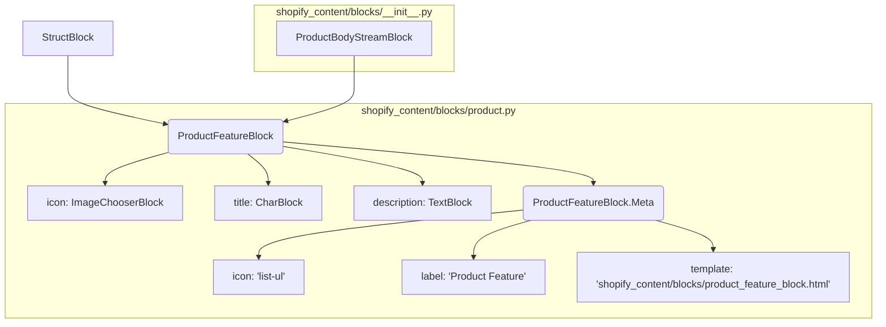

# Bloques de StreamField de Wagtail: Bloques de Producto

Este módulo, `shopify_content/blocks/product.py`, define los bloques de contenido reutilizables de Wagtail StreamField específicamente diseñados para mostrar características de productos. Estos bloques son fundamentales para estructurar el contenido de las páginas de productos en el sistema de gestión de contenido, permitiendo a los editores añadir y organizar fácilmente información clave sobre un producto.

## Componentes del Módulo

### `ProductFeatureBlock`

El `ProductFeatureBlock` es un `StructBlock` que permite la creación de elementos de características de producto con un icono opcional, un título y una descripción. Está diseñado para resaltar los puntos de venta clave de un producto en un formato estructurado y visualmente atractivo.

**Propiedades:**

*   `icon` (ImageChooserBlock, opcional): Un bloque para seleccionar una imagen (SVG o PNG) que sirva como icono para la característica del producto. `help_text`: "Icono SVG o PNG opcional para esta característica."
*   `title` (CharBlock, requerido): Un campo de texto corto para el título de la característica del producto. `max_length=100`.
*   `description` (TextBlock, requerido): Un campo de texto más largo para la descripción detallada de la característica del producto.

**Uso:**

Este bloque se utiliza dentro de StreamFields, particularmente en `ProductBodyStreamBlock` (definido en `shopify_content/blocks/__init__.py`), que es el StreamField principal para las páginas de productos. Permite a los editores construir secciones de características de productos de forma flexible.

### `ProductFeatureBlock.Meta`

La clase `Meta` anidada dentro de `ProductFeatureBlock` define las opciones de configuración para el bloque en la interfaz de administración de Wagtail.

**Opciones de Configuración:**

*   `icon`: 'list-ul' - Define el icono que se mostrará para este bloque en la interfaz de administración de Wagtail, lo que facilita su identificación.
*   `label`: 'Product Feature' - El nombre legible por humanos que se muestra para este bloque en la interfaz de usuario de Wagtail.
*   `template`: 'shopify_content/blocks/product_feature_block.html' - Especifica la plantilla HTML que Wagtail utilizará para renderizar este bloque en el frontend.

## Arquitectura y Relaciones

El `ProductFeatureBlock` es un componente clave en la estructura de contenido de las páginas de productos. Extiende `wagtail.blocks.StructBlock`, lo que le permite agrupar varios campos como un solo elemento en un StreamField. Se integra en la estructura general de bloques de contenido de Shopify a través de `ProductBodyStreamBlock`.

*Diagrama: Relación entre `ProductFeatureBlock` y `ProductBodyStreamBlock`.*

## Integración en el Sistema General

Este módulo es una parte integral del sistema de gestión de contenido de Shopify. Los `ProductFeatureBlock`s son utilizados para construir el cuerpo de las páginas de productos (`ProductPage`, definido en [Content_Page_Models_Product_Pages.md](../Content_Page_Models/Content_Page_Models_Product_Pages.md)) mediante el `ProductBodyStreamBlock`.

Esto asegura que las páginas de productos puedan presentar sus características de manera coherente y editable a través de la interfaz de administración de Wagtail, contribuyendo a una experiencia de usuario rica y a la capacidad de SEO de la tienda.

## Referencias

*   [Bloques de StreamField de Wagtail](../Wagtail_StreamField_Blocks.md)
*   [Bloques de StreamField de Wagtail: Bloques de Contenido](../Wagtail_StreamField_Blocks/Wagtail_StreamField_Blocks_Content_Blocks.md)
*   [Bloques de StreamField de Wagtail: Bloques de Medios](../Wagtail_StreamField_Blocks/Wagtail_StreamField_Blocks_Media_Blocks.md)
*   [Páginas de Producto del Modelo de Páginas de Contenido](../Content_Page_Models/Content_Page_Models_Product_Pages.md)
