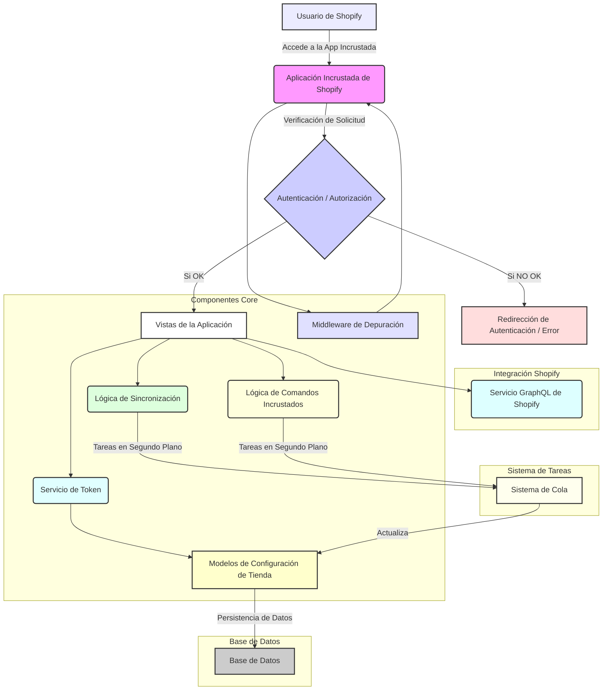

# Aplicación Core - Aplicación Incrustada de Shopify

Este módulo, `Core_Application___Shopify_Embedded_App`, es el corazón de la integración de la plataforma con Shopify, actuando como la aplicación incrustada principal dentro del ecosistema de Shopify. Su propósito es proporcionar la lógica fundamental para la autenticación, la gestión de la configuración de la tienda, la interacción con la interfaz de usuario incrustada de Shopify y el manejo de los flujos de trabajo de sincronización de contenido y comandos.

## Propósito y Funcionalidad Principal

La aplicación incrustada permite una experiencia de usuario fluida dentro del panel de administración de Shopify, ofreciendo funcionalidades clave como:

*   **Autenticación y Autorización:** Maneja el flujo de OAuth para la instalación y el acceso a la tienda Shopify, asegurando que las interacciones de la aplicación sean seguras y estén autorizadas.
*   **Gestión de la Configuración de la Tienda:** Almacena y gestiona la información esencial de la tienda, como tokens de acceso, estados y alcances de permisos.
*   **Vistas Incrustadas de Shopify:** Proporciona las vistas y la lógica para que la aplicación funcione perfectamente dentro de la interfaz de usuario de Shopify, incluyendo redirecciones y comunicación entre iframes.
*   **Sincronización de Contenido:** Facilita la importación y sincronización de contenido de Shopify a Wagtail (un CMS), permitiendo a los comerciantes gestionar su contenido desde un único lugar.
*   **Ejecución de Comandos Incrustados:** Permite la ejecución de comandos de gestión específicos directamente desde la aplicación incrustada de Shopify, lo que agiliza las tareas administrativas.
*   **Manejo de Errores y Depuración:** Incluye middleware para depuración y mecanismos de manejo de errores para una integración robusta.

## Arquitectura General

La arquitectura del módulo `Core_Application___Shopify_Embedded_App` está diseñada para ser modular y extensible. Se integra con el marco Django para la gestión de modelos, vistas y formularios, y utiliza la biblioteca Python de Shopify App Bridge para interactuar con la interfaz de usuario incrustada de Shopify. La comunicación con la API de Shopify se realiza a través de un servicio de GraphQL y la gestión de webhooks se maneja en módulos separados.

## Sub-Módulos

Este módulo se organiza en los siguientes sub-módulos para gestionar sus diversas responsabilidades:

*   **[Configuración y Modelos de la Aplicación Incrustada de Shopify](Core_Application___Shopify_Embedded_App/Core_Application___Shopify_Embedded_App_configuracion_modelos.md)**: Define la configuración principal de la aplicación, los modelos de datos para las tiendas Shopify y los formularios asociados.
*   **[Vistas y Lógica de Autenticación de la Aplicación Incrustada de Shopify](Core_Application___Shopify_Embedded_App/Core_Application___Shopify_Embedded_App_Core_Application___Shopify_Embedded_App_vistas_autenticacion.md)**: Contiene las vistas de la aplicación incrustada, la lógica de autenticación y las redirecciones dentro del entorno de Shopify.
*   **[Middleware de Depuración de Shopify](Core_Application___Shopify_Embedded_App/Core_Application___Shopify_Embedded_App_debug_middleware.md)**: Proporciona el middleware específico para el entorno de desarrollo local con el proxy de Shopify CLI.
*   **[Pruebas de la Aplicación Core de Shopify](Core_Application___Shopify_Embedded_App/Core_Application___Shopify_Embedded_App_pruebas.md)**: Incluye los tests unitarios y de integración para asegurar la correcta funcionalidad del módulo.

Para detalles específicos sobre la integración con la API de Shopify o los metaobjetos, consulte los siguientes módulos:

*   **[Cliente de la API de Shopify](Shopify_API_Client.md)**
*   **[Integración de Metaobjetos de Shopify](Shopify_Metaobjects_Integration.md)**
*   **[Manejo de Webhooks](Webhooks_Handling.md)**