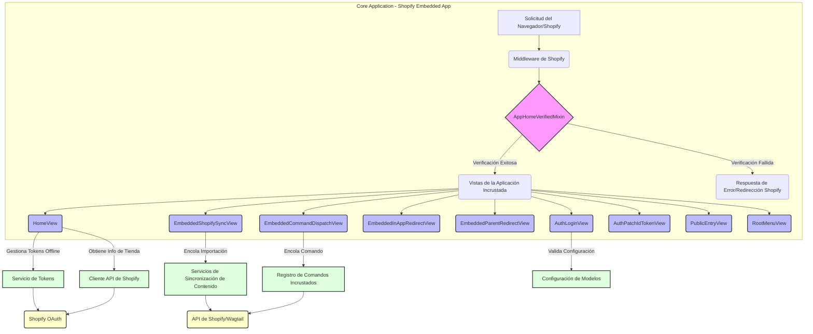

# Vistas de Autenticación y Aplicación Incrustada de Shopify

Este módulo (`Core_Application___Shopify_Embedded_App_vistas_autenticacion`) gestiona las vistas relacionadas con la autenticación y la interacción dentro de la aplicación incrustada de Shopify. Proporciona la lógica central para el inicio de sesión, la verificación de solicitudes, la sincronización de contenido y la ejecución de comandos, asegurando una integración segura y funcional con la plataforma Shopify.

## Funcionalidad Principal

### `AppHomeVerifiedMixin`

Este mixin es fundamental para todas las vistas que operan dentro del entorno de la aplicación incrustada de Shopify. Su propósito principal es verificar la solicitud entrante utilizando el mecanismo de Shopify App Home antes de permitir que la vista procese la solicitud. Las subclases deben implementar el método `dispatch_after_verified()` para la lógica posterior a la verificación.

### `AuthLoginView`

Responsable de manejar el proceso de inicio de sesión inicial para la aplicación de Shopify. Utiliza `ShopConfigForm` para validar la entrada de la tienda y redirige al usuario a la URL de instalación de OAuth de Shopify si los datos son válidos.

### `AuthPatchIdTokenView`

Esta vista se encarga de aplicar un parche al token de ID, un paso crucial para mantener la seguridad y la sesión dentro de la aplicación incrustada de Shopify, especialmente en escenarios donde el token de ID puede necesitar ser actualizado o validado nuevamente.

### `EmbeddedCommandDispatchView`

Permite el envío de comandos de administración permitidos desde la página de inicio de la aplicación incrustada. Verifica que la tienda tenga un token de acceso configurado y encola el comando especificado para su ejecución en segundo plano.

### `EmbeddedInAppRedirectView`

Gestiona las redirecciones que ocurren dentro del iframe de la aplicación incrustada. Valida que la ruta de destino sea una ruta de aplicación relativa segura y utiliza el SDK de Shopify para realizar la redirección.

### `EmbeddedParentRedirectView`

Controla las redirecciones que rompen el marco del iframe de la aplicación incrustada, permitiendo redirigir a URLs externas o a la parte superior de la ventana del navegador. Valida la URL de destino para garantizar que sea un host permitido.

### `EmbeddedShopifySyncView`

Inicia la importación de nuevo contenido de Shopify (productos, colecciones, blogs, glosario, etc.) en Wagtail desde la página de inicio de la aplicación incrustada. Encola las tareas de importación para que se procesen en segundo plano.

### `HomeView`

Actúa como el panel principal o la página de inicio de la aplicación incrustada de Shopify. Extiende `AppHomeVerifiedMixin` y se encarga de asegurar el ciclo de vida del token offline. Muestra información sobre la configuración de la tienda, recursos de sincronización disponibles, comandos recientes y ejecuciones de sincronización.

### `PublicEntryView`

Un punto de entrada público para la aplicación, a menudo utilizado para la visualización inicial o para presentar un formulario de configuración de la tienda al usuario.

### `RootMenuView`

El centro de navegación principal de la aplicación, generalmente accesible en la raíz (/). Es una vista simple basada en plantilla que sirve como un menú principal para el CMS headless.

## Arquitectura y Relaciones de Componentes

El módulo `vistas_autenticacion` es una parte integral de la [Aplicación Incrustada de Shopify](../Core_Application___Shopify_Embedded_App.md). Las vistas de este módulo orquestan la interacción del usuario y la comunicación con la API de Shopify, así como con otros componentes internos como los servicios de sincronización de contenido y el registro de comandos incrustados.

El `AppHomeVerifiedMixin` establece un patrón de seguridad crucial, asegurando que todas las interacciones sensibles dentro de la aplicación incrustada estén debidamente autenticadas y autorizadas por Shopify. Este mixin encapsula la lógica de verificación y manejo de respuestas del SDK de Shopify, delegando la lógica de negocio a `dispatch_after_verified` en las vistas que lo implementan.

Las vistas, como `HomeView`, `EmbeddedShopifySyncView`, y `EmbeddedCommandDispatchView`, dependen en gran medida del `AppHomeVerifiedMixin` para la verificación de seguridad. Además, interactúan con otros módulos:

*   **Servicios de Sincronización de Contenido**: `EmbeddedShopifySyncView` utiliza el servicio `shopify_content.sync.task_dispatch.enqueue_shopify_import` para iniciar la importación de datos de Shopify a Wagtail. Para más detalles, consulte [Servicios de Sincronización de Contenido](../../Wagtail_Content_Management___API/Shopify_Content_Management/Content_Synchronization_Services.md).
*   **Registro de Comandos Incrustados**: `EmbeddedCommandDispatchView` interactúa con `shopify_content.embedded_commands.registry.get_command_by_id` y `shopify_content.embedded_commands.dispatch.enqueue_embedded_command` para gestionar y ejecutar comandos de administración personalizados. Consulte [Registro de Comandos Incrustados](../../Wagtail_Content_Management___API/Shopify_Content_Management/Embedded_Commands_Registry.md) para más información.
*   **Configuración de la Tienda**: Vistas como `AuthLoginView` y `HomeView` interactúan con `shop_config_lookup` y `ShopConfigForm` para gestionar la configuración y el estado de autenticación de la tienda. Para más detalles, consulte [Configuración de Modelos](Core_Application___Shopify_Embedded_App_configuracion_modelos.md).
*   **Servicio de Tokens**: `HomeView` y otras vistas utilizan `token_service.ensure_offline_token_lifecycle` para gestionar los tokens de acceso offline, un aspecto crítico de la persistencia de la sesión.
*   **Shopify API Client**: `HomeView` utiliza `shopify_requests.domains.shop.fetch_shop_admin_graphql` para obtener información de la tienda a través de la API de GraphQL. Para más información, consulte [Cliente API de Shopify](../Shopify_API_Client.md).

## Integración con el Sistema General

Este módulo es una pieza clave en la integración de la plataforma con Shopify, específicamente para la parte de la aplicación incrustada. Se sitúa dentro de la `Core_Application___Shopify_Embedded_App`, que a su vez forma parte de la `Application_Core___Shopify_Integration_Platform`. Su función principal es facilitar una experiencia de usuario fluida y segura dentro del entorno de Shopify, manejando la autenticación, la navegación y las interacciones con los datos y comandos del CMS Wagtail.

Las vistas aquí definidas actúan como la interfaz de usuario para los administradores de la tienda Shopify, permitiéndoles configurar la aplicación, sincronizar contenido, ejecutar comandos y navegar por las diferentes funcionalidades. La seguridad se gestiona a través de la verificación de Shopify App Home y el ciclo de vida de los tokens, asegurando que solo las solicitudes autorizadas sean procesadas. Esto es vital para mantener la integridad de los datos y la seguridad de la plataforma general.