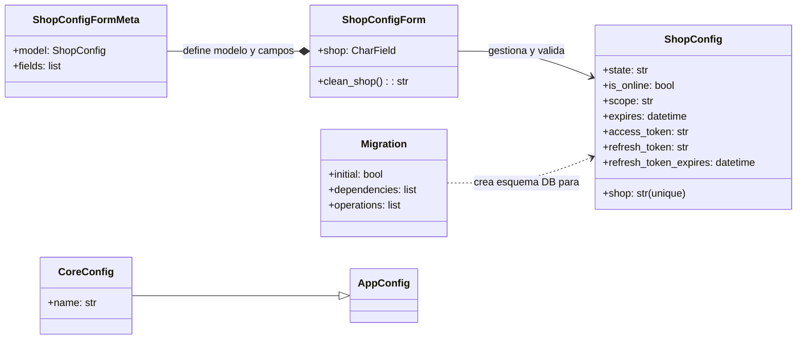
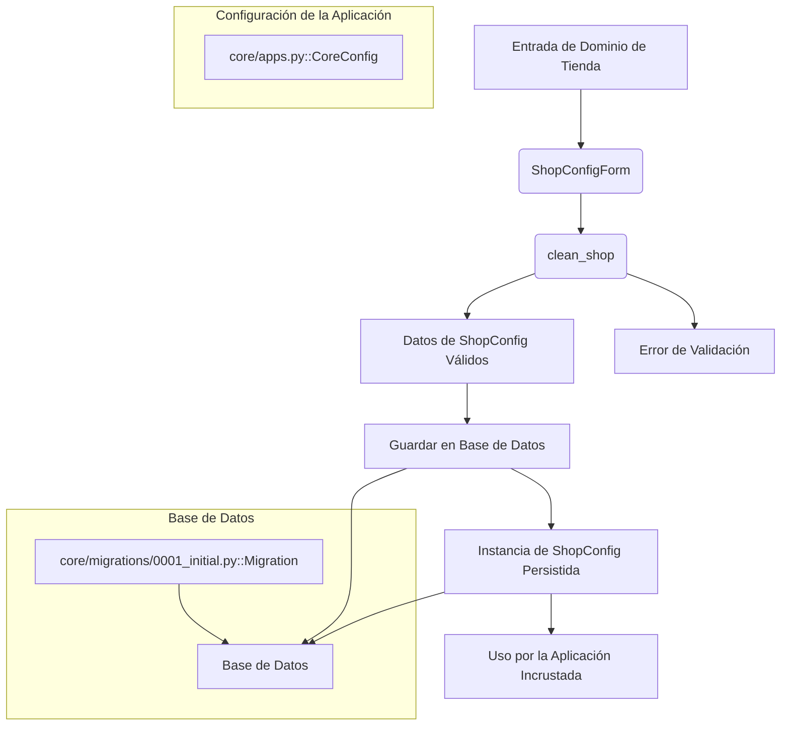

# Configuración y Modelos de la Aplicación Incrustada de Shopify

Este módulo, `Core_Application___Shopify_Embedded_App_configuracion_modelos`, es fundamental para la gestión de la configuración y los modelos de datos principales dentro de la aplicación incrustada de Shopify. Se encarga de definir la estructura de datos para la configuración de las tiendas Shopify y proporciona los mecanismos para su inicialización y validación.

## Propósito y Funcionalidad Principal

El objetivo principal de este módulo es establecer el esquema de la base de datos y la lógica de negocio para almacenar la información esencial de cada tienda Shopify que utiliza la aplicación incrustada. Esto incluye credenciales de autenticación, permisos y otros detalles de configuración necesarios para que la aplicación interactúe correctamente con la API de Shopify.

Los componentes clave de este módulo son:

*   **`CoreConfig` (core/apps.py)**: Configuración principal de la aplicación Django, que registra la aplicación `core` dentro del proyecto, permitiendo a Django descubrir sus modelos, vistas y otros componentes.
*   **`ShopConfig` (core/models.py)**: El modelo de base de datos que almacena la configuración específica de cada tienda Shopify, incluyendo el dominio de la tienda, tokens de acceso, tokens de refresco, el alcance de los permisos (scope) y su estado.
*   **`Migration` (core/migrations/0001_initial.py)**: La migración inicial de la base de datos para la aplicación `core`, que define la creación de la tabla `ShopConfig` y sus campos asociados.
*   **`ShopConfigForm` y `ShopConfigForm.Meta` (core/forms.py)**: Un formulario de Django (`ModelForm`) diseñado para la validación y gestión de los datos del modelo `ShopConfig`, específicamente el campo `shop` (dominio de la tienda), aplicando una validación de formato estricta.

## Arquitectura y Relaciones entre Componentes

La arquitectura de este módulo se centra en el modelo `ShopConfig` como la entidad principal para almacenar la información de las tiendas Shopify. Los demás componentes giran en torno a este modelo, proporcionando la infraestructura necesaria para su persistencia, configuración y validación.

A continuación, se presenta un diagrama de clases que ilustra las relaciones entre los componentes de este módulo:

### Flujo de Datos y Componentes

El siguiente diagrama de flujo de datos describe cómo la información de configuración de una tienda Shopify es manejada por los componentes de este módulo, desde la entrada de datos hasta su persistencia en la base de datos.

## Integración con el Sistema General

Este módulo es una parte integral de la [Aplicación Core - Shopify Embedded App](../Core_Application___Shopify_Embedded_App.md). Sirve como el pilar para la persistencia de la configuración de las tiendas, permitiendo que la aplicación se conecte y opere con múltiples tiendas Shopify de manera segura y eficiente.

La `ShopConfig` es utilizada por otros módulos, como las [Vistas de Autenticación](Core_Application___Shopify_Embedded_App_vistas_autenticacion.md), para recuperar los tokens de acceso necesarios para realizar llamadas a la API de Shopify. Sin una `ShopConfig` correctamente almacenada y validada, la aplicación no podría autenticarse con las tiendas Shopify ni realizar ninguna operación en ellas.

En resumen, `Core_Application___Shopify_Embedded_App_configuracion_modelos` proporciona los cimientos de datos y la lógica de validación que permiten a la aplicación incrustada de Shopify mantener un registro de las tiendas a las que está conectada y gestionar sus credenciales de manera segura.
