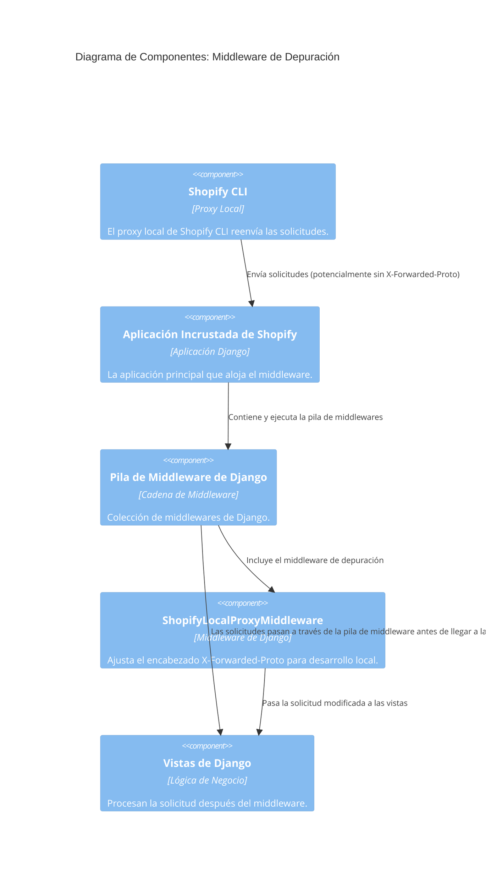
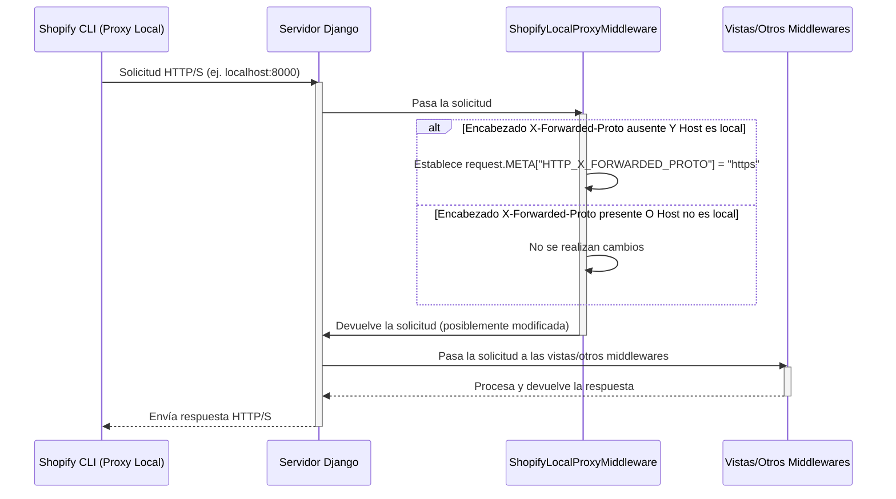

# Middleware de Depuración para la Aplicación Incrustada de Shopify

Este documento detalla el `ShopifyLocalProxyMiddleware`, un componente crucial para el desarrollo local de la aplicación incrustada de Shopify, asegurando que las solicitudes se manejen correctamente a través del proxy local de la CLI de Shopify.

## Propósito y Funcionalidad Principal

El `ShopifyLocalProxyMiddleware` tiene como objetivo principal resolver un problema específico que surge durante el desarrollo local de aplicaciones incrustadas de Shopify: la omisión del encabezado `X-Forwarded-Proto` por parte del proxy local de la CLI de Shopify. Este encabezado es fundamental para que las aplicaciones determinen el protocolo original (HTTP o HTTPS) de la solicitud, lo cual es vital para la generación de URLs seguras y otras verificaciones de seguridad dentro de la aplicación Django.

Cuando una solicitud llega al servidor Django a través del proxy local de la CLI de Shopify y el encabezado `HTTP_X_FORWARDED_PROTO` está ausente, este middleware interviene. Si además la solicitud proviene de una dirección de host local (como `localhost`, `127.0.0.1` o `[::1]`), el middleware establece explícitamente `HTTP_X_FORWARDED_PROTO` a `"https"`. Esto simula el comportamiento de un entorno de producción donde las solicitudes siempre son HTTPS, garantizando que la aplicación se comporte de manera consistente y segura durante el desarrollo.

### `ShopifyLocalProxyMiddleware`

- **Ubicación:** `core/debug_middleware.py`
- **Descripción:** Un middleware de Django que inyecta el encabezado `X-Forwarded-Proto` con el valor "https" si está ausente y la solicitud se origina en un host local, compensando la omisión del encabezado por parte del proxy local de la CLI de Shopify.

```python
class ShopifyLocalProxyMiddleware:
    """Set X-Forwarded-Proto when Shopify CLI local proxy omits it."""

    def __init__(self, get_response):
        self.get_response = get_response

    def __call__(self, request):
        if not request.META.get("HTTP_X_FORWARDED_PROTO"):
            host = request.META.get("HTTP_HOST", "")
            if host.startswith(("localhost:", "127.0.0.1:", "[::1]:")):
                request.META["HTTP_X_FORWARDED_PROTO"] = "https"
        return self.get_response(request)
```

## Arquitectura y Relaciones entre Componentes

El `ShopifyLocalProxyMiddleware` se integra en la cadena de procesamiento de middleware de Django. Su posición dentro de esta cadena es importante, ya que debe ejecutarse antes que cualquier otro componente que dependa de la determinación correcta del esquema de la solicitud (HTTP/HTTPS).

### Diagrama de Componentes



### Diagrama de Flujo de Procesos (Desarrollo Local)



## Integración en el Sistema General

Este middleware es una parte integral de la configuración de desarrollo local para la [Aplicación Incrustada de Shopify](../Core_Application___Shopify_Embedded_App.md). Asegura que el entorno de desarrollo refleje con precisión el comportamiento del entorno de producción en términos de seguridad del protocolo, lo que previene errores comunes relacionados con la determinación incorrecta del esquema de URL (HTTP vs. HTTPS) y el manejo de cookies seguras.

Su presencia es vital para el correcto funcionamiento de características que dependen de URLs absolutas o de la verificación de seguridad del protocolo, como los flujos de autenticación OAuth de Shopify y los enlaces dentro de la propia aplicación incrustada. Sin este middleware, los desarrolladores podrían encontrarse con redirecciones fallidas, errores de seguridad o un comportamiento inconsistente de la aplicación durante la fase de desarrollo.
