# Pruebas de la Aplicación Incrustada de Shopify

Este documento detalla las pruebas unitarias y de integración para la [Aplicación Incrustada de Shopify](../Core_Application___Shopify_Embedded_App.md), cubriendo sus componentes principales como la autenticación, la configuración de la tienda, las redirecciones incrustadas y la sincronización de datos con Shopify. Estas pruebas garantizan la fiabilidad y el correcto funcionamiento de la aplicación en el ecosistema de Shopify.

## Arquitectura de Pruebas

La arquitectura de pruebas está organizada en clases de `TestCase` y `SimpleTestCase` de Django, cada una centrada en verificar aspectos específicos de la aplicación. A continuación, se muestra una visión general de cómo se estructuran las pruebas y los componentes que validan.

### Relación de Componentes de Prueba

```mermaid
graph TD
    subgraph Core_Application___Shopify_Embedded_App_pruebas
        A[ShopConfigFormTests] --> B(Validación de Formularios de Configuración de Tienda)
        C[RootMenuViewTests] --> D(Renderizado de la Vista Raíz y Navegación)
        E[PublicEntryViewTests] --> F(Comportamiento de la Vista de Entrada Pública/Instalación)
        G[AuthLoginViewTests] --> H(Flujo de Autenticación y Redirecciones de Login)
        I[HomeViewAuthTests] --> J(Autenticación de la Vista Principal y Manejo de Tokens)
        K[AuthPatchIdTokenViewTests] --> L(Actualización del Token de ID)
        M[TokenLifecycleTests] --> N(Gestión del Ciclo de Vida de los Tokens de Acceso)
        O[EmbeddedRedirectValidationTests] --> P(Validación de URLs de Redirección Incrustadas)
        Q[EmbeddedRedirectViewTests] --> R(Manejo de Redirecciones Dentro y Fuera de la Aplicación Incrustada)
        S[EmbeddedShopifySyncViewTests] --> T(Sincronización de Datos con Shopify)
        U[EmbeddedCommandDispatchViewTests] --> V(Despacho de Comandos Incrustados)
        W[ShopConfigLookupTests] --> X(Consulta de Configuración de Tienda)
    end

    subgraph Core_Application___Shopify_Embedded_App
        SubA[core/forms.py::ShopConfigForm]
        SubB[core/views.py::RootMenuView]
        SubC[core/views.py::PublicEntryView]
        SubD[core/views.py::AuthLoginView]
        SubE[core/views.py::HomeView]
        SubF[core/views.py::AuthPatchIdTokenView]
        SubG[core/models.py::ShopConfig]
        SubH[core/embedded_redirects]
        SubI[core/views.py::EmbeddedInAppRedirectView & EmbeddedParentRedirectView]
        SubJ[core/views.py::EmbeddedShopifySyncView]
        SubK[core/views.py::EmbeddedCommandDispatchView]
        SubL[core/shop_config_lookup]
    end

    B --> SubA
    D --> SubB
    F --> SubC
    H --> SubD
    J --> SubE
    L --> SubF
    N --> SubG
    P --> SubH
    R --> SubI
    T --> SubJ
    V --> SubK
    X --> SubL

    style A fill:#f9f,stroke:#333,stroke-width:2px
    style C fill:#f9f,stroke:#333,stroke-width:2px
    style E fill:#f9f,stroke:#333,stroke-width:2px
    style G fill:#f9f,stroke:#333,stroke-width:2px
    style I fill:#f9f,stroke:#333,stroke-width:2px
    style K fill:#f9f,stroke:#333,stroke-width:2px
    style M fill:#f9f,stroke:#333,stroke-width:2px
    style O fill:#f9f,stroke:#333,stroke-width:2px
    style Q fill:#f9f,stroke:#333,stroke-width:2px
    style S fill:#f9f,stroke:#333,stroke-width:2px
    style U fill:#f9f,stroke:#333,stroke-width:2px
    style W fill:#f9f,stroke:#333,stroke-width:2px
```

### Descripción de las Clases de Prueba

*   **`ShopConfigFormTests`**: Prueba la validación y normalización del formulario `ShopConfigForm`, asegurando que los dominios de la tienda Shopify se manejen correctamente.
*   **`RootMenuViewTests`**: Verifica que la vista raíz (`/`) renderice correctamente el hub de navegación de la aplicación, incluyendo enlaces a diferentes secciones administrativas y la API.
*   **`PublicEntryViewTests`**: Asegura el correcto funcionamiento de la vista de entrada pública (`/core/install`), que sirve como punto de aterrizaje para la instalación de la aplicación, con o sin un dominio de tienda especificado.
*   **`AuthLoginViewTests`**: Valida el flujo de login de autenticación, incluyendo la presentación del formulario de login y las redirecciones a Shopify para la instalación.
*   **`HomeViewAuthTests`**: Cubre la autenticación y autorización en la vista principal (`/app/`), incluyendo el manejo de tokens de ID, políticas de seguridad de contenido y el reintento de solicitudes con sesiones inválidas.
*   **`AuthPatchIdTokenViewTests`**: Prueba la vista responsable de actualizar el token de ID, asegurando que redirige correctamente según la respuesta del SDK de Shopify.
*   **`TokenLifecycleTests`**: Valida el ciclo de vida completo de los tokens de acceso, desde el intercambio inicial hasta la renovación y el manejo de fallos, asegurando la persistencia y actualización de los tokens de acceso offline en la base de datos.
*   **`EmbeddedRedirectValidationTests`**: Se centra en la validación de URLs para redirecciones incrustadas, verificando que solo se permitan rutas seguras y configuradas.
*   **`EmbeddedRedirectViewTests`**: Prueba las vistas que manejan las redirecciones dentro y fuera de la aplicación incrustada, interactuando con el SDK de Shopify para asegurar un comportamiento de redirección seguro y correcto.
*   **`EmbeddedShopifySyncViewTests`**: Verifica la funcionalidad de sincronización de datos con Shopify, incluyendo el despacho de tareas de importación y el renderizado de botones de sincronización en la interfaz de usuario.
*   **`EmbeddedCommandDispatchViewTests`**: Prueba la capacidad de la aplicación para despachar comandos incrustados, como la configuración de locales o la reconstrucción de índices, y cómo se registran y muestran en el historial.
*   **`ShopConfigLookupTests`**: Asegura que las funciones de consulta de configuración de la tienda (`get_shop_config`, `shop_has_access_token`) recuperen la configuración correcta, especialmente cuando existen múltiples formatos de dominio para una misma tienda.

## Integración con el Sistema General

Este módulo de pruebas es fundamental para mantener la estabilidad y funcionalidad de la [Aplicación Incrustada de Shopify](../Core_Application___Shopify_Embedded_App.md) dentro de la [Plataforma de Integración de Shopify de Core Application](../../Application_Core___Shopify_Integration_Platform.md). Al validar exhaustivamente los componentes críticos, las pruebas aseguran que la aplicación incrustada interactúa correctamente con la API de Shopify, maneja la autenticación de usuarios de forma segura y proporciona una experiencia fluida para los comerciantes. La robustez de este módulo de pruebas contribuye directamente a la calidad general del producto y a la confianza en las funcionalidades de integración con Shopify.