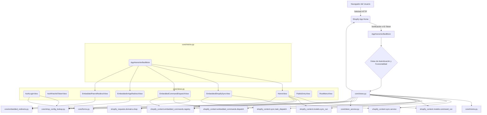

# Módulo Core_Application___Shopify_Embedded_App_vistas_autenticacion

## Introducción

El módulo `Core_Application___Shopify_Embedded_App_vistas_autenticacion` es el encargado de gestionar los flujos de autenticación, la verificación de solicitudes y las diversas funcionalidades de las vistas dentro de la aplicación incrustada de Shopify. Este módulo facilita la integración segura y la interacción con la plataforma Shopify, permitiendo operaciones como la sincronización de contenido, la ejecución de comandos y la gestión de redirecciones.

## Arquitectura

La arquitectura del módulo se centra en la reutilización de código a través de mixins y una clara separación de responsabilidades entre las diferentes vistas. Utiliza el `AppHomeVerifiedMixin` para asegurar que todas las solicitudes que entran a las vistas principales hayan sido verificadas por Shopify App Home, garantizando la seguridad y la procedencia de las interacciones.

### Diagrama de Componentes

### Flujo de Autenticación y Verificación

1.  Una solicitud desde el navegador del usuario llega a Shopify App Home.
2.  Shopify App Home verifica la solicitud y, si es válida, proporciona un token de identificación.
3.  La solicitud es procesada por el `AppHomeVerifiedMixin` en `core/mixins.py`, que valida el token y prepara el contexto para la vista.
4.  Si la verificación es exitosa, se invoca el método `dispatch_after_verified` de la vista correspondiente en `core/views.py`.
5.  Las vistas manejan la lógica de negocio específica, interactuando con otros módulos como `shopify_content` para sincronización y comandos, o `shopify_requests` para interactuar con la API de Shopify.

## Submódulos

Este módulo se descompone en los siguientes submódulos para una mejor organización y gestión de responsabilidades:

*   [AppHomeVerifiedMixin](./Core_Application___Shopify_Embedded_App_vistas_autenticacion/Core_Application___Shopify_Embedded_App_vistas_autenticacion_AppHomeVerifiedMixin.md)
*   [Vistas Funcionales](./Core_Application___Shopify_Embedded_App_vistas_autenticacion/Core_Application___Shopify_Embedded_App_vistas_autenticacion_VistasFuncionales.md)

