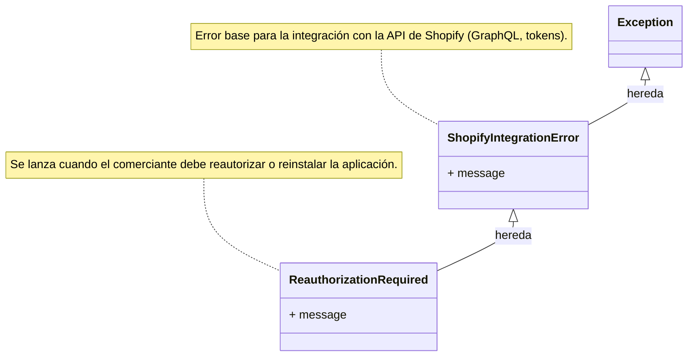

# Gestión de Errores del Cliente de la API de Shopify

Este módulo, `Shopify_API_Client_Gestion_Errores`, es una parte fundamental del [Cliente de la API de Shopify](../Shopify_API_Client.md) dentro de la Plataforma de Integración de Shopify. Su propósito principal es definir y estandarizar las excepciones personalizadas que pueden ocurrir durante las interacciones con la API de administración de Shopify, tanto a través de GraphQL como en el manejo de tokens.

## Funcionalidad Principal

El módulo proporciona las siguientes clases de excepción:

### `ShopifyIntegrationError`

`ShopifyIntegrationError` sirve como la clase base para todos los errores que pueden surgir de la integración con la API de administración de Shopify. Esto incluye problemas relacionados con las solicitudes GraphQL, la gestión de tokens de acceso y cualquier otra operación de comunicación con Shopify. Al tener una excepción base, se facilita la captura y el manejo general de errores en todo el sistema.

### `ReauthorizationRequired`

`ReauthorizationRequired` es una excepción específica que hereda de `ShopifyIntegrationError`. Se lanza cuando la aplicación detecta que el comerciante debe volver a autorizar o reinstalar la aplicación de Shopify. Esta excepción es crucial para el flujo de autenticación y asegura que la aplicación pueda guiar al usuario a través del proceso de reautorización cuando sea necesario, manteniendo la seguridad y el acceso adecuado a los recursos de Shopify.

## Arquitectura y Relaciones de Componentes

Las excepciones en este módulo tienen una relación jerárquica simple, donde `ReauthorizationRequired` extiende la funcionalidad de `ShopifyIntegrationError` para representar un tipo de error más específico.

## Integración en el Sistema General

El módulo `Shopify_API_Client_Gestion_Errores` es un componente vital para la robustez del módulo [Cliente de la API de Shopify](../Shopify_API_Client.md). Estas excepciones son capturadas y manejadas en varias partes de la [Plataforma de Integración de Shopify](../../Application_Core___Shopify_Integration_Platform.md) para garantizar un comportamiento predecible y una experiencia de usuario fluida.

Por ejemplo, el servicio GraphQL ([Shopify_API_Client_Servicio_GraphQL](Shopify_API_Client_Servicio_GraphQL.md)) podría lanzar estas excepciones cuando detecta problemas con las credenciales de la API o respuestas inesperadas, permitiendo que las capas superiores de la aplicación actúen en consecuencia, como redirigir al usuario para una reautorización.