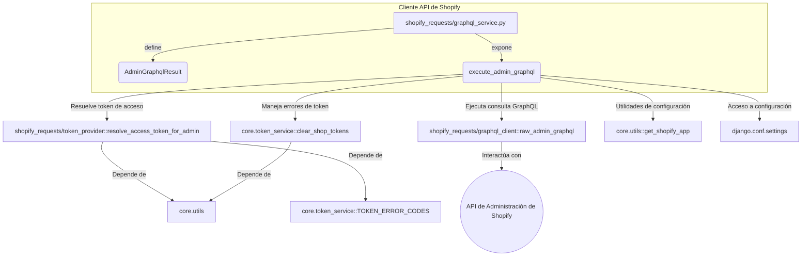
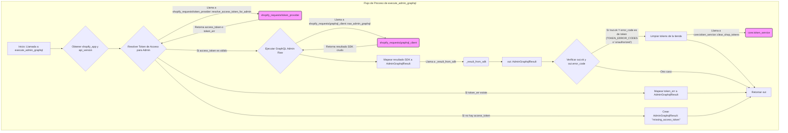

# Servicio GraphQL del Cliente API de Shopify

El módulo `Shopify_API_Client_Servicio_GraphQL` es un componente central dentro de la plataforma de integración de Shopify, encargado de facilitar la comunicación con la API GraphQL de administración de Shopify. Su propósito principal es abstraer la complejidad de la autenticación y la ejecución de consultas GraphQL, proporcionando una interfaz simplificada para interactuar con la tienda Shopify.

Este módulo gestiona la resolución de tokens de acceso, la ejecución de las consultas y el manejo de errores, incluyendo la detección de problemas de autorización y la lógica de reintento para ciertos tipos de errores.

## Arquitectura y Componentes Clave

El servicio GraphQL se basa en varios componentes y dependencias para ofrecer su funcionalidad:

### `shopify_requests/graphql_service.py`

Este archivo contiene la lógica principal para la interacción con la API GraphQL de Shopify.

*   **`AdminGraphqlResult`**: Una clase `dataclass` que encapsula el resultado de una operación GraphQL. Proporciona una estructura clara para el estado de la operación (éxito/fallo), los datos de la respuesta, las extensiones, códigos de error y banderas para indicar si se requiere reautorización o si la operación es reintentable.
*   **`execute_admin_graphql`**: La función principal expuesta por el módulo. Es responsable de:
    *   Obtener un token de acceso válido para la tienda Shopify, utilizando el módulo `token_provider`.
    *   Ejecutar la consulta GraphQL a través de un cliente GraphQL de bajo nivel (`graphql_client`).
    *   Mapear el resultado crudo del SDK a una instancia de `AdminGraphqlResult`.
    *   Manejar errores específicos, como tokens no válidos o expirados, y limpiar los tokens de la tienda cuando sea necesario.
    *   Identificar si una operación requiere reautorización o si puede ser reintentada.

### Relación con otros componentes

## Flujo de Datos y Proceso

El flujo de datos dentro de la función `execute_admin_graphql` sigue un proceso bien definido para asegurar la correcta ejecución de las consultas GraphQL y el manejo robusto de errores.

## Integración con el Sistema General

Este servicio es un pilar fundamental del [Cliente API de Shopify](../Shopify_API_Client.md), ya que proporciona la capacidad de interactuar directamente con la lógica de negocio en Shopify a través de su API más avanzada.

*   **Manejo de Errores:** Se integra con [Gestion de Errores](Shopify_API_Client_Gestion_Errores.md) para lanzar excepciones o devolver estados que indican problemas específicos, como la necesidad de reautorización (`ReauthorizationRequired`).
*   **Gestión de Tokens:** Depende en gran medida de los servicios de gestión de tokens, probablemente definidos en el sub-módulo de [Configuración y Modelos](../Core_Application___Shopify_Embedded_App/Core_Application___Shopify_Embedded_App_configuracion_modelos.md) o en las [Vistas de Autenticación](../Core_Application___Shopify_Embedded_App/Core_Application___Shopify_Embedded_App_vistas_autenticacion.md) para la persistencia y validación de los tokens de acceso de Shopify.
*   **Configuración:** Utiliza `django.conf.settings` para obtener la versión de la API de administración de Shopify, lo que permite una fácil configuración a nivel de proyecto.
