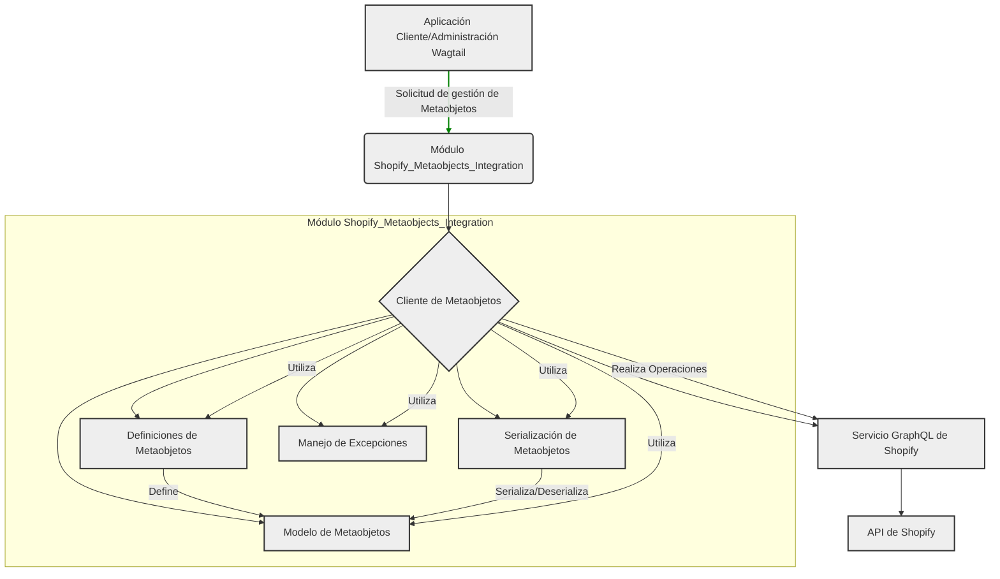

# Integración de Metaobjetos de Shopify

Este módulo es responsable de la interacción con la API de Metaobjetos de Shopify. Proporciona funcionalidades para definir, crear, actualizar y gestionar metaobjetos y sus definiciones dentro de la plataforma Shopify. Facilita la sincronización de estructuras de datos personalizadas y contenido entre la aplicación y Shopify.

## Arquitectura General

El módulo `Shopify_Metaobjects_Integration` se integra con el cliente GraphQL de administración de Shopify para realizar operaciones CRUD en metaobjetos y sus definiciones. Se compone de varias unidades lógicas que manejan la definición de esquemas, la serialización de datos, la gestión de clientes API y el manejo de errores.

## Sub-módulos

A continuación se describen los principales sub-módulos y sus responsabilidades:

*   [Cliente de Metaobjetos](Shopify_Metaobjects_Integration/Shopify_Metaobjects_Integration_Cliente_Metaobjetos.md)
*   [Definición de Metaobjetos](Shopify_Metaobjects_Integration/Shopify_Metaobjects_Integration_Definicion_Metaobjetos.md)
*   [Excepciones de Metaobjetos](Shopify_Metaobjects_Integration/Shopify_Metaobjects_Integration_Excepciones_Metaobjetos.md)
*   [Modelo de Metaobjetos](Shopify_Metaobjects_Integration/Shopify_Metaobjects_Integration_Modelo_Metaobjetos.md)