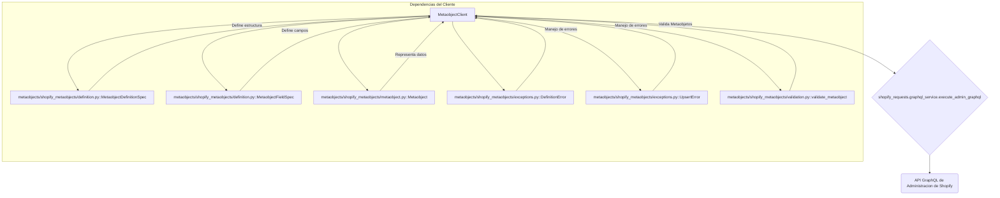

# Cliente de Metaobjetos de Shopify

Este módulo, `Shopify_Metaobjects_Integration_Cliente_Metaobjetos`, es el componente principal para interactuar con la API de Metaobjetos de Shopify. Facilita la gestión programática de definiciones de metaobjetos y los datos de metaobjetos individuales dentro de una tienda Shopify.

## Propósito y Funcionalidad Principal

El `MetaobjectClient` proporciona una interfaz Python para realizar operaciones CRUD (Crear, Leer, Actualizar, Eliminar) y de sincronización con los metaobjetos de Shopify. Sus funcionalidades principales incluyen:

*   **Gestión de Definiciones de Metaobjetos**:
    *   `get_definition(type: str)`: Recupera la definición de un metaobjeto por su tipo.
    *   `create_definition(spec: MetaobjectDefinitionSpec)`: Crea una nueva definición de metaobjeto en Shopify.
    *   `update_definition(definition_id: str, fields: list[MetaobjectFieldSpec] | None, capabilities: dict | None)`: Actualiza los campos y capacidades de una definición de metaobjeto existente.
    *   `ensure_definition(spec: MetaobjectDefinitionSpec)`: Asegura que una definición de metaobjeto existe, creándola si es necesario o sincronizando campos faltantes.
    *   `sync_missing_fields(existing: MetaobjectDefinitionSpec, spec: MetaobjectDefinitionSpec)`: Añade campos a una definición existente que están presentes en la especificación deseada pero ausentes en la definición actual de Shopify.

*   **Gestión de Datos de Metaobjetos**:
    *   `get_by_handle(type: str, handle: str)`: Recupera un metaobjeto específico utilizando su tipo y *handle*.
    *   `update(metaobject_id: str, metaobject: Metaobject, ...)`: Actualiza un metaobjeto existente.
    *   `upsert(metaobject: Metaobject, ...)`: Realiza una operación de *upsert* (actualiza si existe, crea si no) para un metaobjeto.
    *   `upsert_many(metaobjects: list[Metaobject], ...)`: Realiza operaciones de *upsert* para una lista de metaobjetos, informando de las estadísticas de éxito y fallo.
    *   `sync(data: Any, definition: MetaobjectDefinitionSpec, ...)`: Sincroniza datos de varias fuentes (diccionarios, *dataclasses*, objetos `Metaobject`) con un metaobjeto en Shopify, manejando la creación o actualización según sea necesario.

## Arquitectura y Relaciones entre Componentes

El `MetaobjectClient` actúa como un orquestador para las interacciones con la API de Shopify. Se basa en varios componentes internos y externos para realizar sus funciones.

### Diagrama de Arquitectura de Componentes

### Descripción de Componentes y Dependencias

*   **`MetaobjectClient`**: La clase central de este módulo que encapsula la lógica para interactuar con la API de Metaobjetos de Shopify.
*   **`shopify_requests.graphql_service.execute_admin_graphql`**: Este cliente utiliza la función `execute_admin_graphql` (definida en [Servicio GraphQL del Cliente de la API de Shopify](../Shopify_API_Client/Shopify_API_Client_Servicio_GraphQL.md)) para realizar todas las llamadas a la API de Shopify, enviando consultas y mutaciones GraphQL.
*   **`MetaobjectDefinitionSpec` y `MetaobjectFieldSpec`**: Clases de especificación (discutidas en [Definición de Metaobjetos](Shopify_Metaobjects_Integration_Definicion_Metaobjetos.md)) que se utilizan para definir la estructura de los metaobjetos, incluyendo sus campos y capacidades. El cliente las usa para crear y actualizar definiciones.
*   **`Metaobject`**: Una clase de modelo (descrita en [Modelo de Metaobjetos](Shopify_Metaobjects_Integration_Modelo_Metaobjetos.md)) que representa los datos de un metaobjeto individual. El cliente convierte los datos entrantes a esta forma y devuelve objetos de este tipo.
*   **`DefinitionError` y `UpsertError`**: Excepciones personalizadas (detalladas en [Excepciones de Metaobjetos](Shopify_Metaobjects_Integration_Excepciones_Metaobjetos.md)) utilizadas para manejar errores específicos durante la creación/actualización de definiciones y operaciones de *upsert* de metaobjetos, respectivamente.
*   **`metaobjects/shopify_metaobjects/validation.py::validate_metaobject`**: Una utilidad interna para validar los datos de un metaobjeto contra su definición antes de enviarlos a Shopify.

## Flujo de Datos

El flujo de datos para una operación típica, como `upsert` o `sync`, sigue los siguientes pasos:

1.  **Entrada de Datos**: Los datos del metaobjeto pueden provenir de un diccionario, una instancia de *dataclass* o un objeto `Metaobject` ya existente.
2.  **Conversión a `Metaobject`**: El `MetaobjectClient` convierte los datos de entrada en una instancia estandarizada de `Metaobject`.
3.  **Validación**: Si la validación está habilitada y se proporciona una definición, el metaobjeto se valida contra su `MetaobjectDefinitionSpec` para asegurar la integridad de los datos. Si hay errores, se lanza un `UpsertError`.
4.  **Transformación a Formato Shopify**: El objeto `Metaobject` se transforma en un formato de campos compatible con la API GraphQL de Shopify.
5.  **Ejecución de GraphQL**: Se construye y se ejecuta una mutación GraphQL (por ejemplo, `METAOBJECT_UPSERT` o `METAOBJECT_UPDATE`) utilizando `execute_admin_graphql`, enviando los datos formateados a la API de Shopify.
6.  **Procesamiento de Respuesta**: La respuesta de la API de Shopify es analizada. Cualquier error de usuario reportado por Shopify se convierte en un `UpsertError`. Si la operación es exitosa, los datos del metaobjeto devueltos por Shopify se utilizan para crear una nueva instancia de `Metaobject` que se devuelve al llamador.

## Integración con el Sistema General

Este módulo es una parte fundamental de la [Integración de Metaobjetos de Shopify](../Shopify_Metaobjects_Integration.md) dentro de la [Plataforma de Integración de Shopify del Núcleo de la Aplicación](../../Application_Core___Shopify_Integration_Platform.md). Proporciona la capa de comunicación de bajo nivel para que otras partes del sistema, como la [Gestión de Contenido de Shopify del Wagtail Content Management & API](../../Wagtail_Content_Management___API/Shopify_Content_Management.md), puedan definir y manipular estructuras de datos personalizadas (metaobjetos) en Shopify.

Esto es crucial para:
*   **Contenido Estructurado**: Permite que el sistema de gestión de contenido (Wagtail) almacene datos complejos y estructurados directamente en Shopify, extendiendo su modelo de datos más allá de los tipos de recursos estándar (productos, colecciones, páginas).
*   **Sincronización de Contenido**: Habilita comandos de gestión y procesos de sincronización (como los que se encuentran en [Metaobject_Definition___Setup_Commands](../../Wagtail_Content_Management___API/Shopify_Content_Management/Metaobject_Definition___Setup_Commands.md)) para asegurar que las definiciones de metaobjetos existan y que los datos de contenido estén actualizados en Shopify.

## Referencias

*   [Servicio GraphQL del Cliente de la API de Shopify](../Shopify_API_Client/Shopify_API_Client_Servicio_GraphQL.md)
*   [Definición de Metaobjetos](Shopify_Metaobjects_Integration_Definicion_Metaobjetos.md)
*   [Modelo de Metaobjetos](Shopify_Metaobjects_Integration_Modelo_Metaobjetos.md)
*   [Excepciones de Metaobjetos](Shopify_Metaobjects_Integration_Excepciones_Metaobjetos.md)
*   [Integración de Metaobjetos de Shopify](../Shopify_Metaobjects_Integration.md)
*   [Plataforma de Integración de Shopify del Núcleo de la Aplicación](../../Application_Core___Shopify_Integration_Platform.md)
*   [Gestión de Contenido de Shopify](../../Wagtail_Content_Management___API/Shopify_Content_Management.md)
*   [Comandos de Configuración y Definición de Metaobjetos](../../Wagtail_Content_Management___API/Shopify_Content_Management/Metaobject_Definition___Setup_Commands.md)
