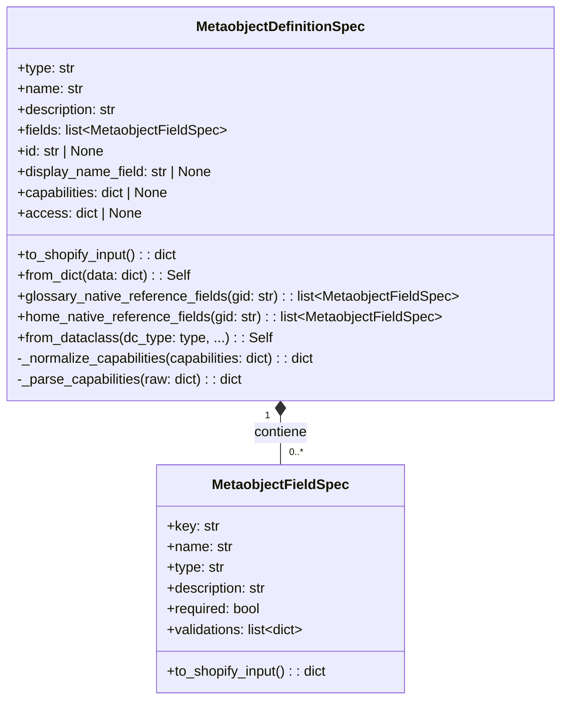
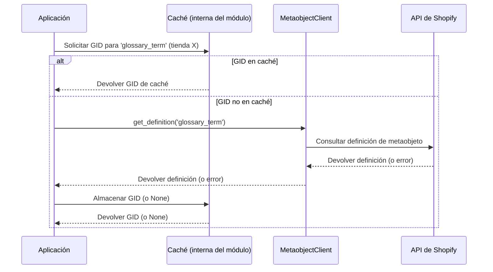
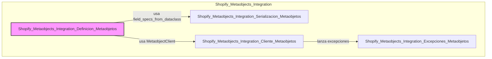

# Definición de Metaobjetos de Shopify

Este módulo, `Shopify_Metaobjects_Integration_Definicion_Metaobjetos`, es fundamental para la integración con la plataforma de Shopify, encargándose de la estructuración y especificación de las definiciones de metaobjetos. Proporciona las clases y utilidades necesarias para describir tanto los metaobjetos en su totalidad como los campos individuales que los componen, facilitando su creación y gestión programática a través de la API de Shopify.

## Propósito y Funcionalidad Principal

El objetivo principal de este módulo es ofrecer una representación programática y tipada de las definiciones de metaobjetos de Shopify. Esto permite a los desarrolladores definir, validar y serializar las estructuras de los metaobjetos de manera consistente, asegurando que los datos almacenados en Shopify cumplan con los requisitos del sistema.

Las funcionalidades clave incluyen:
*   Definición detallada de los campos de un metaobjeto, incluyendo tipo, nombre, descripción y validaciones.
*   Especificación completa de un metaobjeto, abarcando su tipo, nombre, descripción, campos, capacidades y configuración de acceso.
*   Mecanismos para convertir estas especificaciones en formatos compatibles con la API de Shopify.
*   Utilidades para inferir definiciones de metaobjetos a partir de dataclasses de Python.
*   Funciones para gestionar referencias nativas de Shopify (productos, colecciones, artículos y otros metaobjetos) dentro de las definiciones de campos.

## Arquitectura y Relaciones entre Componentes

El módulo se compone de dos dataclasses principales y varias funciones de utilidad que trabajan en conjunto para la gestión de definiciones de metaobjetos.

### `MetaobjectFieldSpec`

Esta dataclass representa la especificación de un campo individual dentro de una definición de metaobjeto.

**Atributos clave:**
*   `key` (str): La clave única del campo.
*   `name` (str): El nombre visible del campo.
*   `type` (str): El tipo de datos del campo (ej. `single_line_text_field`, `list.product_reference`).
*   `description` (str, opcional): Una descripción del campo.
*   `required` (bool, opcional): Indica si el campo es obligatorio.
*   `validations` (list[dict], opcional): Una lista de reglas de validación para el campo.

**Métodos:**
*   `to_shopify_input()`: Convierte la instancia de `MetaobjectFieldSpec` en un diccionario que sigue la estructura JSON esperada por la API de Shopify para la definición de campos.

### `MetaobjectDefinitionSpec`

Esta dataclass representa la definición completa de un metaobjeto en Shopify.

**Atributos clave:**
*   `type` (str): El tipo de metaobjeto (ej. `my_custom_metaobject`).
*   `name` (str): El nombre visible del metaobjeto.
*   `description` (str): Una descripción del metaobjeto.
*   `fields` (list[`MetaobjectFieldSpec`]): Una lista de las especificaciones de los campos que componen el metaobjeto.
*   `id` (str, opcional): El ID global (GID) del metaobjeto en Shopify, una vez creado.
*   `display_name_field` (str, opcional): La clave del campo que se utilizará como nombre de visualización del metaobjeto.
*   `capabilities` (dict, opcional): Define las capacidades del metaobjeto, como si es publicable, visible en la tienda online o renderizable.
*   `access` (dict, opcional): Configuración de acceso para el metaobjeto.

**Métodos y Métodos de Clase:**
*   `to_shopify_input()`: Transforma la especificación del metaobjeto en un formato de diccionario adecuado para la API de Shopify. Incluye lógica para normalizar las capacidades.
*   `_normalize_capabilities(capabilities: dict)`: Método estático interno para ajustar la estructura de las capacidades antes de enviarlas a Shopify.
*   `_parse_capabilities(raw: dict[str, Any] | None)`: Método estático interno para convertir el formato de capacidades GraphQL en el formato interno utilizado por la dataclass.
*   `from_dict(data: dict[str, Any])`: Método de clase que construye una instancia de `MetaobjectDefinitionSpec` a partir de un diccionario de datos, como los que se recibirían de una respuesta de la API de Shopify.
*   `glossary_native_reference_fields(glossary_definition_gid: str | None = None)`: Método de clase que retorna una lista de `MetaobjectFieldSpec` predefinidos para campos de referencia nativa de Shopify (`product_reference`, `collection_reference`, `article_reference`) y, opcionalmente, referencias a un metaobjeto de glosario si se proporciona su GID.
*   `home_native_reference_fields(glossary_definition_gid: str | None = None)`: Similar al anterior, pero para campos de referencia relevantes para páginas de inicio (colecciones destacadas, artículos del centro educativo, etc.).
*   `from_dataclass(dc_type: type, *, type: str, name: str, description: str, handle_field: str = "handle")`: Método de clase que crea una especificación de metaobjeto a partir de una dataclass de Python, inferiendo automáticamente los campos. Depende de la función `field_specs_from_dataclass` del módulo `[Serialización de Metaobjetos](Shopify_Metaobjects_Integration_Serializacion_Metaobjetos.md)`.

### Funciones de Utilidad

*   `_glossary_definition_gid_cache`: Un caché para almacenar el GID de la definición del metaobjeto 'glossary_term'.
*   `glossary_definition_gid(shop: str) -> str | None`: Busca y devuelve el GID de la definición del metaobjeto 'glossary_term' para una tienda específica, utilizando un caché para mejorar el rendimiento. Depende de `[Cliente de Metaobjetos](Shopify_Metaobjects_Integration_Cliente_Metaobjetos.md)`.
*   `clear_glossary_definition_gid_cache() -> None`: Vacía el caché del GID de la definición del metaobjeto de glosario.

### Diagrama de Clases

### Diagrama de Flujo de la Función `glossary_definition_gid`

### Diagrama de Dependencias del Módulo

## Cómo encaja en el Sistema General

Este módulo es una parte integral de la [Integración de Metaobjetos de Shopify](../Shopify_Metaobjects_Integration.md) dentro de la plataforma de integración. Actúa como el pilar para definir la estructura de los datos personalizados que se sincronizan o gestionan en Shopify.

*   **Definición de Esquemas**: Permite que otras partes del sistema, como los [Comandos de Configuración de Metaobjetos de Wagtail](../../Wagtail_Content_Management___API/Shopify_Content_Management/Metaobject_Definition___Setup_Commands.md), definan de manera programática las definiciones de metaobjetos y sus campos asociados en Shopify. Esto es crucial para mantener la consistencia del esquema de datos entre la aplicación y la plataforma de e-commerce.
*   **Creación y Actualización de Metaobjetos**: Las especificaciones definidas aquí son utilizadas por el [Cliente de Metaobjetos](Shopify_Metaobjects_Integration_Cliente_Metaobjetos.md) para enviar solicitudes a la API de Shopify para crear o actualizar definiciones de metaobjetos.
*   **Manejo de Contenido Dinámico**: Al definir los tipos de campos y las validaciones, este módulo asegura que los datos de metaobjetos sean estructurados correctamente, lo que es vital para la ingestión y renderización de contenido dinámico en la tienda Shopify.
*   **Integración con Wagtail**: La capacidad de generar `MetaobjectDefinitionSpec` a partir de dataclasses facilita la integración con el CMS Wagtail, permitiendo que los modelos de contenido de Wagtail se mapeen directamente a las definiciones de metaobjetos de Shopify.
*   **Referencias Inter-Metaobjetos**: Las funciones para manejar referencias nativas (`glossary_native_reference_fields`, `home_native_reference_fields`) son esenciales para construir relaciones complejas entre diferentes tipos de contenido en Shopify, como vincular productos a términos de glosario o colecciones destacadas a páginas de inicio.
