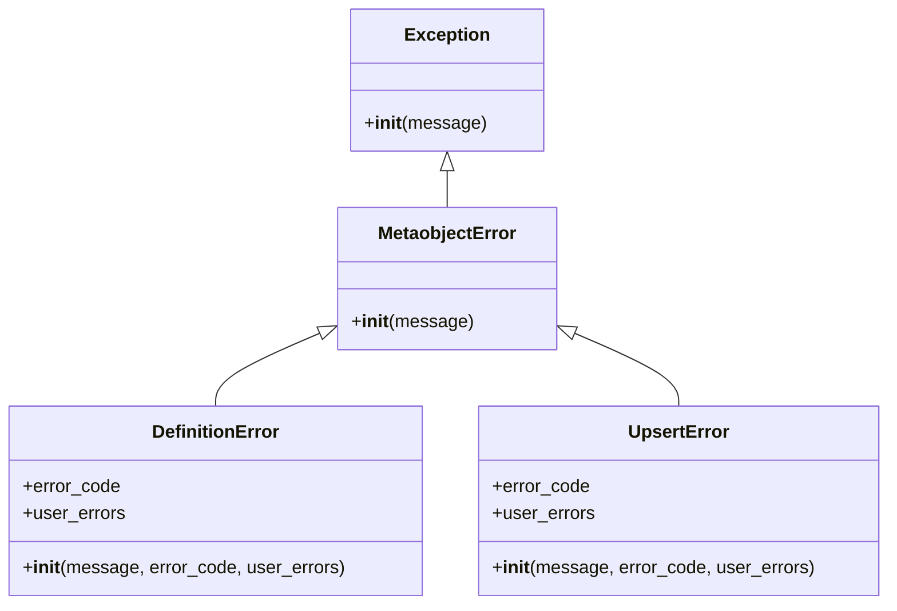

# Excepciones de Integración de Metaobjetos de Shopify

Este módulo (`Shopify_Metaobjects_Integration_Excepciones_Metaobjetos`) define un conjunto de clases de excepción personalizadas diseñadas para gestionar y categorizar los errores que pueden surgir durante las operaciones con los metaobjetos de Shopify. Estas excepciones son fundamentales para proporcionar un manejo de errores robusto y detallado dentro de la plataforma de integración, permitiendo a los desarrolladores diagnosticar y responder adecuadamente a los fallos en la creación, actualización o manipulación de definiciones y datos de metaobjetos.

## Arquitectura y Relaciones de Componentes

El módulo establece una jerarquía clara de excepciones, donde `MetaobjectError` actúa como la clase base para todos los errores relacionados con metaobjetos. `DefinitionError` y `UpsertError` heredan de `MetaobjectError`, especializándose en tipos específicos de fallos.

### Componentes Principales

*   **`MetaobjectError`**: Es la excepción base para todas las operaciones de metaobjetos. Capturar esta excepción permite manejar cualquier error general relacionado con metaobjetos.
*   **`DefinitionError`**: Se lanza cuando una operación de definición de metaobjeto falla. Esto incluye errores al crear, actualizar o eliminar la definición de un metaobjeto en Shopify. Proporciona los atributos `error_code` y `user_errors` para ofrecer detalles adicionales sobre el fallo, que pueden ser mensajes de error específicos de la API de Shopify.
*   **`UpsertError`**: Se lanza cuando una operación de "upsert" (actualizar o insertar) de un metaobjeto existente o nuevo falla. Similar a `DefinitionError`, incluye `error_code` y `user_errors` para una depuración precisa y manejo de errores.

## Cómo Encaja el Módulo en el Sistema General

Este módulo de excepciones es una parte integral de la [Integración de Metaobjetos de Shopify](../Shopify_Metaobjects_Integration.md). Sirve como el mecanismo principal para señalar y transportar información de errores detallada desde las capas de bajo nivel que interactúan directamente con la API de Shopify (como el cliente de metaobjetos, ver [Cliente de Metaobjetos](Shopify_Metaobjects_Integration_Cliente_Metaobjetos.md)) hasta las capas de aplicación superiores.

Cuando el sistema intenta realizar acciones como definir un nuevo tipo de metaobjeto o modificar los valores de un metaobjeto existente, se espera que el código capture estas excepciones para:

1.  **Manejo de errores:** Implementar lógica específica para diferentes tipos de fallos (ej., reintentar una operación, notificar a un administrador, o presentar un mensaje amigable al usuario).
2.  **Depuración:** Utilizar `error_code` y `user_errors` para entender la causa raíz de un problema, especialmente cuando los errores provienen directamente de la API de Shopify.
3.  **Coherencia:** Mantener una estrategia de manejo de errores uniforme en todo el subsistema de integración de metaobjetos.

Por ejemplo, si la creación de una definición de metaobjeto falla debido a un nombre de campo no válido, se lanzará un `DefinitionError` con los detalles específicos del problema. De manera similar, si la actualización de un valor de metaobjeto no cumple con las restricciones de tipo, un `UpsertError` proporcionará la información necesaria para corregirlo.

Este diseño permite una separación limpia de responsabilidades: el código que realiza las operaciones de metaobjetos se enfoca en la interacción con la API, mientras que el código cliente se encarga de la lógica de negocio y la presentación de errores, basándose en la información estructurada proporcionada por estas excepciones.