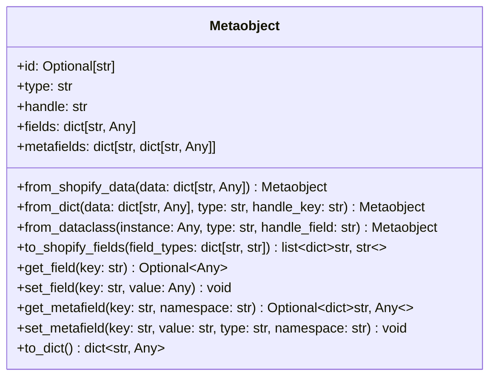
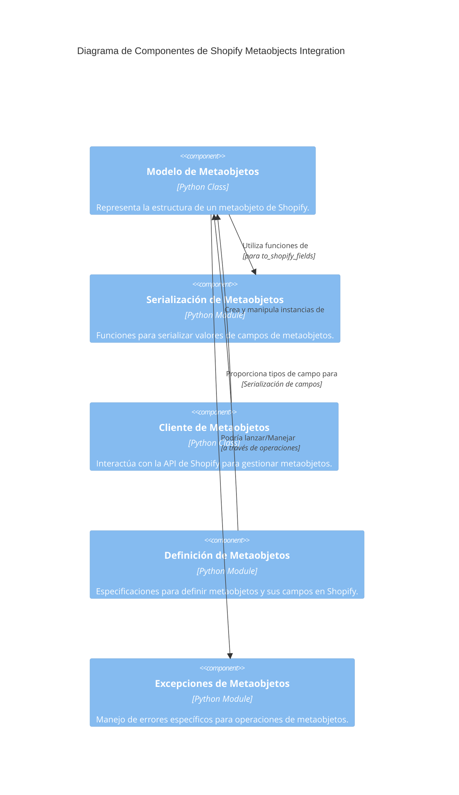

# Modelo de Metaobjetos de Shopify

Este documento describe el módulo `Shopify_Metaobjects_Integration_Modelo_Metaobjetos`, que proporciona la representación central de los metaobjetos de Shopify dentro de la plataforma de integración. Este módulo define la estructura y el comportamiento de un metaobjeto, facilitando su creación, manipulación y serialización para la interacción con la API de Shopify.

## Propósito y Funcionalidad Principal

El componente principal de este módulo es la clase `Metaobject`, que actúa como el modelo de datos para los metaobjetos de Shopify. Encapsula las propiedades clave de un metaobjeto, como su tipo, handle, ID y los campos y metacampos asociados. Permite la conversión bidireccional entre la representación de datos de la aplicación y el formato requerido por la API de Shopify.

### Clase `Metaobject`

La clase `Metaobject` ofrece las siguientes funcionalidades:

*   **Inicialización**: Permite crear una instancia de `Metaobject` con su tipo, handle, ID opcional, campos y metacampos.
*   **`from_shopify_data(data: dict[str, Any]) -> "Metaobject"`**: Un constructor de clase que crea una instancia de `Metaobject` a partir de la estructura de datos JSON devuelta por la API de Shopify.
*   **`from_dict(data: dict[str, Any], *, type: str, handle_key: str = "handle") -> "Metaobject"`**: Crea un `Metaobject` a partir de un diccionario de Python, especificando el tipo y la clave que representa el handle.
*   **`from_dataclass(instance: Any, *, type: str, handle_field: str = "handle") -> "Metaobject"`**: Permite la conversión de instancias de `dataclass` de Python a objetos `Metaobject`, utilizando un campo específico como handle.
*   **`to_shopify_fields(self, field_types: dict[str, str] | None = None) -> list[dict[str, str]]`**: Serializa los campos del metaobjeto en el formato `list[dict[str, str]]` esperado por la API de Shopify, aplicando la lógica de serialización de tipos si se proporcionan `field_types`.
*   **`get_field(self, key: str) -> Optional[Any]`**: Recupera el valor de un campo específico del metaobjeto.
*   **`set_field(self, key: str, value: Any) -> None`**: Establece o actualiza el valor de un campo específico del metaobjeto.
*   **`get_metafield(self, key: str, namespace: str = "custom") -> Optional[dict[str, Any]]`**: Recupera un metacampo específico por su clave y namespace.
*   **`set_metafield(self, key: str, value: str, type: str = "single_line_text_field", namespace: str = "custom") -> None`**: Establece o actualiza un metacampo específico, incluyendo su tipo y namespace.
*   **`to_dict(self) -> dict[str, Any]`**: Convierte el objeto `Metaobject` de vuelta a un diccionario de Python, incluyendo todos sus atributos.

### Diagrama de Clases: `Metaobject`

## Arquitectura y Relaciones entre Componentes

El módulo `Shopify_Metaobjects_Integration_Modelo_Metaobjetos` es una parte fundamental de la integración con los metaobjetos de Shopify. Su clase `Metaobject` sirve como el modelo de datos central y se relaciona con otros componentes de la siguiente manera:

*   **[Serialización de Metaobjetos](Shopify_Metaobjects_Integration_Serializacion_Metaobjetos.md)**: La clase `Metaobject` utiliza la función `serialize_field_value` del módulo `metaobjects/shopify_metaobjects/serialization.py` para convertir los valores de los campos al formato adecuado antes de enviarlos a Shopify. Esto asegura que los datos se ajusten a los tipos de campo definidos en Shopify.
*   **[Cliente de Metaobjetos](Shopify_Metaobjects_Integration_Cliente_Metaobjetos.md)**: El `MetaobjectClient` (en `metaobjects/shopify_metaobjects/client.py`) es el consumidor principal de las instancias de `Metaobject`. El cliente utiliza estos objetos para construir las solicitudes GraphQL para crear, actualizar o eliminar metaobjetos en Shopify.
*   **[Definición de Metaobjetos](Shopify_Metaobjects_Integration_Definicion_Metaobjetos.md)**: Aunque no hay una dependencia directa y explícita del modelo `Metaobject` a las definiciones en tiempo de ejecución, el proceso de serialización (`to_shopify_fields`) puede hacer uso de los tipos de campo (`field_types`) que provienen de las definiciones de metaobjetos (e.g., `MetaobjectDefinitionSpec`). Esto asegura que la serialización de los campos se alinee con los tipos definidos en Shopify.
*   **[Excepciones de Metaobjetos](Shopify_Metaobjects_Integration_Excepciones_Metaobjetos.md)**: Las operaciones que implican la creación o manipulación de `Metaobject` podrían generar excepciones definidas en este módulo, como `DefinitionError`, `MetaobjectError` o `UpsertError`, para manejar situaciones anómalas de manera estructurada.

### Diagrama de Componentes

## Cómo encaja el módulo en el sistema general

El módulo `Shopify_Metaobjects_Integration_Modelo_Metaobjetos` es un componente clave dentro de la plataforma de integración de Shopify, formando parte del sub-módulo [Shopify_Metaobjects_Integration](../Shopify_Metaobjects_Integration.md). Su rol principal es estandarizar la representación de los datos de metaobjetos de Shopify dentro de la aplicación.

En el contexto de la aplicación, este modelo de metaobjetos es utilizado por la [API de Contenido de Shopify](../../Wagtail_Content_Management___API/Shopify_Content_API.md) y el sistema de [Gestión de Contenido de Shopify (Wagtail)](../../Wagtail_Content_Management___API/Shopify_Content_Management.md). Permite que la aplicación cree, lea, actualice y elimine metaobjetos de Shopify de una manera consistente, lo cual es crucial para la gestión de contenido dinámico y la extensión de las capacidades de los productos y colecciones de Shopify.

Por ejemplo, comandos de gestión como `ensure_metaobject_definitions` dentro del módulo [Metaobject_Definition___Setup_Commands](../../Wagtail_Content_Management___API/Shopify_Content_Management/Metaobject_Definition___Setup_Commands.md) podrían interactuar con los metaobjetos a través del `MetaobjectClient` que, a su vez, construye las solicitudes usando el modelo `Metaobject`.

En resumen, este módulo proporciona el cimiento de datos sobre el cual se construyen todas las interacciones con los metaobjetos en Shopify, asegurando la integridad y la correcta interpretación de la información entre la aplicación y la plataforma de comercio electrónico.