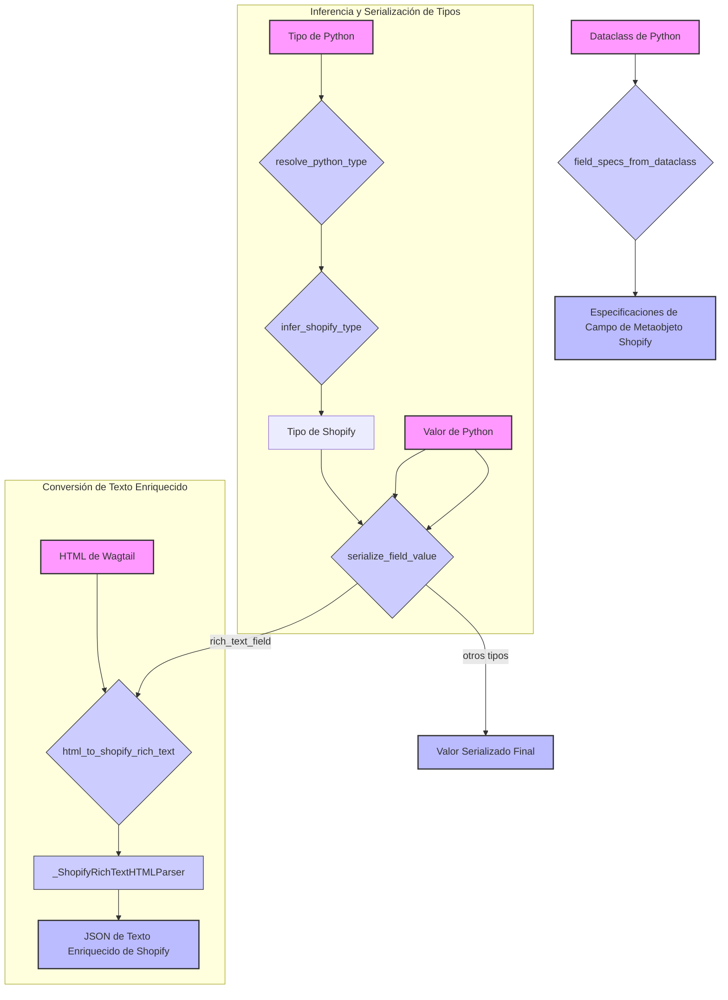

# Serialización de Metaobjetos de Shopify

Este módulo, `Shopify_Metaobjects_Integration_Serializacion_Metaobjetos`, es fundamental para la integración de la plataforma con Shopify, gestionando la conversión de tipos de datos Python a formatos compatibles con los Metaobjetos de Shopify. Su funcionalidad principal radica en la serialización de valores de campos, con un enfoque particular en el procesamiento de contenido de texto enriquecido (HTML) a la estructura JSON requerida por Shopify.

## Propósito y Funcionalidad Principal

El objetivo primordial de este módulo es facilitar el mapeo y la transformación de datos entre los modelos de la aplicación y la estructura de Metaobjetos de Shopify. Esto incluye:

*   **Resolución e Inferencia de Tipos**: Determinar el tipo de datos de Python y su correspondiente tipo de Metaobjeto de Shopify.
*   **Serialización de Valores**: Convertir valores de Python (cadenas, números, booleanos, listas, diccionarios) en sus representaciones serializadas adecuadas para Shopify.
*   **Procesamiento de Texto Enriquecido**: Transformar contenido HTML (comúnmente proveniente de campos `RichTextField` de Wagtail) en el formato JSON estructurado que Shopify espera para sus campos de texto enriquecido.
*   **Generación de Especificaciones de Campo**: A partir de dataclasses de Python, este módulo puede generar las especificaciones de campo necesarias para definir la estructura de los Metaobjetos en Shopify.

## Arquitectura y Relaciones entre Componentes

El módulo `metaobjects/shopify_metaobjects/serialization.py` organiza su funcionalidad a través de varias funciones utilitarias y una clase principal para el manejo de HTML. A continuación, se detalla la interacción entre sus componentes clave:

### _ShopifyRichTextHTMLParser

La clase `_ShopifyRichTextHTMLParser` (un componente interno de `serialization.py`) es una subclase de `HTMLParser` de Python, diseñada específicamente para interpretar cadenas HTML y convertirlas en un formato de documento JSON estructurado compatible con los campos `rich_text_field` de Shopify. Maneja etiquetas HTML comunes como párrafos, encabezados, listas, negritas, cursivas y enlaces, traduciéndolas a nodos en la estructura JSON de Shopify.

### Flujo de Serialización de Datos

El proceso de serialización implica los siguientes pasos y componentes:

1.  **`resolve_python_type`**: Esta función toma una anotación de tipo de Python (por ejemplo, `Optional[str]`) y resuelve el tipo concreto subyacente (en este caso, `str`).
2.  **`infer_shopify_type`**: Utiliza el tipo de Python resuelto y metadatos opcionales para determinar el tipo de Metaobjeto de Shopify más adecuado, utilizando el mapeo `PYTHON_TO_SHOPIFY_TYPE`.
3.  **`serialize_field_value`**: Es el orquestador principal de la serialización. Recibe un valor de Python y el tipo de Shopify inferido. Para tipos simples, realiza una conversión directa a cadena o JSON. Para el tipo `rich_text_field`, invoca a `html_to_shopify_rich_text`.
4.  **`html_to_shopify_rich_text`**: Esta función es la encargada de la conversión de HTML a la estructura JSON de Shopify. Si el input ya es un JSON de texto enriquecido válido, lo retorna; de lo contrario, utiliza `_ShopifyRichTextHTMLParser` para parsear el HTML y construir la estructura JSON. Las funciones `_text` y `_paragraph` son auxiliares para la creación de nodos JSON.
5.  **`field_specs_from_dataclass`**: Permite generar dinámicamente las especificaciones de los campos de un Metaobjeto de Shopify a partir de una dataclass de Python, incluyendo la inferencia de tipos y si el campo es requerido, basándose en la configuración de la dataclass.

## Encaje en el Sistema General

Este módulo es una pieza crítica dentro del componente padre [Shopify_Metaobjects_Integration](../../Shopify_Metaobjects_Integration.md). Su funcionalidad permite que la aplicación interactúe sin problemas con la API de Metaobjetos de Shopify al garantizar que los datos se formatee correctamente antes de ser enviados. Es particularmente relevante para:

*   **Sincronización de Contenido**: Cuando el contenido editorial (creado y gestionado en Wagtail) necesita ser exportado o sincronizado con Shopify, este módulo se asegura de que los campos, especialmente los de texto enriquecido, se traduzcan de manera precisa.
*   **Definición de Esquemas**: La capacidad de generar especificaciones de campo a partir de dataclasses Python agiliza el proceso de definición de nuevos tipos de Metaobjetos en Shopify, manteniendo la coherencia entre el modelo de datos de la aplicación y Shopify.
*   **Integración con Wagtail**: La función `html_to_shopify_rich_text` y la clase `_ShopifyRichTextHTMLParser` son un claro puente con el subsistema [Wagtail_Content_Management___API](../../../Wagtail_Content_Management___API.md), permitiendo que el contenido enriquecido gestionado en Wagtail se represente fielmente en Shopify.