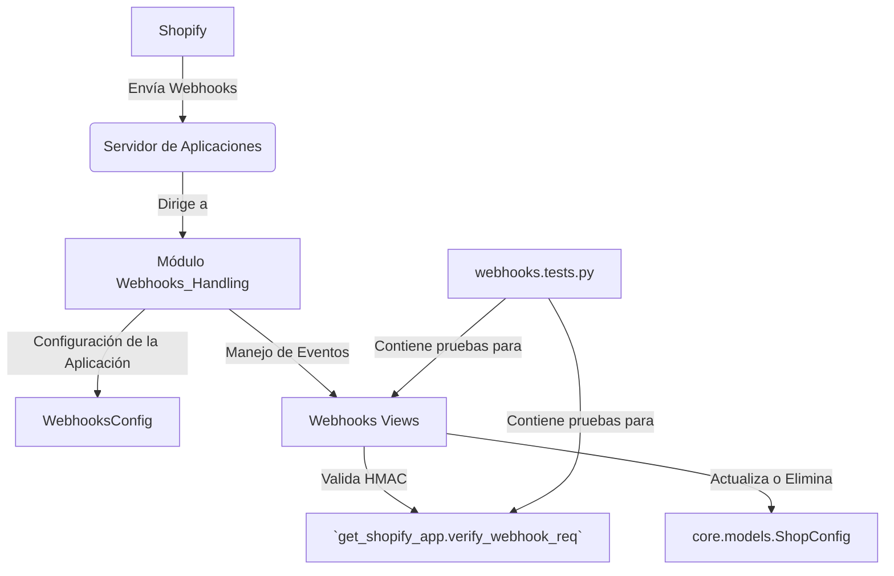

# Gestión de Webhooks

Este módulo, `Webhooks_Handling`, es una parte integral de la plataforma de integración de Shopify, diseñado para procesar y responder a los webhooks entrantes de Shopify. Su propósito principal es gestionar los eventos en tiempo real que ocurren en una tienda Shopify, como instalaciones o desinstalaciones de aplicaciones, o actualizaciones de permisos de alcance.

## Arquitectura

El módulo `Webhooks_Handling` se integra dentro de la aplicación Django, aprovechando el sistema de configuración de aplicaciones y las utilidades de prueba de Django. Su funcionalidad principal se centra en la recepción y verificación de solicitudes de webhook de Shopify, y en la ejecución de la lógica de negocio correspondiente, como la actualización del estado de `ShopConfig`.

*Diagrama 1: Visión general de la arquitectura del módulo de Gestión de Webhooks.*

## Componentes Principales

El módulo se compone de los siguientes elementos clave:

*   **Configuración de la Aplicación (`WebhooksConfig`):** Define los metadatos de la aplicación para el subsistema de webhooks, permitiendo su registro y gestión dentro de la aplicación Django.
*   **Manejo de Pruebas de Webhooks:** Contiene las pruebas unitarias para garantizar la correcta funcionalidad de los webhooks, incluyendo la validación HMAC y la lógica de negocio asociada a eventos como la desinstalación de la aplicación y la actualización de los ámbitos de permisos.

Para una descripción detallada de los casos de prueba de los webhooks, consulte la documentación del submódulo [Pruebas de Webhooks de Shopify](Webhooks_Handling/Webhooks_Handling_pruebas.md).
