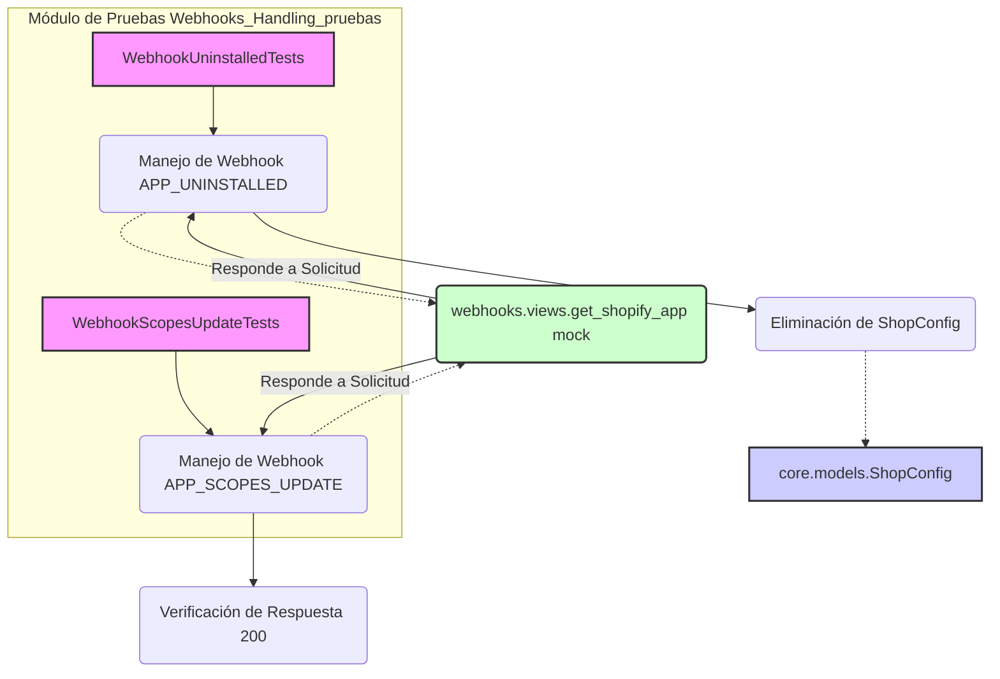

# Pruebas de Gestión de Webhooks

Este módulo, `Webhooks_Handling_pruebas`, contiene los casos de prueba unitarios para la funcionalidad de manejo de webhooks dentro de la plataforma de integración de Shopify. Su propósito principal es asegurar que la aplicación responda correctamente a los eventos de webhook enviados por Shopify, como la desinstalación de la aplicación y las actualizaciones de los ámbitos de permisos.

## Contexto del Módulo

El módulo `Webhooks_Handling_pruebas` se encuentra dentro del componente principal [Webhooks_Handling](../Webhooks_Handling.md) de la plataforma de integración de Shopify. Complementa la lógica de manejo de webhooks probando los escenarios clave de interacción con la API de Shopify y la base de datos local. Las pruebas se centran en verificar la integridad de los datos y la lógica de respuesta ante eventos específicos.

## Arquitectura y Relaciones de Componentes

Los tests en este módulo interactúan con componentes simulados de la aplicación de Shopify y con el modelo `ShopConfig` de la aplicación principal.

**Descripción del Diagrama:**

*   **`WebhookUninstalledTests`** y **`WebhookScopesUpdateTests`**: Representan las clases de prueba que contienen la lógica de verificación.
*   **`Manejo de Webhook APP_UNINSTALLED`** y **`Manejo de Webhook APP_SCOPES_UPDATE`**: Indican los escenarios específicos de webhook que cada clase de prueba aborda.
*   **`webhooks.views.get_shopify_app mock`**: Simula la interacción con la aplicación de Shopify, verificando la autenticidad del webhook y proporcionando respuestas simuladas.
*   **`core.models.ShopConfig`**: El modelo de base de datos con el que interactúan las pruebas, especialmente `WebhookUninstalledTests`, para verificar la eliminación de la configuración de la tienda.

## Componentes de Pruebas

### `WebhookUninstalledTests`

Esta clase de prueba se encarga de verificar el comportamiento de la aplicación cuando recibe un webhook `APP_UNINSTALLED` de Shopify. Asegura que la aplicación maneje correctamente los casos de HMAC inválido y la eliminación de la configuración de la tienda.

*   **`test_invalid_hmac_returns_sdk_response`**:
    *   **Propósito**: Verifica que si el HMAC (Hash-based Message Authentication Code) de la solicitud del webhook es inválido, la aplicación responde con un error 401 (Unauthorized).
    *   **Funcionamiento**: Simula una respuesta de `get_shopify_app().verify_webhook_req` con `ok=False` y un código de registro `invalid_hmac`, y luego comprueba que la respuesta HTTP tenga el código de estado 401 y el contenido esperado.

*   **`test_uninstalled_deletes_shop_config_by_short_shop`**:
    *   **Propósito**: Asegura que, al recibir un webhook `APP_UNINSTALLED` válido, la configuración de la tienda (`ShopConfig`) correspondiente se elimine de la base de datos, incluso si el campo `shop` se almacena con un nombre corto (ej. "demo").
    *   **Funcionamiento**: Crea una instancia de `ShopConfig` con un nombre de tienda corto, simula una verificación de webhook exitosa y luego verifica que `ShopConfig.objects.filter(shop="demo").exists()` devuelva `False`.

*   **`test_uninstalled_deletes_shop_config_by_full_domain_row`**:
    *   **Propósito**: Similar al anterior, pero verifica que la `ShopConfig` se elimine correctamente cuando el campo `shop` se almacena con el dominio completo (ej. "demo.myshopify.com").
    *   **Funcionamiento**: Crea una instancia de `ShopConfig` con un dominio completo, simula una verificación de webhook exitosa y comprueba que no existan registros de `ShopConfig` en la base de datos después de la solicitud.

### `WebhookScopesUpdateTests`

Esta clase de prueba se dedica a verificar el manejo del webhook `APP_SUBSCRIPTIONS_UPDATE` (o `APP_SCOPES_UPDATE`).

*   **`test_scopes_update_ok_returns_200`**:
    *   **Propósito**: Confirma que cuando la aplicación recibe un webhook `APP_SCOPES_UPDATE` válido, responde con un código de estado HTTP 200, indicando una recepción y procesamiento exitosos.
    *   **Funcionamiento**: Simula una verificación de webhook exitosa y luego comprueba que la respuesta HTTP del endpoint `scopes_update` sea 200.

## Referencias

*   Para entender la implementación de los webhooks, consulte la documentación del módulo [Webhooks_Handling](../Webhooks_Handling.md).
*   La configuración de la tienda se gestiona en [Core_Application___Shopify_Embedded_App/Core_Application___Shopify_Embedded_App_configuracion_modelos](../Core_Application___Shopify_Embedded_App/Core_Application___Shopify_Embedded_App_configuracion_modelos.md), específicamente el modelo `ShopConfig`.
