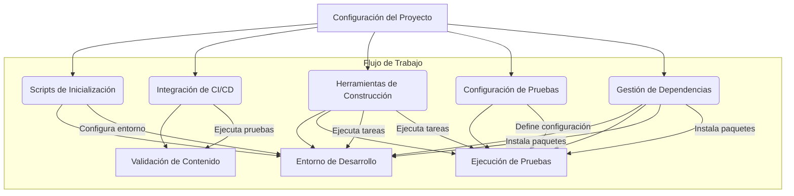

# Módulo de Construcción, CI y Configuración

Este módulo abarca los componentes esenciales para la configuración del proyecto, el proceso de construcción, la integración continua (CI) y la gestión de dependencias. Su propósito principal es asegurar que el entorno de desarrollo sea coherente, que las pruebas se ejecuten automáticamente y que el proyecto pueda ser construido y desplegado de manera eficiente.

## Visión General de la Arquitectura

La arquitectura de este módulo se centra en la orquestación de varias herramientas y scripts para automatizar las tareas de desarrollo y despliegue. Los componentes principales incluyen archivos de configuración, scripts de inicialización, flujos de trabajo de CI y herramientas de construcción.

*Diagrama 1: Visión General de la Arquitectura del Módulo de Construcción, CI y Configuración.*

## Submódulos

Este módulo se divide en los siguientes submódulos, cada uno con responsabilidades específicas:

*   **[Configuración del Proyecto](Build,_CI___Configuration/Build,_CI___Configuration_configuracion_proyecto.md)**: Gestiona los archivos de configuración generales que definen el comportamiento del proyecto, incluyendo la configuración de CodeWiki, las configuraciones web y el bloqueo de habilidades.
*   **[Scripts de Inicialización](Build,_CI___Configuration/Build,_CI___Configuration_scripts_inicializacion.md)**: Contiene scripts Bash para la instalación inicial del entorno de desarrollo y para las tareas de reconciliación que se ejecutan al inicio de cada sesión.
*   **[Integración de CI/CD](Build,_CI___Configuration/Build,_CI___Configuration_integracion_ci_cd.md)**: Define los flujos de trabajo de GitHub Actions para la validación automática del contenido editorial y las dependencias del proyecto.
*   **[Herramientas de Construcción (Makefile)](Build,_CI___Configuration/Build,_CI___Configuration_herramientas_construccion_makefile.md)**: Proporciona objetivos para tareas comunes de desarrollo como la ejecución de pruebas y la instalación de dependencias de prueba.
*   **[Configuración de Pruebas](Build,_CI___Configuration/Build,_CI___Configuration_configuracion_pruebas.md)**: Incluye archivos de configuración para el entorno de pruebas de Python, como la configuración de Pytest.
*   **[Gestión de Dependencias](Build,_CI___Configuration/Build,_CI___Configuration_gestion_dependencias.md)**: Administra las dependencias de Python del proyecto, asegurando que todas las librerías necesarias estén instaladas para el desarrollo y las pruebas, y define cómo se empaqueta el proyecto.

---

### Ver también

