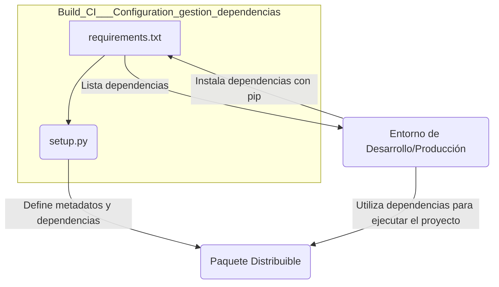
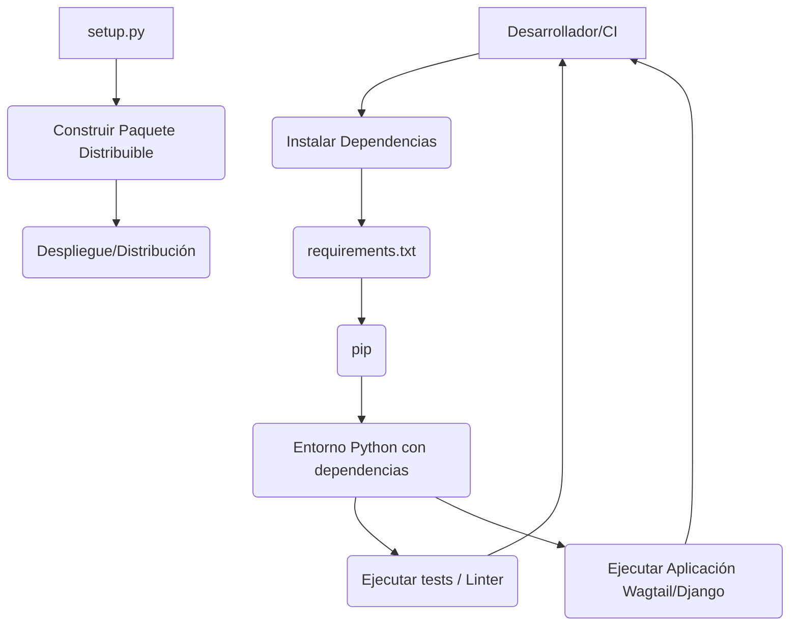

# Build,_CI___Configuration_gestion_dependencias

Este módulo es fundamental para la gestión de las dependencias del proyecto, asegurando que todas las bibliotecas y paquetes necesarios para el desarrollo, pruebas y despliegue de la aplicación estén correctamente definidos e instalados. Se compone principalmente de `requirements.txt` para listar las dependencias y `setup.py` para la configuración de la distribución del paquete.

## Propósito y Funcionalidad Principal

El módulo `Build,_CI___Configuration_gestion_dependencias` se encarga de:

1.  **Definir Dependencias**: Especifica con precisión las bibliotecas externas y sus versiones que el proyecto requiere para funcionar. Esto incluye dependencias de tiempo de ejecución, desarrollo y pruebas.
2.  **Facilitar la Instalación**: Proporciona los mecanismos para instalar estas dependencias de manera consistente en diferentes entornos.
3.  **Configurar la Distribución del Proyecto**: Prepara el proyecto para su empaquetado y distribución como una biblioteca Python.

### `requirements.txt`

El archivo `requirements.txt` es un componente central para la definición de dependencias. Contiene una lista de paquetes Python que deben ser instalados para que la aplicación se ejecute correctamente.

**Funcionalidad clave:**

*   **Listado de dependencias**: Enumera cada paquete con su versión específica o un rango de versiones.
*   **Gestión de dependencias de terceros**: Incluye bibliotecas como `Django`, `wagtail`, `celery`, `pytest`, `ShopifyAPI`, entre otras, que son cruciales para las funcionalidades de la aplicación, el CMS y la integración con Shopify.
*   **Dependencias de desarrollo y CI/CD**: También incluye paquetes utilizados en el desarrollo y la integración continua, como `pytest-django` para pruebas y `django-eventstream` para la comunicación en tiempo real.
*   **Dependencias locales**: Hace referencia a paquetes instalados directamente desde el repositorio, como `django-ninja` desde un repositorio de Git específico y `django-react-ui_editor` como un contenedor SPA local.

### `setup.py`

El archivo `setup.py` es el script principal para construir y distribuir el paquete Python del proyecto. Utiliza `setuptools` para gestionar la configuración del proyecto.

**Funcionalidad clave:**

*   **Definición de metadatos del paquete**: Establece el `name` (`wagtail-shopify`), `version` (`0.2.0`) y `description` del proyecto.
*   **Descubrimiento de paquetes**: Utiliza `find_packages` para localizar automáticamente todos los paquetes de la aplicación, excluyendo directorios como `frontend`, `scripts`, `bin`, `docs` y `tests`.
*   **Inclusión de datos del paquete**: La configuración `include_package_data=True` asegura que los archivos no-Python (como plantillas, archivos estáticos, etc.) definidos en `MANIFEST.in` sean incluidos en el paquete distribuible.
*   **Instalación de dependencias**: Lee las dependencias directamente desde `requirements.txt` y las pasa al parámetro `install_requires`, garantizando que todas las dependencias listadas se instalen junto con el paquete principal.
*   **Requisito de versión de Python**: Especifica que el proyecto requiere Python 3.11 o superior (`python_requires=">=3.11"`) .

## Arquitectura y Relaciones entre Componentes

Este módulo de gestión de dependencias está estrechamente ligado a los procesos de construcción y prueba del proyecto.

### Diagrama de Relación de Componentes



**Explicación del diagrama:**

*   `requirements.txt` lista todas las dependencias externas.
*   `setup.py` lee estas dependencias de `requirements.txt` para incluirlas en la configuración de instalación del paquete.
*   Tanto el entorno de desarrollo/producción como el paquete distribuible dependen de las bibliotecas especificadas en `requirements.txt`.
*   La flecha de `D` a `A` y de `D` a `C` representa cómo un entorno utiliza las definiciones para instalar y ejecutar el software.

### Uso en el Proceso de Construcción y Pruebas

El archivo `requirements.txt` es directamente consumido por las herramientas de gestión de paquetes de Python (como `pip`) y por los scripts de construcción. Por ejemplo, el `Makefile` del proyecto utiliza `requirements.txt` para instalar dependencias de prueba, como se observa en la regla `install-test-deps`:

```makefile
install-test-deps:
        $(VENV_PYTHON) -m pip install -r requirements.txt
```

Esto demuestra la integración directa de `requirements.txt` en el proceso de construcción y CI.

## Cómo el Módulo Encaja en el Sistema General

El módulo `Build,_CI___Configuration_gestion_dependencias` es una parte fundamental de la estrategia general de construcción, CI y configuración del proyecto.

1.  **Base para el Entorno de Desarrollo**: Proporciona una forma estándar para que los desarrolladores configuren sus entornos de trabajo, asegurando que todos tengan las mismas versiones de las bibliotecas.
2.  **Integración Continua (CI)**: Los pipelines de CI, como los definidos en `.github/workflows/content-validate.yml` (ver [Build,_CI___Configuration/Build,_CI___Configuration_integracion_ci_cd.md](Build,_CI___Configuration_integracion_ci_cd.md)), dependen de `requirements.txt` para instalar las dependencias antes de ejecutar pruebas o validaciones. Esto garantiza que las pruebas se realicen en un entorno consistente.
3.  **Empaquetado y Despliegue**: `setup.py` es esencial para crear paquetes distribuibles de la aplicación (`.whl` o `.tar.gz`), que pueden ser instalados en entornos de producción o de prueba. Las dependencias especificadas garantizan que el paquete se instale con todo lo necesario.
4.  **Gestión de Versiones**: Al especificar versiones de paquetes, se mitigan los problemas de compatibilidad y se asegura la reproducibilidad de las construcciones a lo largo del tiempo.
5.  **Relación con la Configuración de Pruebas**: Las dependencias de prueba como `pytest` y `pytest-django` son listadas en `requirements.txt` y son fundamentales para el módulo de [Build,_CI___Configuration/Build,_CI___Configuration_configuracion_pruebas.md](Build,_CI___Configuration_configuracion_pruebas.md).

### Diagrama de Flujo de Dependencias en el Sistema



**Explicación del diagrama:**

*   Un desarrollador o un sistema de CI inicia el proceso de instalación de dependencias leyendo `requirements.txt`.
*   `pip` utiliza este archivo para descargar e instalar los paquetes en el entorno Python.
*   Una vez que el entorno está configurado con todas las dependencias, la aplicación puede ejecutar sus pruebas (`F`), linter, o la propia aplicación (`G`).
*   `setup.py` se utiliza para construir un paquete distribuible que contiene el código del proyecto y las instrucciones para instalar sus dependencias.
*   Este paquete distribuible se utiliza para despliegue o distribución a otros usuarios.

Este módulo, por lo tanto, actúa como la columna vertebral para la consistencia del entorno y la capacidad de distribución del proyecto en todo su ciclo de vida.