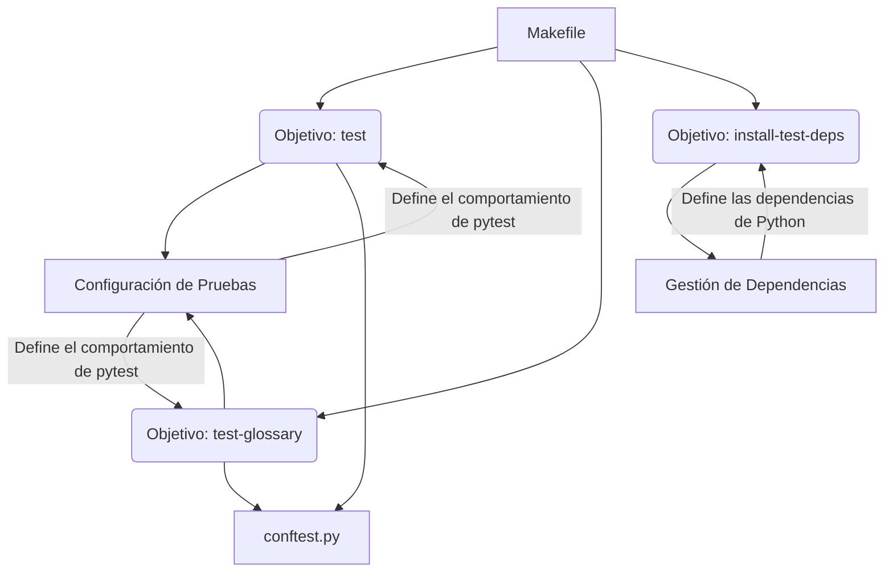

# Herramientas de Construcción (Makefile)

Este submódulo se centra en el `Makefile`, un archivo que define tareas y comandos para automatizar el proceso de construcción, prueba y gestión de dependencias del proyecto. Es una herramienta fundamental para desarrolladores y sistemas de integración continua, ya que permite ejecutar operaciones complejas con comandos simples.

## Componentes Clave

### `Makefile`

El `Makefile` es el corazón de este submódulo. Define varios objetivos (targets) que pueden ser ejecutados desde la línea de comandos para realizar tareas específicas. Utiliza `VENV_PYTHON` para referenciar el intérprete de Python dentro del entorno virtual y `PYTEST` para la ejecución de pruebas.

```makefile
.PHONY: test test-glossary install-test-deps

VENV_PYTHON := .venv/bin/python
PYTEST := $(VENV_PYTHON) -m pytest

test:
	$(PYTEST)

test-glossary:
	$(PYTEST) shopify_content/tests/test_glossary.py metaobjects/shopify_metaobjects/tests/test_client.py

install-test-deps:
	$(VENV_PYTHON) -m pip install -r requirements.txt
```

#### Objetivos Principales:

*   **`test`**: Este objetivo ejecuta todas las pruebas del proyecto utilizando `pytest`. Se basa en la configuración de `pytest.ini` para descubrir y ejecutar los archivos de prueba. (Referencia: [Configuración de Pruebas](Build,_CI___Configuration_configuracion_pruebas.md))

    ```bash
    make test
    ```

*   **`test-glossary`**: Un objetivo específico para ejecutar pruebas relacionadas con el glosario de contenido y el cliente de metaobjetos de Shopify. Esto permite una ejecución de pruebas más granular y enfocada.

    ```bash
    make test-glossary
    ```

*   **`install-test-deps`**: Este objetivo instala las dependencias de Python necesarias para la ejecución de pruebas, tal como se definen en `requirements.txt`. Es crucial para asegurar que el entorno de prueba esté correctamente configurado. (Referencia: [Gestión de Dependencias](Build,_CI___Configuration_gestion_dependencias.md))

    ```bash
    make install-test-deps
    ```

## Relación con otros componentes

El `Makefile` interactúa estrechamente con otros componentes del módulo:

*   **[Configuración de Pruebas](Build,_CI___Configuration_configuracion_pruebas.md)** (`pytest.ini`, `conftest.py`): El `Makefile` invoca `pytest` para ejecutar las pruebas, lo que significa que la configuración definida en estos archivos influye directamente en cómo se descubren y ejecutan las pruebas.
*   **[Gestión de Dependencias](Build,_CI___Configuration_gestion_dependencias.md)** (`requirements.txt`, `setup.py`): El objetivo `install-test-deps` se basa en `requirements.txt` para instalar las dependencias necesarias. `setup.py` también se relaciona con la gestión de dependencias al definir cómo se empaqueta el proyecto.
*   **[Scripts de Inicialización](Build,_CI___Configuration_scripts_inicializacion.md)** (`install.sh`, `start.sh`): Los scripts de inicialización, especialmente `install.sh`, son responsables de configurar el entorno virtual y las dependencias base, que luego son utilizadas por el `Makefile`.
*   **[Integración de CI/CD](Build,_CI___Configuration_integracion_ci_cd.md)** (`content-validate.yml`): Los flujos de trabajo de CI en GitHub Actions pueden invocar los objetivos del `Makefile` para ejecutar pruebas o instalar dependencias como parte del proceso de validación automática.



*Diagrama 1: Relación de Makefile con los componentes de prueba y dependencias.*