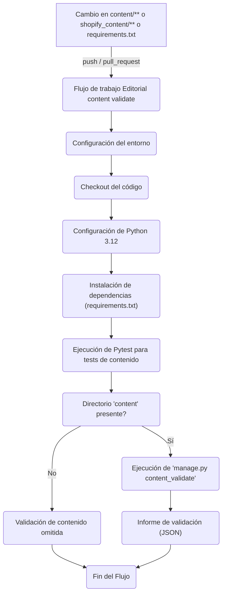

El módulo `Build,_CI___Configuration_integracion_ci_cd` gestiona la integración continua y el despliegue continuo (CI/CD) para la validación del contenido editorial. Su propósito principal es asegurar que cualquier cambio en el contenido o en la lógica relacionada con el almacenamiento del contenido pase por un proceso de validación automatizado antes de ser integrado.

## Arquitectura y Relaciones entre Componentes

Este módulo se centra en el flujo de trabajo definido en `.github/workflows/content-validate.yml`, que automatiza la validación del contenido.

### Flujo de Validación de Contenido

El flujo de trabajo `content-validate.yml` se activa automáticamente en eventos `push` y `pull_request` cuando se detectan cambios en archivos específicos.



**Componentes Clave:**

*   **`.github/workflows/content-validate.yml`**: Este archivo define el flujo de trabajo de GitHub Actions.
    *   **`name: Editorial content validate`**: Nombre descriptivo del flujo de trabajo.
    *   **`on`**: Define los disparadores del flujo de trabajo:
        *   `push`: Se activa cuando se suben cambios a las ramas principales y los `paths` modificados incluyen `content/**`, `shopify_content/content_store/**`, `shopify_content/tests/**` o `requirements.txt`.
        *   `pull_request`: Se activa cuando se abre o actualiza una pull request y los `paths` modificados incluyen `content/**`, `shopify_content/**` o `requirements.txt`.
    *   **`jobs: validate`**: Define el único trabajo de validación.
        *   `runs-on: ubuntu-latest`: Especifica que el trabajo se ejecuta en un entorno Ubuntu.
        *   `steps`: Secuencia de acciones a realizar:
            *   `actions/checkout@v4`: Clona el repositorio.
            *   `actions/setup-python@v5`: Configura el entorno Python (versión 3.12).
            *   `Install dependencies`: Instala las dependencias listadas en `requirements.txt` en un entorno virtual. Para más detalles sobre la gestión de dependencias, consulte [Gestión de Dependencias](Build,_CI___Configuration_gestion_dependencias.md).
            *   `Pytest shopify_content content store`: Ejecuta un subconjunto de tests Pytest relacionados con la lógica de almacenamiento y validación del contenido en `shopify_content/tests/`. Para más información sobre la configuración de pruebas, consulte [Configuración de Pruebas](Build,_CI___Configuration_configuracion_pruebas.md).
            *   `content_validate (if content tree present)`: Ejecuta el comando de gestión de Django `manage.py content_validate --json` si el directorio `content` existe. Este comando es crucial para validar la estructura y el contenido del árbol de contenido. El `|| true` asegura que el flujo de trabajo no falle inmediatamente si la validación encuentra errores, permitiendo un informe completo. La variable de entorno `DJANGO_SETTINGS_MODULE` se establece en `config.settings_test` para esta ejecución.

## Encaje en el Sistema General

Este módulo es fundamental para mantener la calidad y consistencia del contenido editorial dentro del sistema.

*   **Calidad del Contenido**: Al validar automáticamente los cambios en el directorio `content/`, asegura que el contenido siga las reglas y estructuras definidas, previniendo errores antes de su despliegue.
*   **Integridad del Código**: La ejecución de pruebas unitarias (`Pytest`) para `shopify_content/content_store` y `shopify_content/tests` garantiza que la lógica subyacente que maneja el contenido funcione correctamente.
*   **Automatización de Desarrollo**: Reduce la carga manual de validación y pruebas, permitiendo a los desarrolladores centrarse en la creación de nuevas características y contenido.
*   **Parte del Ciclo de Vida del Desarrollo**: Se integra directamente en el ciclo de vida de desarrollo, ejecutándose en cada `push` y `pull_request`, lo que fomenta un enfoque de "shifting left" en la detección de problemas.
*   **Dependencia con la Configuración de Pruebas**: Utiliza las configuraciones de prueba definidas en módulos como [Configuración de Pruebas](Build,_CI___Configuration_configuracion_pruebas.md) para ejecutar sus validaciones.
*   **Dependencia con la Gestión de Dependencias**: Depende del archivo `requirements.txt` gestionado en [Gestión de Dependencias](Build,_CI___Configuration_gestion_dependencias.md) para la instalación de sus dependencias.


El módulo `Build,_CI___Configuration_integracion_ci_cd` gestiona la integración continua y el despliegue continuo (CI/CD) para la validación del contenido editorial. Su propósito principal es asegurar que cualquier cambio en el contenido o en la lógica relacionada con el almacenamiento del contenido pase por un proceso de validación automatizado antes de ser integrado.

## Arquitectura y Relaciones entre Componentes

Este módulo se centra en el flujo de trabajo definido en `.github/workflows/content-validate.yml`, que automatiza la validación del contenido.

### Flujo de Validación de Contenido

El flujo de trabajo `content-validate.yml` se activa automáticamente en eventos `push` y `pull_request` cuando se detectan cambios en archivos específicos.

```mermaid
graph TD
    A[Cambio en content/** o shopify_content/** o requirements.txt] -- push / pull_request --> B(Flujo de trabajo "Editorial content validate")
    B --> C{Configuración del entorno}
    C --> D[Checkout del código]
    D --> E[Configuración de Python 3.12]
    E --> F[Instalación de dependencias (requirements.txt)]
    F --> G[Ejecución de Pytest para tests de contenido]
    G --> H{Directorio 'content' presente?}
    H -- Sí --> I[Ejecución de 'manage.py content_validate']
    H -- No --> J[Validación de contenido omitida]
    I --> K[Informe de validación (JSON)]
    J --> L[Fin del Flujo]
    K --> L
```

**Componentes Clave:**

*   **`.github/workflows/content-validate.yml`**: Este archivo define el flujo de trabajo de GitHub Actions.
    *   **`name: Editorial content validate`**: Nombre descriptivo del flujo de trabajo.
    *   **`on`**: Define los disparadores del flujo de trabajo:
        *   `push`: Se activa cuando se suben cambios a las ramas principales y los `paths` modificados incluyen `content/**`, `shopify_content/content_store/**`, `shopify_content/tests/**` o `requirements.txt`.
        *   `pull_request`: Se activa cuando se abre o actualiza una pull request y los `paths` modificados incluyen `content/**`, `shopify_content/**` o `requirements.txt`.
    *   **`jobs: validate`**: Define el único trabajo de validación.
        *   `runs-on: ubuntu-latest`: Especifica que el trabajo se ejecuta en un entorno Ubuntu.
        *   `steps`: Secuencia de acciones a realizar:
            *   `actions/checkout@v4`: Clona el repositorio.
            *   `actions/setup-python@v5`: Configura el entorno Python (versión 3.12).
            *   `Install dependencies`: Instala las dependencias listadas en `requirements.txt` en un entorno virtual. Para más detalles sobre la gestión de dependencias, consulte [Gestión de Dependencias](Build,_CI___Configuration_gestion_dependencias.md).
            *   `Pytest shopify_content content store`: Ejecuta un subconjunto de tests Pytest relacionados con la lógica de almacenamiento y validación del contenido en `shopify_content/tests/`. Para más información sobre la configuración de pruebas, consulte [Configuración de Pruebas](Build,_CI___Configuration_configuracion_pruebas.md).
            *   `content_validate (if content tree present)`: Ejecuta el comando de gestión de Django `manage.py content_validate --json` si el directorio `content` existe. Este comando es crucial para validar la estructura y el contenido del árbol de contenido. El `|| true` asegura que el flujo de trabajo no falle inmediatamente si la validación encuentra errores, permitiendo un informe completo. La variable de entorno `DJANGO_SETTINGS_MODULE` se establece en `config.settings_test` para esta ejecución.

## Encaje en el Sistema General

Este módulo es fundamental para mantener la calidad y consistencia del contenido editorial dentro del sistema.

*   **Calidad del Contenido**: Al validar automáticamente los cambios en el directorio `content/`, asegura que el contenido siga las reglas y estructuras definidas, previniendo errores antes de su despliegue.
*   **Integridad del Código**: La ejecución de pruebas unitarias (`Pytest`) para `shopify_content/content_store` y `shopify_content/tests` garantiza que la lógica subyacente que maneja el contenido funcione correctamente.
*   **Automatización de Desarrollo**: Reduce la carga manual de validación y pruebas, permitiendo a los desarrolladores centrarse en la creación de nuevas características y contenido.
*   **Parte del Ciclo de Vida del Desarrollo**: Se integra directamente en el ciclo de vida de desarrollo, ejecutándose en cada `push` y `pull_request`, lo que fomenta un enfoque de "shifting left" en la detección de problemas.
*   **Dependencia con la Configuración de Pruebas**: Utiliza las configuraciones de prueba definidas en módulos como [Configuración de Pruebas](Build,_CI___Configuration_configuracion_pruebas.md) para ejecutar sus validaciones.
*   **Dependencia con la Gestión de Dependencias**: Depende del archivo `requirements.txt` gestionado en [Gestión de Dependencias](Build,_CI___Configuration_gestion_dependencias.md) para la instalación de sus dependencias.
