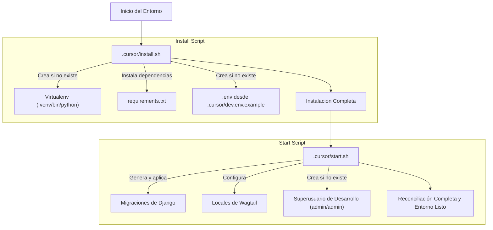

# Scripts de Inicialización

Este módulo contiene los scripts de shell esenciales para la inicialización y configuración de un entorno de desarrollo para el proyecto. Estos scripts, `.cursor/install.sh` y `.cursor/start.sh`, automatizan las tareas de configuración inicial del repositorio, la gestión de dependencias y la reconciliación de la base de datos y usuarios.

## Propósito y Funcionalidad Principal

El módulo `Build,_CI___Configuration_scripts_inicializacion` es fundamental para establecer un entorno de trabajo consistente y reproducible. Facilita la configuración inicial y la preparación del entorno para el desarrollo y la operación, especialmente en entornos de Cloud Agent.

### .cursor/install.sh

El script `install.sh` se encarga del bootstrapping inicial del repositorio de manera *idempotente*. Esto significa que puede ejecutarse múltiples veces sin causar efectos secundarios no deseados y siempre dejará el sistema en el mismo estado. Sus funciones principales incluyen:

*   **Creación de un entorno virtual**: Si no existe un entorno virtual de Python en `.venv/`, este script lo crea utilizando `python3 -m venv .venv`.
*   **Instalación de dependencias de Python**: Actualiza `pip` e instala todas las dependencias listadas en el archivo `requirements.txt`. Para más detalles sobre la gestión de dependencias, consulte [Gestión de Dependencias](Build,_CI___Configuration_gestion_dependencias.md).
*   **Inicialización del archivo .env**: Si no existe un archivo `.env`, se crea copiando el archivo de ejemplo `.cursor/dev.env.example`, que contiene configuraciones básicas para el desarrollo.

### .cursor/start.sh

El script `start.sh` realiza tareas de reconciliación *per-boot* (por cada inicio), también de manera *idempotente*. Estas tareas son cruciales para asegurar que la aplicación esté en un estado operativo después de un inicio o una actualización. Sus funciones principales son:

*   **Generación de migraciones de Django**: Ejecuta `manage.py makemigrations` para generar cualquier migración de base de datos faltante basada en los modelos actuales del proyecto.
*   **Aplicación de migraciones de Django**: Ejecuta `manage.py migrate` para aplicar todas las migraciones pendientes a la base de datos.
*   **Aseguramiento de locales de Wagtail**: Ejecuta `manage.py setup_locales` para garantizar que los locales necesarios de Wagtail estén configurados. Consulte [Comandos de Definición y Configuración de Metaobjetos](../Wagtail_Content_Management___API/Shopify_Content_Management/Metaobject_Definition___Setup_Commands.md) para más información.
*   **Provisión de superusuario de desarrollo**: Crea un superusuario de Django (admin/admin) si aún no existe, facilitando el acceso al panel de administración de Wagtail y la SPA `/cms/`.

## Arquitectura y Relaciones entre Componentes

Los scripts de inicialización forman un flujo secuencial que prepara el entorno para el desarrollo. `install.sh` establece la base, mientras que `start.sh` se encarga de las configuraciones específicas de la aplicación.

### Relaciones

*   **`install.sh`** depende de:
    *   El archivo `requirements.txt` para la instalación de dependencias Python.
    *   El archivo `.cursor/dev.env.example` para la configuración inicial del entorno.
*   **`start.sh`** depende de:
    *   El entorno virtual de Python creado por `install.sh` (específicamente `.venv/bin/python`).
    *   Los comandos de gestión de Django (`manage.py`).
    *   El comando `setup_locales` que es parte del módulo de [Comandos de Definición y Configuración de Metaobjetos](../Wagtail_Content_Management___API/Shopify_Content_Management/Metaobject_Definition___Setup_Commands.md).

## Cómo el Módulo Encaja en el Sistema General

Estos scripts son la primera línea de defensa para la consistencia del entorno de desarrollo y CI/CD.

*   **Entorno de Desarrollo**: Son la forma recomendada para que un nuevo desarrollador configure su entorno local.
*   **Integración Continua (CI)**: En un pipeline de CI, `install.sh` se ejecutaría para preparar el entorno de construcción, seguido de `start.sh` para asegurar que la base de datos y la configuración de la aplicación sean correctas antes de ejecutar pruebas o desplegar. Para la integración con CI/CD, vea [Integración CI/CD](Build,_CI___Configuration_integracion_ci_cd.md).
*   **Despliegue de Cloud Agent**: Dada su naturaleza idempotente, estos scripts son ideales para ser ejecutados en entornos de agente en la nube al inicio o reinicio, asegurando que el estado del servicio sea siempre el esperado.

Este módulo minimiza la intervención manual y estandariza el proceso de configuración del proyecto, lo que es crucial para la mantenibilidad y escalabilidad del sistema.