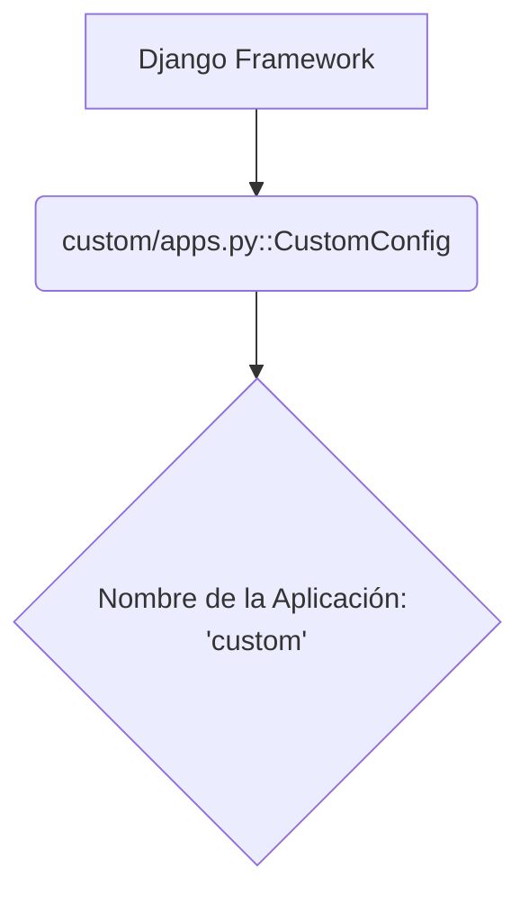

# Personalización

Este módulo (`Customization`) se encarga de la configuración específica de la aplicación a través de la clase `CustomConfig`, que hereda de `django.apps.AppConfig`. Su propósito principal es definir metadatos para la aplicación y permitir la ejecución de código de inicialización cuando Django arranca.

## Arquitectura y Relaciones de Componentes

El componente central de este módulo es `CustomConfig`.

### `custom/apps.py::CustomConfig`

La clase `CustomConfig` es una subclase de `django.apps.AppConfig`. En Django, `AppConfig` es el mecanismo estándar para:
-   Configurar atributos de una aplicación, como su nombre.
-   Realizar la configuración de la aplicación y la introspección.
-   Definir señales o realizar otras tareas de inicialización cuando Django carga la aplicación.

En este módulo, `CustomConfig` simplemente define el nombre de la aplicación como `'custom'`. Esto es fundamental para que Django pueda descubrir y cargar correctamente la aplicación `custom` dentro del proyecto.

## Flujo de Datos y Operaciones

Cuando el servidor Django arranca:
1.  Django busca configuraciones de aplicaciones (`AppConfig`) en las aplicaciones listadas en `INSTALLED_APPS` en los ajustes del proyecto.
2.  Descubre `CustomConfig` en el módulo `custom/apps.py`.
3.  Utiliza la información proporcionada por `CustomConfig` (en este caso, `name = 'custom'`) para registrar la aplicación.

Este módulo no maneja flujos de datos complejos ni operaciones directas, sino que actúa como un punto de configuración y metadatos para la aplicación `custom` dentro del ecosistema de Django.

## Integración con el Sistema General

El módulo `Customization` es un componente de bajo nivel que se integra directamente con el framework Django. Su función es habilitar la aplicación `custom` como una aplicación de Django, permitiendo que otros módulos y el resto del sistema hagan referencia a ella y utilicen sus modelos, vistas, etc., si los tuviera.

Aunque actualmente solo define el nombre de la aplicación, este módulo puede extenderse en el futuro para incluir lógica de inicialización más compleja, configuración de señales o verificaciones de consistencia de datos al inicio de la aplicación.

Para entender cómo se configuran y construyen las dependencias del sistema, consulte el módulo [Build, CI & Configuration](Build,_CI___Configuration.md).
