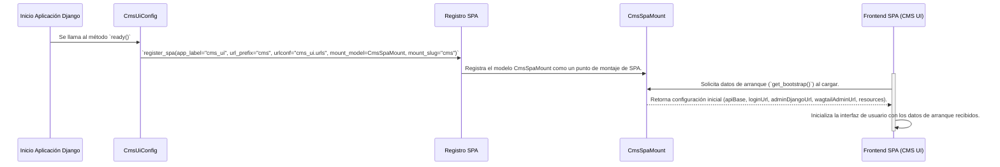
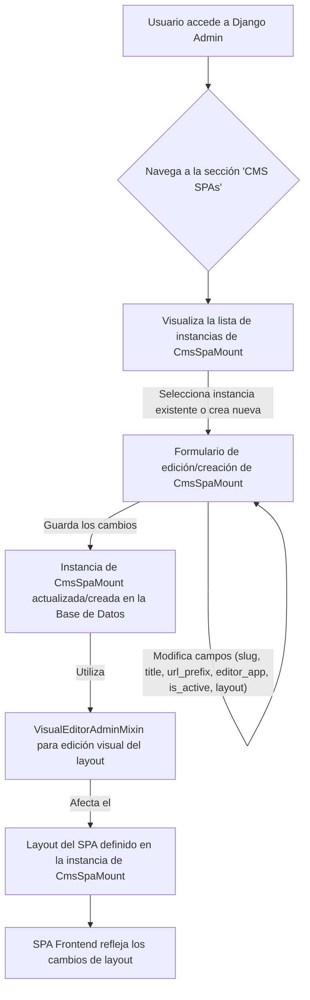

# Integración CMS UI: CmsSpaMount

El módulo `CMS_UI_Integration_CmsSpaMount` es un componente crucial para la integración de una Single Page Application (SPA) de gestión de contenido dentro del ecosistema Django/Wagtail. Este módulo facilita el montaje de una interfaz de usuario CMS basada en React, permitiendo a los comerciantes editar y gestionar contenido de Shopify a través de una experiencia de usuario moderna y dedicada, separada de la interfaz de administración tradicional de Wagtail. Se apoya en el framework `django_react_ui_editor` para su funcionalidad base.

## Arquitectura y Componentes

Este módulo define el modelo de datos para un montaje de SPA, su integración en la interfaz de administración de Django y su configuración inicial al arrancar la aplicación.

### Diagrama de Arquitectura

```mermaid
graph TD
    subgraph Frontend (Interfaz de Usuario CMS)
        SPA[SPA de CMS (React)]
    end

    subgraph Backend (Django/Wagtail)
        direction LR
        A[Aplicación Django] --> B(cms_ui.apps.CmsUiConfig)
        B --> C{Registro SPA}
        C -- Registra --> D[django_react_ui_editor.spa_registry::register_spa]
        D --> E(cms_ui.models.CmsSpaMount)
        E -- Hereda de --> F[django_react_ui_editor.models.SpaMount]
        E -- Administrado por --> G(cms_ui.admin.CmsSpaMountAdmin)
        G -- Utiliza --> H[django_react_ui_editor.admin.VisualEditorAdminMixin]
        I[Base de Datos] -- Migraciones --> J(cms_ui.migrations.0001_initial_cms_spa_mount.py::Migration)
        J -- Crea tabla para --> E
        E -- Proporciona datos de inicio a --> SPA
    end

    SPA <--> E
    G <--> E
```
**Pie de Diagrama:** Este diagrama ilustra la arquitectura del módulo `CMS_UI_Integration_CmsSpaMount`, mostrando sus componentes clave y cómo se relacionan entre sí y con el frontend del SPA.

### Diagrama de Flujo de Datos e Interacción (Inicialización del SPA)


**Pie de Diagrama:** Este diagrama de secuencia detalla el proceso de inicialización del SPA de CMS, desde el inicio de la aplicación Django hasta que el frontend del SPA recibe sus datos de arranque.

### Flujo de Proceso: Administración de CmsSpaMount en Django Admin


**Pie de Diagrama:** Este diagrama de flujo describe el proceso de cómo un administrador interactúa con el modelo `CmsSpaMount` a través de la interfaz de administración de Django, incluyendo la capacidad de edición visual.

## Integración con el Sistema General

El módulo `CMS_UI_Integration_CmsSpaMount` se integra en la plataforma de gestión de contenido al proporcionar una interfaz de usuario dedicada para la edición de contenido, aprovechando la flexibilidad de una SPA.

-   **Framework de Editor UI de React-Django:** Este módulo es una implementación específica del framework general [Django_React_UI_Editor_Framework.md](../Django_React_UI_Editor_Framework.md), utilizando sus modelos (`SpaMount`) y mixins de administración (`VisualEditorAdminMixin`). Esto permite que el SPA de CMS herede funcionalidades como el registro automático de SPAs y la integración con la administración de Django.
-   **API de Contenido de Shopify:** La configuración `bootstrap` proporcionada por `CmsSpaMount` incluye `apiBase: "/api/v1"` y una lista de `resources` como "glossary", "products", "collections", "blogs", "articles", y "locations". Esto indica que el SPA interactúa directamente con la [Shopify_Content_API.md](../Shopify_Content_API.md) para gestionar y recuperar datos de contenido.
-   **Administración Wagtail:** Aunque el SPA proporciona una interfaz de edición separada, el valor `wagtailAdminUrl: "/admin/"` en los datos de arranque sugiere que aún puede haber enlaces o accesos a la interfaz de administración de Wagtail si es necesario. Además, la presencia de `RestrictWagtailAdminMiddleware` en el módulo padre `CMS_UI_Integration` podría indicar un control de acceso para dirigir a los usuarios hacia el SPA de CMS como la interfaz principal de edición.
-   **Migraciones de Base de Datos:** El módulo incluye su propia migración (`0001_initial_cms_spa_mount.py`) para establecer la tabla `CmsSpaMount` en la base de datos, lo que es fundamental para persistir la configuración de los montajes del SPA.

## Componentes Core

### `cms_ui/admin.py::CmsSpaMountAdmin`

Esta clase registra el modelo `CmsSpaMount` en la interfaz de administración de Django. Extiende `VisualEditorAdminMixin` de `django_react_ui_editor.admin` para habilitar una experiencia de edición visual para el layout del SPA, permitiendo a los administradores configurar la estructura de la interfaz de usuario del CMS directamente desde Django Admin.
Define campos de visualización en lista, filtros y campos de búsqueda para facilitar la gestión.

### `cms_ui/apps.py::CmsUiConfig`

`CmsUiConfig` es la clase de configuración de la aplicación Django para `cms_ui`. En su método `ready()`, se encarga de registrar el SPA del CMS utilizando `django_react_ui_editor.spa_registry.register_spa`. Esta acción vital establece el `url_prefix` (e.g., "cms"), el `urlconf` asociado ("cms_ui.urls"), y vincula el modelo `CmsSpaMount` como el modelo de montaje para este SPA específico. Esto asegura que el SPA esté correctamente integrado y sea reconocible por el framework `django_react_ui_editor`.

### `cms_ui/models.py::CmsSpaMount`

El modelo `CmsSpaMount` hereda de `django_react_ui_editor.models.SpaMount`. Representa una instancia configurable del SPA de CMS en la base de datos.
Su método `get_bootstrap(self, request=None)` es fundamental, ya que proporciona los datos iniciales necesarios para que el frontend del SPA se inicialice correctamente. Esto incluye información como las URLs base de la API, las URLs de inicio de sesión y de administración, y una lista de recursos de contenido (glossary, products, collections, blogs, articles, locations) que el SPA gestionará.
La función `default_cms_layout()` proporciona una estructura de layout por defecto para las páginas del CMS, que puede ser utilizada o modificada para personalizar la interfaz del SPA.

### `cms_ui/models.py::CmsSpaMount.Meta`

Esta subclase `Meta` dentro de `CmsSpaMount` define metadatos específicos para el modelo, como `verbose_name` ("CMS SPA") y `verbose_name_plural` ("CMS SPAs"), que se utilizan para una representación más legible en la interfaz de administración de Django.

### `cms_ui/migrations/0001_initial_cms_spa_mount.py::Migration`

Esta migración inicial es responsable de crear la tabla `CmsSpaMount` en la base de datos de Django. Define todos los campos necesarios para el modelo, como `id`, `slug`, `title`, `url_prefix`, `editor_app`, `layout`, `is_active`, `created_at`, y `updated_at`, asegurando la persistencia de los datos de configuración del SPA.
