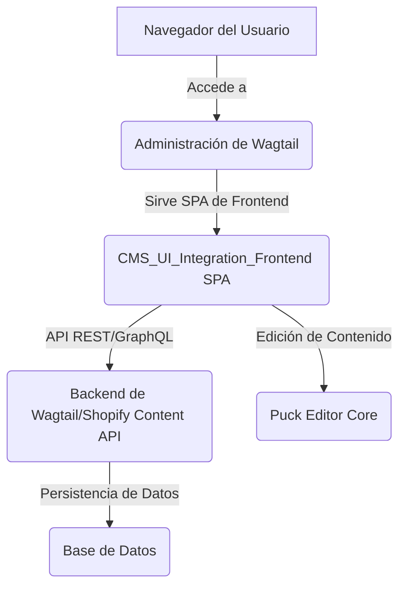
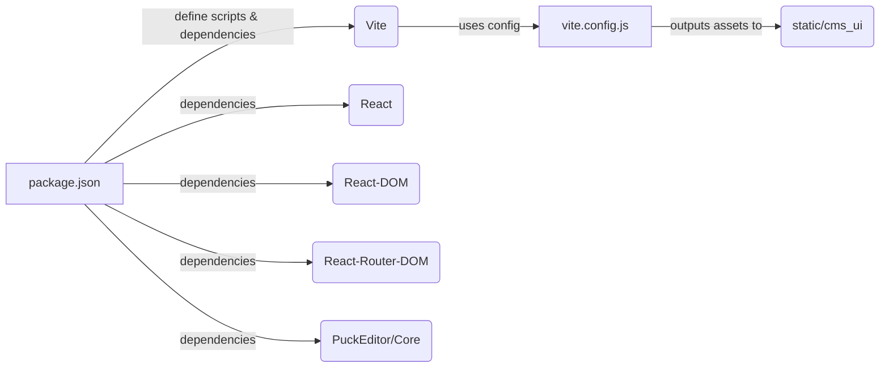
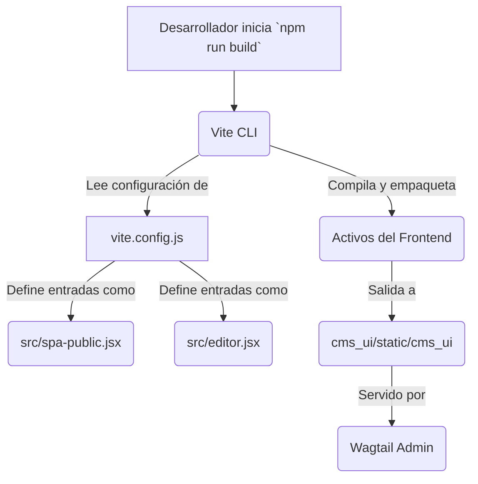
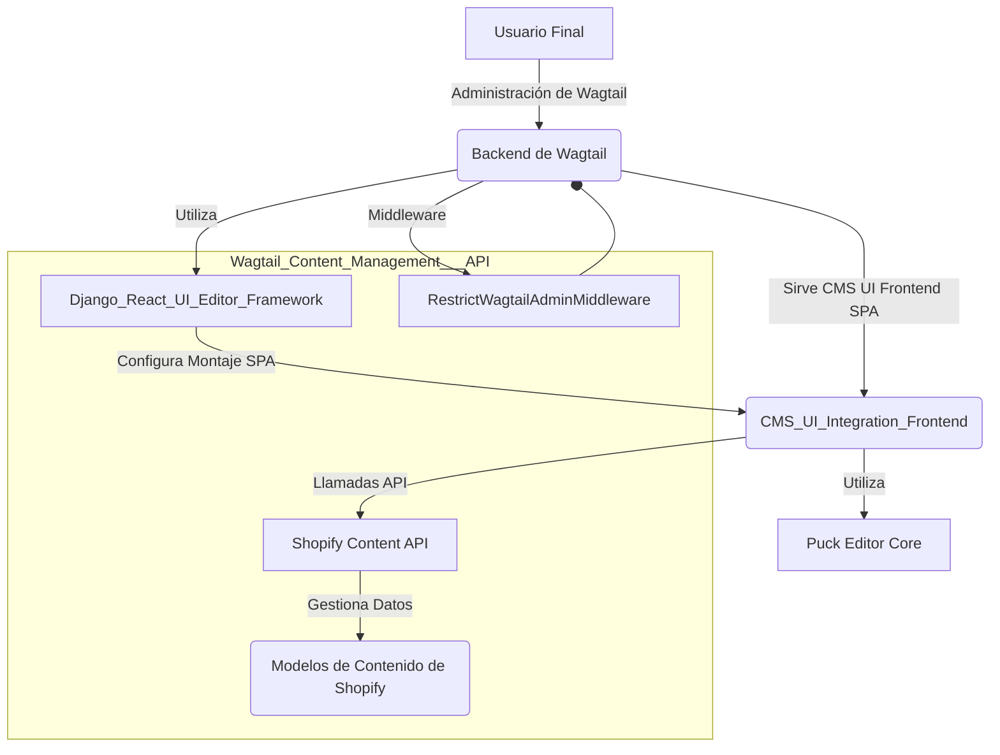

# Integración Frontend de la UI del CMS

Este documento describe el módulo `CMS_UI_Integration_Frontend`, que gestiona la interfaz de usuario (UI) de frontend para la integración del Sistema de Gestión de Contenidos (CMS) en Wagtail. Este módulo es crucial para proporcionar una experiencia de usuario rica e interactiva para la gestión de contenido.

## Propósito y Funcionalidad Principal

El módulo `CMS_UI_Integration_Frontend` es el componente de frontend de la interfaz de usuario del CMS. Está construido como una aplicación de página única (SPA) utilizando React y Vite, y está diseñado para integrarse perfectamente en el entorno administrativo de Wagtail.

Sus responsabilidades principales incluyen:
*   **Proporcionar una interfaz de usuario interactiva**: Permite a los editores gestionar el contenido de Shopify a través de una aplicación web moderna.
*   **Integración con Wagtail**: Se monta dentro de la administración de Wagtail, extendiendo sus capacidades para manejar tipos de contenido específicos de Shopify.
*   **Gestión de la experiencia del editor**: Ofrece herramientas y flujos de trabajo específicos para la creación y edición de contenido.
*   **Automatización del proceso de construcción**: Utiliza Vite para compilar y empaquetar los activos del frontend, asegurando un rendimiento óptimo.

## Arquitectura y Relaciones de Componentes

La arquitectura de este módulo se centra en una SPA basada en React, que interactúa con el backend de Wagtail.

### Diagrama de Arquitectura de Alto Nivel

**Explicación del Diagrama:**
*   El **Navegador del Usuario** interactúa con la **Administración de Wagtail**.
*   La **Administración de Wagtail** sirve la **CMS_UI_Integration_Frontend SPA** al navegador.
*   La **SPA** se comunica con el **Backend de Wagtail/Shopify Content API** para la gestión de datos.
*   El backend interactúa con la **Base de Datos** para la persistencia del contenido.
*   La SPA utiliza el **Puck Editor Core** para la funcionalidad de edición de contenido.

### Componentes del Frontend

Los componentes principales de este módulo frontend son:

*   **`cms_ui/frontend/package.json`**:
    *   Define los metadatos del proyecto, scripts de construcción (`dev`, `build`, `preview`) y gestiona las dependencias de JavaScript.
    *   **Dependencias clave**:
        *   `react`, `react-dom`, `react-router-dom`: Para la construcción de la interfaz de usuario.
        *   `@puckeditor/core`: Un potente editor de contenido que se integra en la SPA para una experiencia de edición rica.
    *   **DevDependencies clave**:
        *   `vite`, `@vitejs/plugin-react`: Herramientas de construcción rápidas para el desarrollo y despliegue del frontend.

*   **`cms_ui/frontend/vite.config.js`**:
    *   Configura el proceso de construcción de Vite para la SPA.
    *   Define los puntos de entrada para la aplicación (`spa-public.jsx` para la parte pública y `editor.jsx` para las funcionalidades del editor).
    *   Especifica el directorio de salida de la construcción (`../static/cms_ui`), donde los activos compilados se servirán estáticamente.

### Diagrama de Dependencias del Frontend

## Proceso de Construcción del Frontend

El proceso de construcción del frontend se gestiona a través de Vite, configurado por `vite.config.js`.

### Diagrama de Flujo del Proceso de Construcción

**Comandos de Construcción:**
*   **`npm run dev`**: Inicia el servidor de desarrollo de Vite para un desarrollo rápido con recarga en caliente.
*   **`npm run build`**: Compila los archivos JavaScript y CSS optimizados para producción en el directorio `cms_ui/static/cms_ui`.
*   **`npm run preview`**: Sirve los archivos compilados en producción localmente para previsualización.

## Integración en el Sistema General

Este módulo se integra con el sistema general de Wagtail y Shopify de la siguiente manera:

*   **Montaje de SPA**: La SPA de frontend se monta dentro del entorno de administración de Wagtail, específicamente en un `CmsSpaMount` (ver [CMS_UI_Integration_CmsSpaMount.md](CMS_UI_Integration_CmsSpaMount.md)). Esto permite que la aplicación de React se cargue como una parte nativa de la UI de Wagtail.
*   **Comunicación con el Backend**: La SPA se comunica con la [Shopify Content API](../Shopify_Content_API.md) (que forma parte de `Wagtail_Content_Management___API`) para realizar operaciones CRUD en el contenido.
*   **Middleware**: El middleware `RestrictWagtailAdminMiddleware` (definido en [CMS_UI_Integration_Management.md](CMS_UI_Integration_Management.md)) puede restringir el acceso a ciertas partes de la administración de Wagtail, posiblemente para asegurar que la SPA sea el punto de entrada principal para la gestión de contenido de Shopify.
*   **Dependencia del Editor de UI de Django/React**: Este módulo se basa en el marco `Django_React_UI_Editor_Framework` para el montaje y la gestión de la SPA dentro de Django/Wagtail.

### Diagrama de Integración del Sistema

**Referencias:**
*   [Shopify Content API](../Shopify_Content_API.md): Para la comunicación del frontend con el backend.
*   [CMS_UI_Integration_CmsSpaMount.md](CMS_UI_Integration_CmsSpaMount.md): Detalles sobre cómo se monta la SPA en Wagtail.
*   [CMS_UI_Integration_Management.md](CMS_UI_Integration_Management.md): Información sobre el middleware y comandos de gestión.
*   [Django_React_UI_Editor_Framework.md](../Django_React_UI_Editor_Framework.md): Detalles sobre el marco general para la integración de UI de React en Django.
