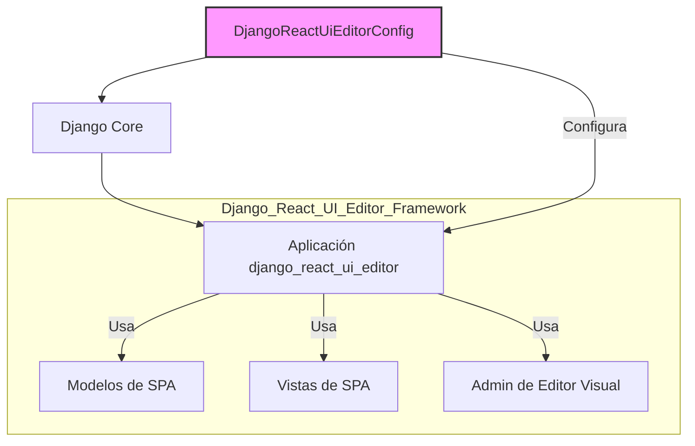
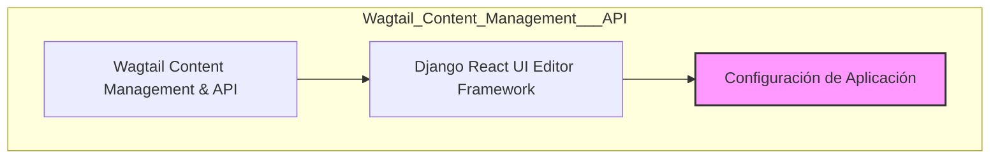

# Configuración de la Aplicación Django React UI Editor Framework

El módulo `Django_React_UI_Editor_Framework_Configuracion_Aplicacion` es fundamental para la inicialización y configuración del componente `django_react_ui_editor` dentro del entorno de Django. Define cómo Django reconoce y gestiona la aplicación, sentando las bases para la integración de un editor visual React en el CMS de Wagtail.

## Propósito y Funcionalidad Principal

El componente principal en este módulo es `DjangoReactUiEditorConfig` (`django_react_ui_editor/apps.py::DjangoReactUiEditorConfig`). Esta clase es una subclase de `django.apps.AppConfig` de Django, lo que significa que es la configuración principal para la aplicación `django_react_ui_editor`.

Sus atributos clave son:
*   `default_auto_field = "django.db.models.BigAutoField"`: Especifica el tipo de campo de clave primaria que Django debe usar automáticamente para los modelos de la aplicación. `BigAutoField` es un entero de 64 bits, lo que permite un rango más amplio de IDs.
*   `name = "django_react_ui_editor"`: Define el nombre canónico de la aplicación, que Django utiliza para localizarla y cargar sus componentes.
*   `verbose_name = "Django React UI Editor"`: Proporciona un nombre legible para la aplicación, que se muestra en la interfaz de administración de Django y en otros contextos donde se necesita una descripción más amigable.

En esencia, esta clase asegura que la aplicación `django_react_ui_editor` se registre correctamente con el framework de Django, permitiendo que sus modelos, vistas, administradores y otros componentes sean descubiertos y utilizados por el sistema.

## Arquitectura y Relaciones entre Componentes

La configuración de la aplicación `DjangoReactUiEditorConfig` es un punto de entrada esencial para el subsistema [Django React UI Editor Framework](../Django_React_UI_Editor_Framework.md). Su existencia permite que Django cargue la aplicación y, a su vez, que los demás componentes del framework del editor de UI (como los modelos de montaje de SPA, la integración del editor visual en el admin, etc.) funcionen correctamente.

### Diagrama de Componentes: Configuración de la Aplicación

**Descripción**: `DjangoReactUiEditorConfig` (A) configura el `Django Core` (B), que a su vez carga y gestiona la `Aplicación django_react_ui_editor` (C). Esta aplicación depende de otros componentes del framework como los `Modelos de SPA` (D), las `Vistas de SPA` (E) y el `Admin de Editor Visual` (F).

### Diagrama de Contexto: Framework del Editor de UI en el Sistema General

**Descripción**: El `Django React UI Editor Framework` (B), que incluye la `Configuración de Aplicación` (C), es un componente clave del sistema general de `Wagtail Content Management & API` (A). La configuración es el primer paso para que el framework sea operativo dentro de Wagtail.

## Cómo el Módulo se Integra en el Sistema General

Este módulo se integra en el sistema general al ser el punto de partida para que la funcionalidad del editor visual basado en React esté disponible. Sin `DjangoReactUiEditorConfig`, Django no sería capaz de reconocer el `django_react_ui_editor` como una aplicación instalada, lo que impediría la carga de sus rutas URL, modelos y lógica de negocio.

Es parte esencial de la habilitación de una interfaz de usuario rica y dinámica para la edición de contenido dentro de Wagtail, aprovechando React para una experiencia de usuario moderna. Se enlaza con el módulo padre [Django_React_UI_Editor_Framework](../Django_React_UI_Editor_Framework.md) y, por extensión, con la totalidad del sistema de [Wagtail_Content_Management___API](../../Wagtail_Content_Management___API.md).
