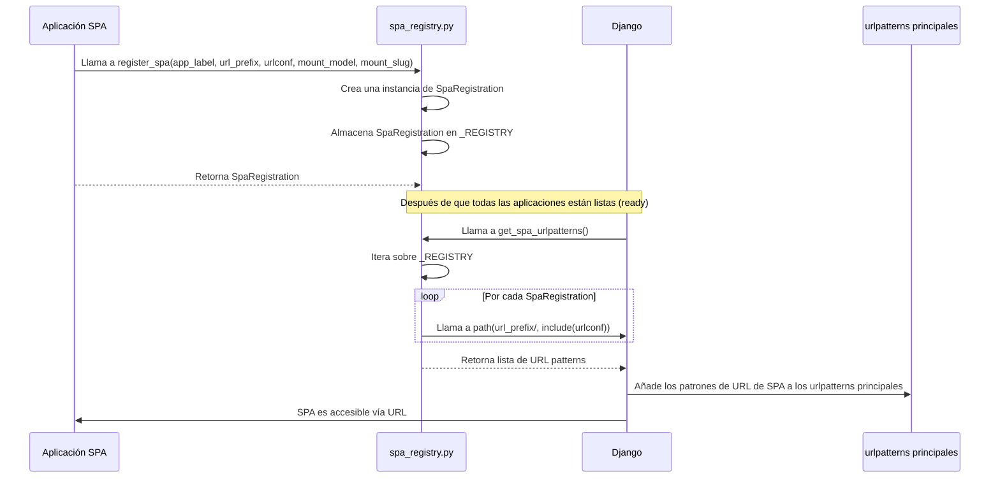

# Registro y URL de SPA del Django React UI Editor Framework

Este módulo, `Django_React_UI_Editor_Framework_Registro_y_URL_de_SPA`, es un componente crucial dentro del marco de trabajo `Django_React_UI_Editor_Framework` que gestiona el registro de Single Page Applications (SPAs) y la generación de sus patrones de URL dinámicamente dentro de una aplicación Django. Facilita la integración y el montaje de interfaces de usuario React en el entorno de Wagtail Content Management System, permitiendo que múltiples SPAs coexistan y sean accesibles a través de rutas de URL definidas.

## Arquitectura y Componentes Principales

El módulo se centra en el `SpaRegistration` y un conjunto de funciones para manejar un registro global de SPAs.

### Componentes Clave

*   **`SpaRegistration` (django_react_ui_editor/spa_registry.py::SpaRegistration)**: Un dataclass inmutable que encapsula la información necesaria para registrar una SPA. Incluye:
    *   `app_label`: El nombre de la aplicación Django a la que pertenece la SPA.
    *   `url_prefix`: El prefijo de la URL bajo el cual se montará la SPA.
    *   `urlconf`: La ruta al módulo `urlconf` de Django que define los patrones de URL específicos de la SPA.
    *   `mount_model`: El modelo de Django asociado al punto de montaje de la SPA.
    *   `mount_slug`: Un slug para identificar el punto de montaje.

*   **`register_spa`**: Esta función permite a otras partes del sistema registrar una SPA en un registro global interno (`_REGISTRY`). Toma los mismos parámetros que el dataclass `SpaRegistration` y devuelve una instancia de `SpaRegistration`.

*   **`get_registered_spas`**: Proporciona una copia del diccionario que contiene todas las `SpaRegistration`s registradas, mapeadas por su `app_label`.

*   **`get_spa_urlpatterns`**: Genera dinámicamente una lista de patrones de URL de Django. Itera sobre todas las SPAs registradas y crea un `path` para cada una, incluyendo su `urlconf` bajo el `url_prefix` correspondiente. Esta función es clave para que las SPAs sean accesibles en la aplicación Django.

### Relación entre Componentes

La relación entre los componentes de este módulo es la siguiente:

1.  Las aplicaciones individuales o módulos que deseen integrar una SPA llaman a `register_spa` para añadir su configuración al `_REGISTRY`.
2.  Una vez que todas las aplicaciones están listas, `get_spa_urlpatterns` es invocado para consolidar todos los patrones de URL de las SPAs registradas.
3.  Estos patrones de URL son luego incluidos en el `urlpatterns` principal del proyecto Django, haciendo las SPAs accesibles.

El modelo `SpaMount` (definido en [Modelos de Montaje SPA](Django_React_UI_Editor_Framework_Modelos_Montaje_SPA.md)) es el encargado de representar en la base de datos estos puntos de montaje y es referenciado por `SpaRegistration` a través del campo `mount_model`.

## Diagramas

### Diagrama de Clases

```mermaid
classDiagram
    class SpaRegistration {
        +app_label: str
        +url_prefix: str
        +urlconf: str
        +mount_model: Type
        +mount_slug: str
    }

    class SpaRegistryFunctions {
        +register_spa(app_label, url_prefix, urlconf, mount_model, mount_slug) SpaRegistration
        +get_registered_spas() dict~str, SpaRegistration~
        +get_spa_urlpatterns() list~URLPattern~
    }

    class DjangoURLResolver {
        +path()
        +include()
    }

    SpaRegistration <-- SpaRegistryFunctions : usa
    SpaRegistryFunctions --> DjangoURLResolver : genera patrones
    SpaRegistration "1" -- "1" SpaMount : referencia a modelo

    note for SpaRegistryFunctions "El registro interno `_REGISTRY` almacena instancias de SpaRegistration"
    note for SpaRegistration "Dataclass inmutable que define la configuración de una SPA."
    note for DjangoURLResolver "Módulo `django.urls` para la resolución de URLs."
    link SpaMount: Wagtail_Content_Management___API/Django_React_UI_Editor_Framework/Django_React_UI_Editor_Framework_Modelos_Montaje_SPA.md
```

### Diagrama de Flujo de Registro de SPA



## Integración en el Sistema General

Este módulo es fundamental para la capacidad del `Django_React_UI_Editor_Framework` de montar y gestionar SPAs React como partes integrales de una aplicación Django/Wagtail.

*   **Puntos de Montaje Dinámicos**: Permite definir puntos de montaje (URLs base) para las SPAs sin codificar rutas estáticas directamente en el `urls.py` principal del proyecto.
*   **Gestión Centralizada**: El `_REGISTRY` actúa como un registro centralizado de todas las SPAs disponibles, lo que simplifica la administración y el descubrimiento.
*   **Extensibilidad**: Otros módulos pueden registrar fácilmente sus propias SPAs, haciendo el framework altamente extensible.

Está estrechamente relacionado con los [Modelos de Montaje SPA](Django_React_UI_Editor_Framework_Modelos_Montaje_SPA.md) que definen la estructura de la base de datos para los puntos de montaje de las SPAs, y con las [Vistas Shell de SPA](Django_React_UI_Editor_Framework_Vistas_Shell_de_SPA.md) que sirven como el punto de entrada para renderizar estas SPAs. La interacción con el CMS de Wagtail se realiza a través de la integración de estas SPAs en el contexto administrativo, como se detalla en [Integración UI del CMS](../CMS_UI_Integration.md).