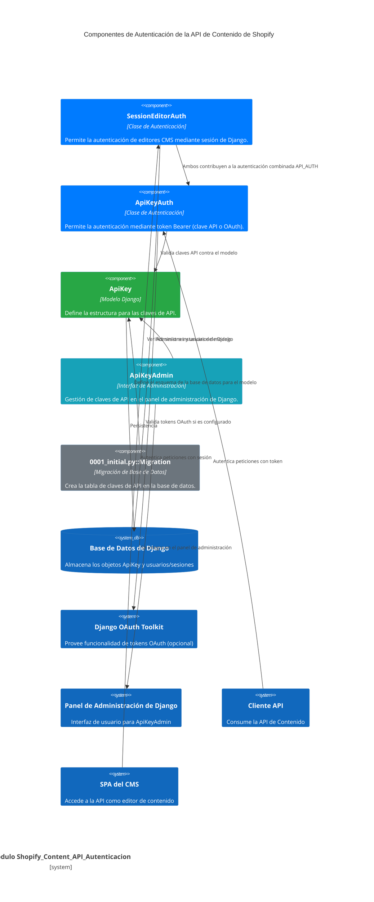

# Autenticación de la API de Contenido de Shopify

Este módulo (`Shopify_Content_API_Autenticacion`) es el encargado de gestionar los mecanismos de autenticación para la API de Contenido de Shopify. Proporciona métodos seguros para que tanto los editores del CMS como los clientes externos puedan interactuar con la API.

## Propósito y Funcionalidad Principal

El módulo define y gestiona las diferentes estrategias de autenticación necesarias para proteger los puntos finales de la API. Sus componentes principales son:

-   **`api/auth.py::ApiKeyAuth`**: Implementa la autenticación mediante tokens Bearer. Permite el uso de claves API generadas internamente o tokens de acceso OAuth2 para autenticar las solicitudes. Se encarga de validar estos tokens contra el modelo `ApiKey` o contra el sistema `oauth2_provider`.

-   **`api/auth.py::SessionEditorAuth`**: Proporciona autenticación basada en sesiones de Django, diseñada específicamente para usuarios del CMS (personal o miembros del grupo `cms_editors`). Esto permite que la interfaz de usuario del CMS interactúe de forma segura con la API desde el mismo origen.

-   **`api/models.py::ApiKey`**: Es un modelo de Django que representa una clave de API. Almacena el nombre descriptivo de la clave, la clave secreta (generada automáticamente si no se proporciona), el estado de actividad, la fecha de creación y la fecha de su último uso.

-   **`api/models.py::ApiKey.Meta`**: Define metadatos para el modelo `ApiKey`, como los nombres legibles para humanos en el panel de administración de Django (`verbose_name`, `verbose_name_plural`).

-   **`api/admin.py::ApiKeyAdmin`**: Registra el modelo `ApiKey` en la interfaz de administración de Django. Esto permite a los administradores crear, ver, editar y desactivar claves de API de manera sencilla. Configura los campos a mostrar, filtros y campos de solo lectura.

-   **`api/migrations/0001_initial.py::Migration`**: Contiene la lógica para la creación inicial de la tabla de base de datos para el modelo `ApiKey`.

## Arquitectura y Relaciones de Componentes

El módulo de autenticación se integra con el sistema general de Django y, opcionalmente, con Django OAuth Toolkit para la gestión de tokens de acceso. Los siguientes diagramas ilustran las relaciones entre los componentes.

**Flujo de Autenticación:**

1.  **Para clientes externos (API Keys/OAuth):**
    *   Un cliente envía una solicitud a la API con un token (clave API o token OAuth) en el encabezado `Authorization: Bearer <token>`.
    *   `ApiKeyAuth` intercepta la solicitud.
    *   Intenta validar el token como una `ApiKey` buscando en la base de datos. Si tiene éxito, autentica al usuario.
    *   Si no es una `ApiKey` válida, intenta validar el token como un `AccessToken` de OAuth utilizando `django-oauth-toolkit` (si está configurado) y los scopes requeridos (`MCP_OAUTH_REQUIRED_SCOPES`).
    *   Si el token OAuth es válido, autentica al usuario asociado a ese token.

2.  **Para editores del CMS (Sesión de Django):**
    *   Un editor del CMS accede a la API desde la Single Page Application (SPA) en `/cms/`.
    *   El navegador envía la cookie de sesión de Django junto con la solicitud.
    *   `SessionEditorAuth` intercepta la solicitud y verifica si el usuario autenticado en la sesión es un superusuario, personal o miembro del grupo `cms_editors`.
    *   Si cumple los criterios, el usuario es autenticado.

3.  **Combinación de autenticación (`API_AUTH`):**
    *   La variable `API_AUTH` (definida en `api/auth.py`) combina `SessionEditorAuth` y `ApiKeyAuth`, permitiendo que las solicitudes se autentiquen mediante cualquiera de los dos métodos. Esto proporciona flexibilidad para el acceso tanto desde el CMS como desde clientes programáticos.

## Integración con el Sistema General

El módulo `Shopify_Content_API_Autenticacion` es una parte fundamental de la seguridad de la [Shopify_Content_API](../Shopify_Content_API.md). Su papel es crucial para:

-   **Proteger los datos del CMS**: Asegura que solo los usuarios autorizados (editores o sistemas con claves API válidas) puedan acceder o modificar el contenido gestionado por Wagtail y expuesto a través de la API.
-   **Facilitar la interacción del CMS**: Permite que la interfaz de administración del CMS (posiblemente una SPA, como se insinúa por `SessionEditorAuth`) interactúe de manera fluida y segura con los servicios de backend.
-   **Habilitar integraciones externas**: Proporciona un medio para que otras aplicaciones o servicios (como agentes de IA) se autentiquen y operen con la API de Contenido de forma segura mediante claves API o OAuth.
-   **Gestión en Django Admin**: El modelo `ApiKey` y su administración a través de `ApiKeyAdmin` se integran directamente en el panel de administración de Django, lo que permite una gestión sencilla de las credenciales de acceso para los administradores del sistema.

Este módulo se encuentra dentro de la estructura de la [API de Gestión de Contenido de Wagtail y Shopify](../../Wagtail_Content_Management___API.md), proporcionando los cimientos de seguridad para todas las operaciones de contenido. Se basa en el ecosistema de Django para la gestión de usuarios, sesiones y modelos de base de datos.
