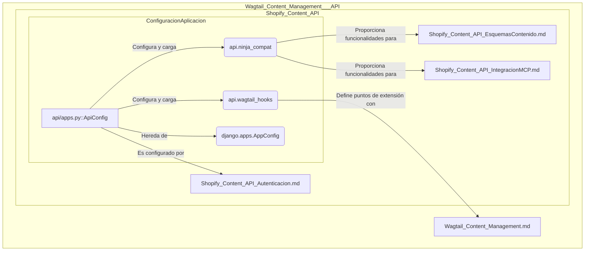

# Configuración de la Aplicación API de Contenido de Shopify

El módulo `Shopify_Content_API_ConfiguracionAplicacion` es responsable de la configuración fundamental de la aplicación Django que expone la API de contenido para Shopify. Centraliza los ajustes iniciales y las integraciones esenciales para el correcto funcionamiento de la API dentro del ecosistema de Wagtail.

## Propósito y Funcionalidad Principal

El componente principal en este módulo es `api/apps.py::ApiConfig`. Esta clase extiende `django.apps.AppConfig` y define la configuración a nivel de aplicación para el subsistema de la API de contenido. Sus funcionalidades clave incluyen:

*   **Configuración por defecto del campo de auto-incremento**: Establece `BigAutoField` como el tipo de campo predeterminado para las claves primarias auto-incrementales de los modelos en la aplicación `api`, lo que asegura la capacidad de escalar con un gran número de registros.
*   **Identificación de la Aplicación**: Define el nombre corto de la aplicación como `'api'` y un nombre legible para el usuario como `'Content API'`, facilitando su identificación en la administración de Django.
*   **Carga de Integraciones**: Durante la inicialización de Django (método `ready()`), se importan `api.ninja_compat` y `api.wagtail_hooks`. Estas importaciones son cruciales para establecer la compatibilidad con el framework Django Ninja (utilizado para construir la API RESTful) y para registrar los ganchos necesarios para la integración con el CMS Wagtail.

## Arquitectura y Relaciones entre Componentes

La clase `ApiConfig` actúa como el punto de entrada de configuración para la aplicación `api` dentro del proyecto Django. Su diseño se basa en la extensión de `django.apps.AppConfig`, lo que le permite aprovechar el sistema de configuración de aplicaciones de Django.

*   **`api/apps.py::ApiConfig`**: El componente central, que define cómo se inicializa y se comporta la aplicación `api`.
*   **`django.apps.AppConfig`**: La clase base de Django de la que hereda `ApiConfig`, proporcionando la estructura estándar para la configuración de aplicaciones.
*   **`api.ninja_compat`**: Este módulo, importado por `ApiConfig`, es fundamental para la integración con el framework Django Ninja, que probablemente se utiliza para definir los esquemas y las vistas de la API. Está estrechamente relacionado con la definición de los [Esquemas de Contenido de la API de Shopify](Shopify_Content_API_EsquemasContenido.md) y la [Integración con MCP](Shopify_Content_API_IntegracionMCP.md).
*   **`api.wagtail_hooks`**: Este módulo se importa para registrar ganchos y funcionalidades específicas que permiten a la API de contenido interactuar y extender el comportamiento del [CMS Wagtail](Wagtail_Content_Management.md).

## Cómo el Módulo Encaja en el Sistema General

El módulo `Shopify_Content_API_ConfiguracionAplicacion` es un pilar fundamental para la operación de la API de contenido de Shopify. Su función principal es asegurar que la aplicación `api` esté correctamente inicializada y lista para interactuar con otras partes del sistema:

1.  **Habilitación de la API**: Al configurar el nombre y cargar `api.ninja_compat`, este módulo prepara el terreno para que los endpoints de la API estén disponibles y sigan las convenciones de Django Ninja. Esto permite la exposición de datos de contenido a través de HTTP/HTTPS.
2.  **Integración con Wagtail**: La importación de `api.wagtail_hooks` garantiza que cualquier personalización o extensión necesaria para la gestión de contenido a través de Wagtail se cargue correctamente, lo que podría incluir paneles de administración, señales o cualquier otra lógica que vincule la API con la interfaz de usuario del CMS.
3.  **Base para la Autenticación**: Aunque `ApiConfig` no maneja directamente la autenticación, su existencia es un requisito previo para que módulos relacionados, como [Autenticación de la API de Contenido de Shopify](Shopify_Content_API_Autenticacion.md), puedan registrar sus mecanismos de seguridad.

En resumen, este módulo proporciona la base estructural y de inicialización para que la API de contenido de Shopify funcione como una aplicación Django bien integrada, permitiendo la interacción fluida con el CMS Wagtail y la exposición eficiente del contenido.