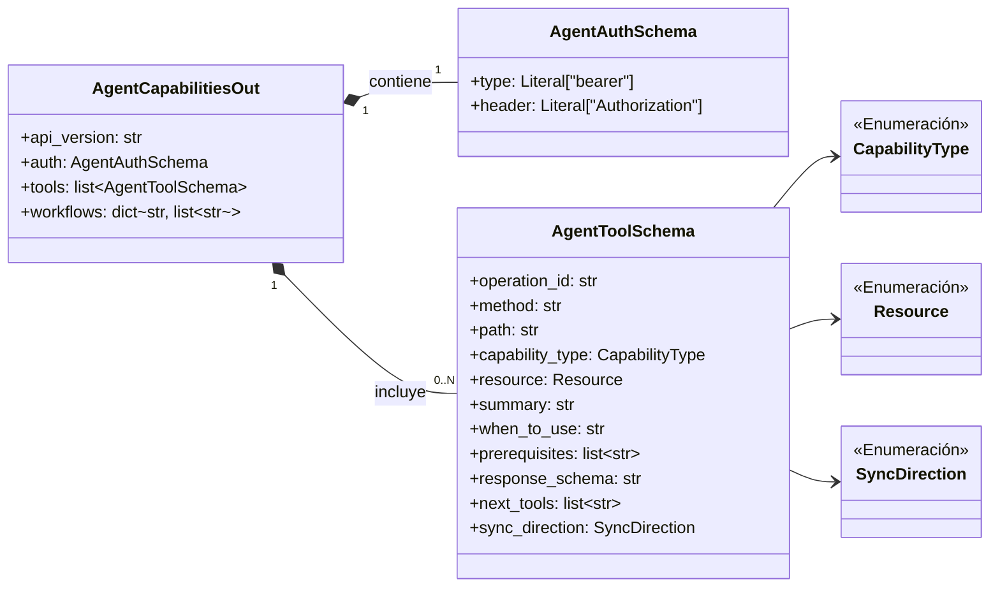
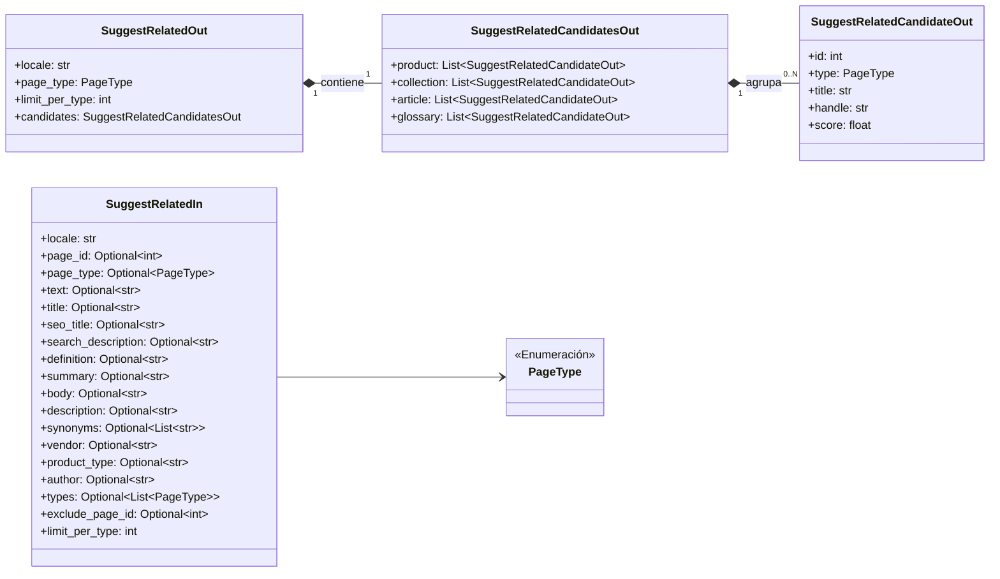

# Esquemas de Capacidades de la API de Contenido de Shopify

Este módulo (`Shopify_Content_API_EsquemasCapacidades`) define los esquemas de datos utilizados por la API de Contenido de Shopify para describir las capacidades de los agentes, la estructura de las secciones de la página de inicio y las sugerencias de enlaces semánticos. Estos esquemas, construidos con Pydantic y Ninja, aseguran una validación y serialización de datos consistente para la interacción de la API.

## Arquitectura y Componentes

El módulo se organiza en torno a tres grupos principales de esquemas, cada uno sirviendo a un propósito específico dentro de la API:

1.  **Esquemas de Capacidades del Agente**: Definen cómo se anuncian las herramientas y capacidades disponibles para los agentes externos.
2.  **Esquemas de Secciones de la Página de Inicio**: Estructuran los diferentes tipos de contenido que pueden aparecer en la página de inicio, permitiendo a los agentes manipular el diseño y el contenido de estas secciones.
3.  **Esquemas de Enlaces Semánticos**: Facilitan la sugerencia y gestión de enlaces entre diferentes tipos de contenido.

### Esquemas de Capacidades del Agente

Estos esquemas, definidos en `api/schemas/capabilities.py`, son cruciales para que los agentes externos descubran y comprendan las operaciones que pueden realizar a través de la API.

*   `AgentAuthSchema`: Define el esquema de autenticación requerido para todas las herramientas del agente, especificando el tipo de autenticación (por ejemplo, "bearer") y el nombre del encabezado HTTP.
*   `AgentToolSchema`: Describe una herramienta o capacidad individual del agente, incluyendo su ID de operación, método HTTP, ruta de la API, tipo de capacidad (lectura, escritura, sincronización), recurso sobre el que opera, un resumen, cuándo usarla, requisitos previos, el esquema de respuesta y herramientas sugeridas para el seguimiento.
*   `AgentCapabilitiesOut`: El esquema de salida principal que agrupa todas las capacidades de un agente. Incluye la versión de la API, los requisitos de autenticación (`AgentAuthSchema`), una lista completa de herramientas (`AgentToolSchema`) y flujos de trabajo predefinidos.

#### Diagrama de Clases: Esquemas de Capacidades del Agente

### Esquemas de Secciones de la Página de Inicio

Los esquemas en `api/schemas/home_sections.py` definen la estructura de datos para las diversas secciones de la página de inicio que los agentes pueden manipular a través de la API. Estos campos son opcionales en las operaciones `PATCH`, lo que permite actualizaciones parciales, y el normalizador de la API se encarga de rellenar los valores requeridos o predeterminados.

*   `HomeSectionFields`: Es el esquema de nivel superior para las secciones de la página de inicio, agrupando todos los demás esquemas de sección como campos opcionales.
*   `TrustBarValueSchema` y `TrustBarItemSchema`: Definen la sección de la barra de confianza con elementos de confianza individuales.
*   `FeaturedCollectionsValueSchema`: Describe una sección para mostrar colecciones destacadas.
*   `NavCollectionPillsValueSchema` y `NavCollectionPillItemSchema`: Estructuran la navegación de píldoras de colección.
*   `EditorialIntroValueSchema`: Representa la sección de introducción editorial.
*   `BestSellersValueSchema`: Define la sección de productos más vendidos.
*   `ShopByNeedValueSchema` y `ShopByNeedCardSchema`: Describen la sección "Comprar por necesidad" con tarjetas de intención.
*   `EducationalHubValueSchema`: Estructura la sección del centro educativo.
*   `BrandValuesValueSchema` y `BrandValueItemSchema`: Definen la sección de valores de marca.
*   `MarketBlockValueSchema`: Representa un bloque específico de mercado.
*   `FaqValueSchema` y `HomeFaqItemSchema`: Definen la sección de preguntas frecuentes.
*   `InternalLinksValueSchema`, `InternalLinkGroupSchema`, `InternalLinkItemSchema`: Estructuran la sección de enlaces internos.
*   `PromoGatewayValueSchema` y `PromoGatewayCardSchema`: Describen la sección de la pasarela de promoción.
*   `SeoSchemaValueSchema`: Controla las opciones de esquema SEO para la página de inicio.

#### Diagrama de Clases: Esquemas de Secciones de la Página de Inicio

```mermaid
classDiagram
    direction TD
    HomeSectionFields "1" *-- "0..1" PromoGatewayValueSchema : incluye
    HomeSectionFields "1" *-- "0..1" NavCollectionPillsValueSchema : incluye
    HomeSectionFields "1" *-- "0..1" TrustBarValueSchema : incluye
    HomeSectionFields "1" *-- "0..1" FeaturedCollectionsValueSchema : incluye
    HomeSectionFields "1" *-- "0..1" EditorialIntroValueSchema : incluye
    HomeSectionFields "1" *-- "0..1" BestSellersValueSchema : incluye
    HomeSectionFields "1" *-- "0..1" ShopByNeedValueSchema : incluye
    HomeSectionFields "1" *-- "0..1" EducationalHubValueSchema : incluye
    HomeSectionFields "1" *-- "0..1" BrandValuesValueSchema : incluye
    HomeSectionFields "1" *-- "0..1" MarketBlockValueSchema : incluye
    HomeSectionFields "1" *-- "0..1" FaqValueSchema : incluye
    HomeSectionFields "1" *-- "0..1" InternalLinksValueSchema : incluye
    HomeSectionFields "1" *-- "0..1" SeoSchemaValueSchema : incluye

    PromoGatewayValueSchema "1" *-- "0..N" PromoGatewayCardSchema
    NavCollectionPillsValueSchema "1" *-- "0..N" NavCollectionPillItemSchema
    TrustBarValueSchema "1" *-- "0..N" TrustBarItemSchema
    FeaturedCollectionsValueSchema "1" *-- "0..N" ContentReferenceSchema
    ShopByNeedValueSchema "1" *-- "0..N" ShopByNeedCardSchema
    EducationalHubValueSchema "1" *-- "0..N" ContentReferenceSchema
    BrandValuesValueSchema "1" *-- "0..N" BrandValueItemSchema
    FaqValueSchema "1" *-- "0..N" HomeFaqItemSchema
    InternalLinksValueSchema "1" *-- "0..N" InternalLinkGroupSchema
    InternalLinkGroupSchema "1" *-- "0..N" InternalLinkItemSchema

    class HomeSectionFields {
        +promo_gateway: Optional~PromoGatewayValueSchema~
        +nav_collection_pills: Optional~NavCollectionPillsValueSchema~
        +trust_bar: Optional~TrustBarValueSchema~
        +featured_collections: Optional~FeaturedCollectionsValueSchema~
        +editorial_intro: Optional~EditorialIntroValueSchema~
        +best_sellers: Optional~BestSellersValueSchema~
        +shop_by_need: Optional~ShopByNeedValueSchema~
        +educational_hub: Optional~EducationalHubValueSchema~
        +brand_values: Optional~BrandValuesValueSchema~
        +market_block: Optional~MarketBlockValueSchema~
        +faq: Optional~FaqValueSchema~
        +internal_links: Optional~InternalLinksValueSchema~
        +seo_schema: Optional~SeoSchemaValueSchema~
    }
    class PromoGatewayValueSchema {
        +cards: Optional~List~PromoGatewayCardSchema~~
    }
    class PromoGatewayCardSchema {
        +title: Optional~str~
        +badge: Optional~str~
        +media_source: Optional~MediaSource~
        +primary_collection_page_id: Optional~int~
        +category_page_ids: Optional~List~int~~\n        +cta_label: Optional~str~
        +cta_url: Optional~str~
        +column_span: Optional~ColumnSpan~
    }
    class NavCollectionPillsValueSchema {
        +source_collection_page_id: Optional~int~
        +items: Optional~List~NavCollectionPillItemSchema~~
    }
    class NavCollectionPillItemSchema {
        +page_id: int
        +override_label: Optional~str~
    }
    class TrustBarValueSchema {
        +items: Optional~List~TrustBarItemSchema~~
    }
    class TrustBarItemSchema {
        +icon: Optional~TrustIcon~
        +title: Optional~str~
        +description: Optional~str~
    }
    class FeaturedCollectionsValueSchema {
        +badge: Optional~str~
        +title: Optional~str~
        +intro: Optional~str~
        +items: Optional~List~ContentReferenceSchema~~
    }
    class EditorialIntroValueSchema {
        +heading: Optional~str~
        +body: Optional~str~
        +alignment: Optional~Alignment~
    }
    class BestSellersValueSchema {
        +title: Optional~str~
        +collection_page_id: Optional~int~
        +product_limit: Optional~int~
        +badge: Optional~str~
        +background: Optional~Background~
    }
    class ShopByNeedValueSchema {
        +title: Optional~str~
        +cards: Optional~List~ShopByNeedCardSchema~~
    }
    class ShopByNeedCardSchema {
        +title: Optional~str~
        +description: Optional~str~
        +target_page_id: Optional~int~
        +cta_label: Optional~str~
        +cta_url: Optional~str~
        +image_url: Optional~str~
        +intent_tag: Optional~str~
    }
    class EducationalHubValueSchema {
        +title: Optional~str~
        +intro: Optional~str~
        +links: Optional~List~ContentReferenceSchema~~
    }
    class BrandValuesValueSchema {
        +eyebrow: Optional~str~
        +heading: Optional~str~
        +body: Optional~str~
        +image_url: Optional~str~
        +media_position: Optional~MediaPosition~
        +values: Optional~List~BrandValueItemSchema~~
        +cta_label: Optional~str~
        +cta_url: Optional~str~
    }
    class BrandValueItemSchema {
        +icon: Optional~str~
        +title: Optional~str~
        +description: Optional~str~
    }
    class MarketBlockValueSchema {
        +heading: Optional~str~
        +body: Optional~str~
        +highlights: Optional~List~str~~
        +cta_label: Optional~str~
        +cta_url: Optional~str~
        +market_code: Optional~MarketCode~
    }
    class FaqValueSchema {
        +heading: Optional~str~
        +items: Optional~List~HomeFaqItemSchema~~
    }
    class HomeFaqItemSchema {
        +question: Optional~str~
        +answer: Optional~str~
    }
    class InternalLinksValueSchema {
        +heading: Optional~str~
        +groups: Optional~List~InternalLinkGroupSchema~~
    }
    class InternalLinkGroupSchema {
        +title: Optional~str~
        +links: Optional~List~InternalLinkItemSchema~~
    }
    class InternalLinkItemSchema {
        +page_id: int
        +label: Optional~str~
    }
    class SeoSchemaValueSchema {
        +include_faq_schema: Optional~bool~
        +include_organization: Optional~bool~
    }
    class ContentReferenceSchema {
        ~page_id: int~
    }
```

### Esquemas de Enlaces Semánticos

Los esquemas para enlaces semánticos, ubicados en `api/schemas/semantic_links.py`, se utilizan para solicitar y recibir sugerencias de contenido relacionado, facilitando la creación de enlaces contextuales dentro de la plataforma.

*   `SuggestRelatedIn`: Define la entrada para la API de sugerencia de enlaces semánticos. Permite especificar la configuración regional, una ID de página existente (para extraer texto de consulta) o campos de texto estructurados como título, resumen, cuerpo, etc., para una página que aún no existe. También permite filtrar por tipos de página y excluir IDs de página.
*   `SuggestRelatedCandidateOut`: Representa un candidato de enlace semántico sugerido, incluyendo su ID de página Wagtail, tipo de página, título, identificador (handle) y una puntuación de similitud.
*   `SuggestRelatedCandidatesOut`: Agrupa listas de `SuggestRelatedCandidateOut` por tipo de página (producto, colección, artículo, glosario), proporcionando una estructura organizada de los candidatos sugeridos.
*   `SuggestRelatedOut`: El esquema de salida principal para las sugerencias de enlaces semánticos, que encapsula la configuración regional utilizada, el tipo de página de origen, el límite aplicado por tipo y los candidatos sugeridos agrupados por tipo.

#### Diagrama de Clases: Esquemas de Enlaces Semánticos

Este módulo es fundamental para la interacción de agentes con la API, ya que proporciona las estructuras de datos necesarias para comunicar capacidades, manipular el contenido de la página de inicio y gestionar enlaces semánticos de manera efectiva. Los esquemas garantizan que los datos intercambiados sean válidos y consistentes, facilitando la integración y el desarrollo de herramientas de automatización.