# Esquemas de Contenido de la API de Shopify

Este módulo, `Shopify_Content_API_EsquemasContenido`, define las estructuras de datos (schemas) utilizadas para la interacción con la API de contenido de Shopify. Estos esquemas, construidos con Pydantic y `ninja.Schema`, validan y serializan los datos para la creación, actualización y recuperación de diversos tipos de contenido como artículos, blogs, colecciones, términos de glosario, páginas de inicio y ubicaciones.

## Propósito y Funcionalidad Principal

El objetivo principal de este módulo es proporcionar una interfaz clara y tipada para la gestión de contenido que se sincroniza entre Wagtail y Shopify. Cada tipo de contenido tiene tres esquemas principales:

*   **`*In` (Input)**: Utilizado para la creación de nuevas entradas de contenido. Define los campos requeridos y opcionales para iniciar un nuevo recurso.
*   **`*Patch` (Partial Update)**: Utilizado para la actualización parcial de entradas de contenido existentes. Permite modificar campos específicos sin tener que enviar el objeto completo.
*   **`*Out` (Output)**: Utilizado para la representación de contenido cuando se recupera de la API. Incluye todos los campos de solo lectura, campos calculados y referencias a otros recursos.

Estos esquemas aseguran la coherencia de los datos y facilitan la interacción con la API tanto para los desarrolladores que la implementan como para los clientes que la consumen.

## Arquitectura y Relaciones de Componentes

El módulo `Shopify_Content_API_EsquemasContenido` se integra dentro del componente `Shopify_Content_API`, que a su vez es parte de `Wagtail_Content_Management___API`. Los esquemas aquí definidos son los contratos de datos que la API expone. Internamente, estos esquemas hacen uso de tipos y mixins comunes definidos en [Esquemas Comunes de la API de Contenido de Shopify](Shopify_Content_API_EsquemasComunes.md) para campos como metacampos, enlaces relacionados y configuraciones de localización.

### Diagrama de Relaciones de Esquemas

El siguiente diagrama ilustra las relaciones generales entre los diferentes tipos de esquemas de contenido y los esquemas comunes:

```mermaid
graph TD
    subgraph Esquemas de Contenido
        A[ArticleIn] --> C[ArticleOut]
        A --> P[ArticlePatch]
        B[BlogIn] --> C2[BlogOut]
        B --> P2[BlogPatch]
        COLL_I[CollectionIn] --> COLL_O[CollectionOut]
        COLL_I --> COLL_P[CollectionPatch]
        G_I[GlossaryTermIn] --> G_O[GlossaryTermOut]
        G_I --> G_P[GlossaryTermPatch]
        H_I[HomeIn] --> H_O[HomeOut]
        H_I --> H_P[HomePatch]
        L_I[LocationIn] --> L_O[LocationOut]
        L_I --> L_P[LocationPatch]
    end

    subgraph Esquemas Comunes
        LCF(LocaleCreateFields)
        LPF(LocalePatchFields)
        LOF(LocaleOutFields)
        SFOF(StorefrontUrlOutFields)
        MS(MetafieldSchema)
        RLS(RelatedLinkSchema)
        ELS(ExternalLinkSchema)
        SISS(ShopifyImageUrlSchema)
        FAQ(FAQSchema)
        HSF(HomeSectionFields)
    end

    LCF -- Extiende --> A
    LCF -- Extiende --> B
    LCF -- Extiende --> COLL_I
    LCF -- Extiende --> G_I
    LCF -- Extiende --> H_I
    LCF -- Extiende --> L_I

    LPF -- Extiende --> P
    LPF -- Extiende --> P2
    LPF -- Extiende --> COLL_P
    LPF -- Extiende --> G_P
    LPF -- Extiende --> H_P
    LPF -- Extiende --> L_P

    LOF -- Extiende --> C
    LOF -- Extiende --> C2
    LOF -- Extiende --> COLL_O
    LOF -- Extiende --> G_O
    LOF -- Extiende --> H_O
    LOF -- Extiende --> L_O

    SFOF -- Extiende --> C
    SFOF -- Extiende --> C2
    SFOF -- Extiende --> COLL_O
    SFOF -- Extiende --> G_O
    SFOF -- Extiende --> H_O
    SFOF -- Extiende --> L_O

    A -- Usa --> MS
    P -- Usa --> MS
    C -- Usa --> MS
    COLL_I -- Usa --> MS
    COLL_P -- Usa --> MS
    COLL_O -- Usa --> MS
    L_I -- Usa --> FAQ
    L_P -- Usa --> FAQ
    L_O -- Usa --> FAQ
    H_I -- Usa --> HSF
    H_P -- Usa --> HSF
    P_I[ProductIn] --> MS
    P_P[ProductPatch] --> MS
    P_O[ProductOut] --> MS
    P_O --> SISS
    P_I --> LCF
    P_P --> LPF
    P_O --> SFOF
    P_O --> LOF
    C --> RLS
    C2 --> RLS
    COLL_O --> RLS
    G_I --> RLS
    G_P --> RLS
    G_O --> RLS
    G_I --> ELS
    G_P --> ELS
    G_O --> ELS
    H_O --> HSF
    L_O --> FAQ
    P_O --> RLS

    style C fill:#f9f,stroke:#333,stroke-width:2px
    style C2 fill:#f9f,stroke:#333,stroke-width:2px
    style COLL_O fill:#f9f,stroke:#333,stroke-width:2px
    style G_O fill:#f9f,stroke:#333,stroke-width:2px
    style H_O fill:#f9f,stroke:#333,stroke-width:2px
    style L_O fill:#f9f,stroke:#333,stroke-width:2px
    style P_O fill:#f9f,stroke:#333,stroke-width:2px

    subgraph Módulos Relacionados
        WAGTAIL_MODELS[Modelos Wagtail]
        SHOPIFY_API[API de Shopify]
    end

    C -- Mapea a --> WAGTAIL_MODELS
    C2 -- Mapea a --> WAGTAIL_MODELS
    COLL_O -- Mapea a --> WAGTAIL_MODELS
    G_O -- Mapea a --> WAGTAIL_MODELS
    H_O -- Mapea a --> WAGTAIL_MODELS
    L_O -- Mapea a --> WAGTAIL_MODELS
    P_O -- Mapea a --> WAGTAIL_MODELS

    A -- Publica a --> SHOPIFY_API
    P -- Actualiza en --> SHOPIFY_API
    B -- Publica a --> SHOPIFY_API
    P2 -- Actualiza en --> SHOPIFY_API
    COLL_I -- Publica a --> SHOPIFY_API
    COLL_P -- Actualiza en --> SHOPIFY_API
    G_I -- Publica a --> SHOPIFY_API
    G_P -- Actualiza en --> SHOPIFY_API
    H_I -- Publica a --> SHOPIFY_API
    H_P -- Actualiza en --> SHOPIFY_API
    L_I -- Publica a --> SHOPIFY_API
    L_P -- Actualiza en --> SHOPIFY_API
    P_I -- Publica a --> SHOPIFY_API
    P_P -- Actualiza en --> SHOPIFY_API

```

### Esquemas de Artículo (`api/schemas/article.py`)

Los esquemas de artículo gestionan el contenido relacionado con artículos de blog.

#### `ArticleIn`

Define la estructura para crear un nuevo artículo. Incluye campos como `title`, `blog_id` (Wagtail Page ID del `BlogPage` padre), `shopify_id` (Shopify GID opcional), `handle`, `author`, `published_at`, `summary`, `tags`, `featured_image_id` (Wagtail Image ID), `body` (contenido de StreamField, solo para modos `db/mirror`), `seo_title`, `search_description`, `metafields`, `sync_enabled` y `available_locales`. Hereda de `LocaleCreateFields`.

#### `ArticlePatch`

Define la estructura para actualizar un artículo existente. Todos los campos son opcionales y permiten actualizaciones parciales. Incluye un campo `publish` booleano para indicar si el artículo debe publicarse tras la actualización. Hereda de `LocalePatchFields`.

#### `ArticleOut`

Define la estructura para la salida de datos de un artículo. Incluye campos de solo lectura como `id` (Wagtail page ID), `shopify_id`, `title`, `handle`, `slug`, `author`, `published_at`, `summary`, `tags`, `featured_image_id`, `featured_image_url`, `featured_image_alt`, `body`, `seo_title`, `search_description`, `metafields`, `related_links`, `sync_enabled`, `last_synced_at`, `live`, `locale`, `url`, `first_published_at`, `last_published_at`, `blog_id`, `blog_title` y `available_locales`. Hereda de `StorefrontUrlOutFields` y `LocaleOutFields`. Métodos estáticos como `resolve_available_locales`, `resolve_tags`, `resolve_body`, `resolve_metafields`, `resolve_related_links`, `resolve_featured_image_id`, `resolve_locale`, `resolve_url`, `resolve_blog_id`, `resolve_blog_title` y `resolve_translation_page_ids` se utilizan para transformar y resolver datos para la salida.

### Esquemas de Blog (`api/schemas/blog.py`)

Los esquemas de blog gestionan la información de blogs en Shopify y Wagtail.

#### `BlogIn`

Define la estructura para crear un nuevo blog. Incluye `title`, `shopify_id` (Shopify GID opcional), `handle`, `comment_policy`, `sync_enabled` y `available_locales`. Hereda de `LocaleCreateFields`.

#### `BlogPatch`

Define la estructura para actualizar un blog existente, con todos los campos opcionales. También incluye el campo `publish`. Hereda de `LocalePatchFields`.

#### `BlogOut`

Define la estructura de salida para un blog. Incluye `id`, `shopify_id`, `title`, `handle`, `slug`, `comment_policy`, `sync_enabled`, `last_synced_at`, `live`, `locale`, `url`, `first_published_at`, `last_published_at`, `article_count` y `available_locales`. Hereda de `StorefrontUrlOutFields` y `LocaleOutFields`. Los métodos estáticos `resolve_available_locales`, `resolve_translation_page_ids`, `resolve_article_count`, `resolve_locale` y `resolve_url` se encargan de la resolución de campos.

### Esquemas de Colección (`api/schemas/collection.py`)

Los esquemas de colección gestionan las colecciones de productos.

#### `CollectionIn`

Define la estructura para crear una nueva colección. Incluye `title`, `shopify_id`, `handle`, `sort_order`, `description` (StreamField), `seo_title`, `search_description`, `metafields` y `sync_enabled`. Hereda de `LocaleCreateFields`.

#### `CollectionPatch`

Define la estructura para actualizar una colección existente, con todos los campos opcionales, incluyendo `publish`. Hereda de `LocalePatchFields`.

#### `CollectionOut`

Define la estructura de salida para una colección. Incluye `id`, `shopify_id`, `title`, `handle`, `slug`, `sort_order`, `description`, `seo_title`, `search_description`, `image_url`, `image_alt_text`, `metafields`, `related_links`, `sync_enabled`, `last_synced_at`, `live`, `locale`, `url`, `first_published_at` y `last_published_at`. Hereda de `StorefrontUrlOutFields` y `LocaleOutFields`. Utiliza métodos estáticos como `resolve_translation_page_ids`, `resolve_description`, `resolve_metafields`, `resolve_related_links`, `resolve_locale` y `resolve_url`.

### Esquemas de Término de Glosario (`api/schemas/glossary.py`)

Los esquemas de término de glosario gestionan términos de glosario que pueden ser sincronizados como metaobjetos de Shopify.

#### `GlossaryTermIn`

Define la estructura para crear un nuevo término de glosario. Incluye `term`, `shopify_id`, `handle`, `definition` (HTML), `image_id` (Wagtail Image ID), `image_alt_text`, `shopify_image_id` (Shopify File/MediaImage GID), `seo_title`, `search_description`, `locale_code` (Shopify metaobject locale), `related_links`, `external_links`, `synonyms`, `same_as`, `sync_enabled` y `parent_page_id`. Hereda de `LocaleCreateFields`.

#### `GlossaryTermPatch`

Define la estructura para actualizar un término de glosario existente, con campos opcionales y el campo `publish`. Hereda de `LocalePatchFields`.

#### `GlossaryTermOut`

Define la estructura de salida para un término de glosario. Incluye `id`, `shopify_id`, `term`, `title`, `handle`, `slug`, `definition`, `image_id`, `image_url`, `image_alt_text`, `shopify_image_id`, `seo_title`, `search_description`, `locale_code`, `related_links`, `external_links`, `synonyms`, `same_as`, `sync_enabled`, `last_synced_at`, `live`, `locale`, `url`, `first_published_at` y `last_published_at`. Hereda de `StorefrontUrlOutFields` y `LocaleOutFields`. Los métodos estáticos como `_expand_richtext`, `resolve_definition`, `resolve_image_id`, `resolve_image_url`, `resolve_related_links`, `resolve_external_links`, `resolve_synonyms`, `resolve_same_as`, `resolve_locale`, `resolve_last_synced_at`, `resolve_first_published_at`, `resolve_last_published_at`, `resolve_url` y `resolve_title` se encargan de la resolución de datos.

### Esquemas de Página de Inicio (`api/schemas/home.py`)

Estos esquemas gestionan el contenido de la página de inicio, sincronizado como un metaobjeto de Shopify.

#### `HomeIn`

Define la estructura para crear una nueva página de inicio. Incluye `hero_heading`, `shopify_id`, `handle` (ignorado, auto-derivado), `hero_eyebrow`, `hero_subheading`, `hero_body` (HTML), `hero_primary_cta_label`, `hero_primary_cta_url`, `hero_secondary_cta_label`, `hero_secondary_cta_url`, `hero_image_url`, `sections_json`, `shopify_locale`, `seo_title`, `search_description`, `sync_enabled` y `parent_page_id`. Hereda de `LocaleCreateFields` y `HomeSectionFields`.

#### `HomePatch`

Define la estructura para actualizar una página de inicio existente, con campos opcionales y el campo `publish`. Hereda de `LocalePatchFields` y `HomeSectionFields`.

#### `HomeOut`

Define la estructura de salida para una página de inicio. Incluye `id`, `shopify_id`, `hero_heading`, `title`, `handle`, `slug`, `hero_eyebrow`, `hero_subheading`, `hero_body`, `hero_primary_cta_label`, `hero_primary_cta_url`, `hero_secondary_cta_label`, `hero_secondary_cta_url`, `hero_image_url`, `sections_json`, `shopify_locale`, `seo_title`, `search_description`, `sync_enabled`, `last_synced_at`, `live`, `locale`, `url`, `first_published_at` y `last_published_at`. Hereda de `StorefrontUrlOutFields` y `LocaleOutFields`. Los métodos estáticos como `_expand_richtext`, `resolve_hero_body`, `resolve_locale`, `resolve_url`, `resolve_title` y `resolve_sections_json` se encargan de la resolución de datos.

### Esquemas de Ubicación (`api/schemas/location.py`)

Estos esquemas gestionan el contenido de páginas de ubicación, también sincronizadas como metaobjetos de Shopify.

#### `LocationIn`

Define la estructura para crear una nueva página de ubicación. Incluye `titulo`, `shopify_id`, `handle` (ignorado, auto-derivado), `subtitulo`, `intro` (HTML), `country`, `state`, `city`, `titulo_2`, `subtitulo_h2`, `content_2` (HTML), `titulo_3`, `subtitulo_3`, `content_3` (HTML), `brand_section_title`, `brand_section_subtitle`, `brand_section_content` (HTML), `map_title`, `map_content` (HTML), `after_page_content` (HTML), `shopify_locale`, `seo_title`, `search_description`, `faqs`, `sync_enabled` y `parent_page_id`. Hereda de `LocaleCreateFields`.

#### `LocationPatch`

Define la estructura para actualizar una página de ubicación existente, con campos opcionales y el campo `publish`. Hereda de `LocalePatchFields`.

#### `LocationOut`

Define la estructura de salida para una página de ubicación. Incluye `id`, `shopify_id`, `titulo`, `title`, `handle`, `slug`, `subtitulo`, `intro`, `country`, `state`, `city`, `titulo_2`, `subtitulo_h2`, `content_2`, `titulo_3`, `subtitulo_3`, `content_3`, `brand_section_title`, `brand_section_subtitle`, `brand_section_content`, `map_title`, `map_content`, `after_page_content`, `shopify_locale`, `seo_title`, `search_description`, `faqs`, `sync_enabled`, `last_synced_at`, `live`, `locale`, `url`, `first_published_at` y `last_published_at`. Hereda de `StorefrontUrlOutFields` y `LocaleOutFields`. Los métodos estáticos como `_expand_richtext`, `resolve_intro`, `resolve_content_2`, `resolve_content_3`, `resolve_brand_section_content`, `resolve_map_content`, `resolve_after_page_content`, `resolve_faqs`, `resolve_locale`, `resolve_url` y `resolve_title` se encargan de la resolución de datos.

### Esquemas de Producto (`api/schemas/product.py`)

Estos esquemas gestionan la información de productos.

#### `ProductIn`

Define la estructura para crear un nuevo producto. Incluye `title`, `shopify_id`, `handle`, `status`, `vendor`, `product_type`, `tags`, `body` (StreamField), `seo_title`, `search_description`, `metafields` y `sync_enabled`. Hereda de `LocaleCreateFields`.

#### `ProductPatch`

Define la estructura para actualizar un producto existente, con campos opcionales y el campo `publish`. Hereda de `LocalePatchFields`.

#### `ProductOut`

Define la estructura de salida para un producto. Incluye `id`, `shopify_id`, `title`, `handle`, `slug`, `status`, `vendor`, `product_type`, `tags`, `body`, `seo_title`, `search_description`, `shopify_images`, `metafields`, `related_links`, `sync_enabled`, `last_synced_at`, `live`, `locale`, `url`, `first_published_at` y `last_published_at`. Hereda de `StorefrontUrlOutFields` y `LocaleOutFields`. Los métodos estáticos como `resolve_translation_page_ids`, `resolve_tags`, `resolve_body`, `resolve_shopify_images`, `resolve_metafields`, `resolve_related_links`, `resolve_locale` y `resolve_url` se encargan de la resolución de datos.

## Cómo encaja el módulo en el sistema general

El módulo `Shopify_Content_API_EsquemasContenido` es fundamental para la `Wagtail_Content_Management___API` porque define los **contratos de datos** para la interacción entre Wagtail y Shopify. Los esquemas `*In` y `*Patch` se utilizan para validar las cargas útiles de las solicitudes entrantes a la API al crear o actualizar contenido. Una vez validados, estos datos se mapean a los modelos de Wagtail (por ejemplo, `ArticlePage`, `BlogPage`, `CollectionPage`, `GlossaryTermPage`, `HomePage`, `LocationPage` de los módulos [Blog_Content_Models](../Shopify_Content_Management/Blog_Content_Models.md), [Collection_Content_Models](../Shopify_Content_Management/Collection_Content_Models.md), [Glossary_Content_Models](../Shopify_Content_Management/Glossary_Content_Models.md), [Home_Page_Models](../Shopify_Content_Management/Home_Page_Models.md), [Location_Content_Models](../Shopify_Content_Management/Location_Content_Models.md), [Product_Content_Models](../Shopify_Content_Management/Product_Content_Models.md)) y se persisten en la base de datos de Wagtail.

Cuando el contenido se recupera o se prepara para la sincronización saliente, los datos de los modelos de Wagtail se transforman y se serializan utilizando los esquemas `*Out`. Estos esquemas `*Out` también son la base para la información que se envía a Shopify a través de los servicios de sincronización. Por ejemplo, los campos `shopify_id`, `handle`, `metafields`, etc., se utilizan para interactuar con la API de Shopify para crear o actualizar recursos de Shopify.

Además, algunos esquemas hacen referencia a `StreamField` de Wagtail para el `body` o `description` del contenido, lo que indica una fuerte integración con el sistema de gestión de contenido flexible de Wagtail.

La `sync_enabled` bandera en muchos esquemas resalta la naturaleza bidireccional (o al menos sincronizable) de la integración, permitiendo a los editores controlar si los cambios en Wagtail se propagan a Shopify.
