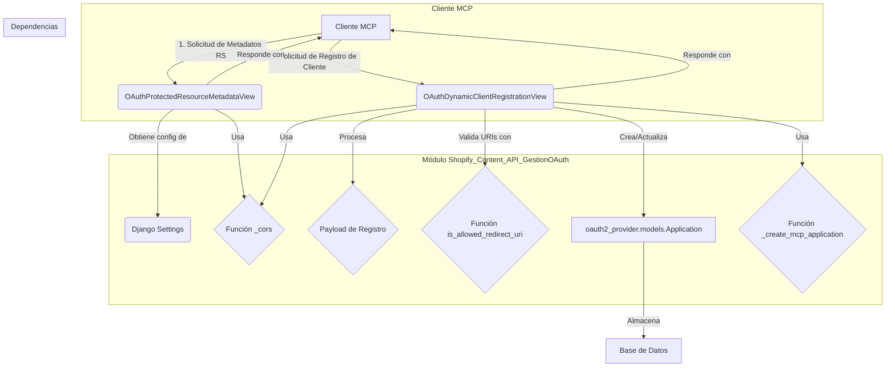
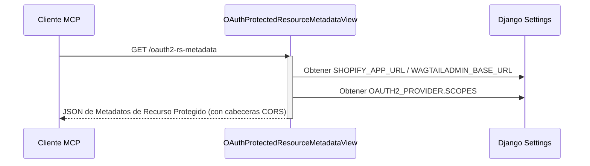
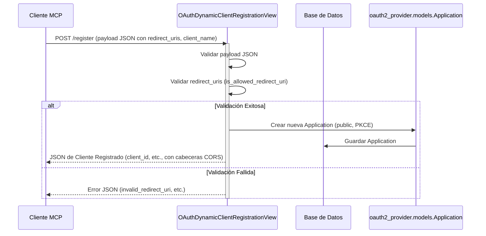

# Gestión de OAuth de la API de Contenido de Shopify

Este módulo es responsable de la gestión del descubrimiento de OAuth y el registro dinámico de clientes para la API de Contenido de Shopify. Facilita la interacción segura entre los clientes de MCP (Meta Content Platform) y el servidor de autorización, permitiendo a los clientes descubrir la configuración del servidor y registrarse dinámicamente para obtener credenciales.

## Arquitectura y Componentes

El módulo `Shopify_Content_API_GestionOAuth` consta de dos componentes principales que gestionan aspectos cruciales del flujo de OAuth: la vista de metadatos de recursos protegidos y la vista de registro dinámico de clientes.

### `OAuthProtectedResourceMetadataView`

La clase `OAuthProtectedResourceMetadataView` es una vista de Django que expone metadatos esenciales sobre los recursos protegidos por OAuth. Esta información es utilizada por los clientes de MCP para descubrir la configuración del servidor de autorización, incluyendo el endpoint del recurso y los ámbitos soportados.

#### Propósito

Proporcionar un documento de descubrimiento estandarizado para que los clientes de OAuth puedan entender cómo interactuar con los recursos protegidos.

#### Detalles de Implementación

- **Endpoint:** Generalmente accesible a través de una ruta como `/oauth2-rs-metadata/`.
- **Información Expuesta:** Incluye la URL del recurso (`resource`), los servidores de autorización (`authorization_servers`), los ámbitos soportados (`scopes_supported`) y los métodos de portador soportados (`bearer_methods_supported`).
- **CORS:** La respuesta incluye cabeceras CORS (`Access-Control-Allow-Origin`, `Access-Control-Allow-Methods`, `Access-Control-Allow-Headers`) para permitir el acceso desde diferentes orígenes.
- **Configuración:** Utiliza `settings.SHOPIFY_APP_URL` o `settings.WAGTAILADMIN_BASE_URL` para construir la URL base. Los ámbitos soportados se recuperan de `settings.OAUTH2_PROVIDER.SCOPES`.

### `OAuthDynamicClientRegistrationView`

La clase `OAuthDynamicClientRegistrationView` implementa el estándar RFC 7591 para el registro dinámico de clientes OAuth. Permite a los clientes públicos de MCP (utilizando PKCE, sin secreto de cliente) registrarse con el servidor de autorización, obteniendo un `client_id` y otros detalles de configuración.

#### Propósito

Facilitar el registro automático y seguro de nuevas aplicaciones cliente que deseen interactuar con la API.

#### Detalles de Implementación

- **Endpoint:** Generalmente accesible a través de una ruta como `/register`.
- **Métodos HTTP:** Soporta `POST` para el registro y `OPTIONS` para pre-vuelos CORS.
- **Validación de `redirect_uris`:** Se realiza una estricta validación de las URIs de redirección proporcionadas en el payload. Solo se permiten URIs predefinidas (Cursor/Claude callbacks) o URIs de bucle invertido (`localhost`, `127.0.0.1`) con rutas específicas (`/callback`, `/oauth/callback`).
- **Creación de `Application`:** Por cada solicitud de registro exitosa, se crea una nueva instancia del modelo `oauth2_provider.models.Application` con el tipo de cliente "público" y el tipo de concesión "código de autorización".
- **Respuesta:** Devuelve un JSON con el `client_id` generado, la fecha de emisión, el nombre del cliente, las URIs de redirección, los tipos de concesión y respuesta, el método de autenticación del endpoint del token y el ámbito (`scope`).
- **CORS:** Al igual que la vista de descubrimiento, incluye cabeceras CORS.
- **CSRF Exención:** La vista está exenta de protección CSRF (`@method_decorator(csrf_exempt, name="dispatch")`) debido a su naturaleza de API pública.

### Relación con otros módulos

- **Autenticación (oauth2_provider):** Este módulo se integra directamente con la librería `oauth2_provider` de Django, utilizando su modelo `Application` para almacenar los clientes registrados. Para más detalles sobre la autenticación, consulte [Autenticación](Shopify_Content_API_Autenticacion.md).
- **Configuración General:** Las URLs base y los ámbitos se configuran a través de los ajustes de Django, que son parte de la configuración general del proyecto. Consulte [Configuración del Proyecto](../../Build,_CI___Configuration/Build,_CI___Configuration_configuracion_proyecto.md) y [Gestión de Dependencias](../../Build,_CI___Configuration/Build,_CI___Configuration_gestion_dependencias.md) para más información sobre los ajustes y las dependencias del proyecto.

## Diagramas

### Diagrama de Arquitectura de la Gestión de OAuth

### Flujo de Descubrimiento de Metadatos de Recursos Protegidos

### Flujo de Registro Dinámico de Clientes

