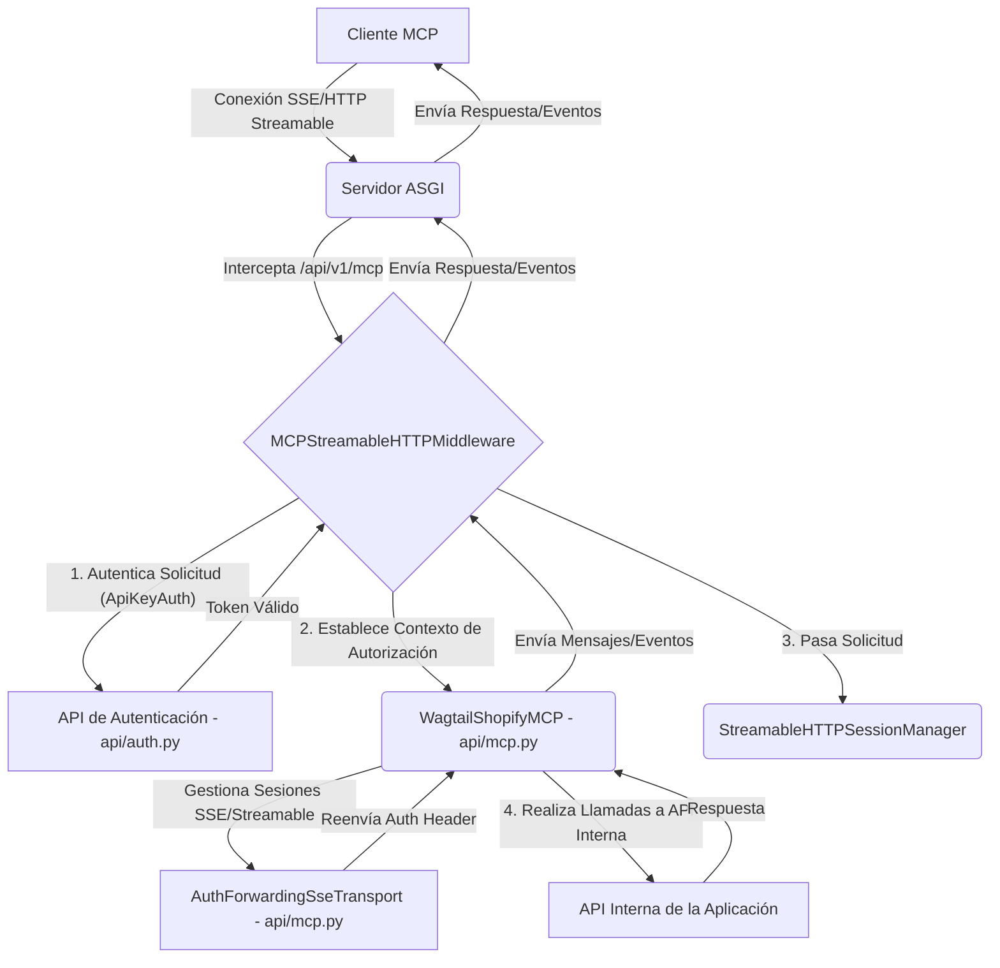
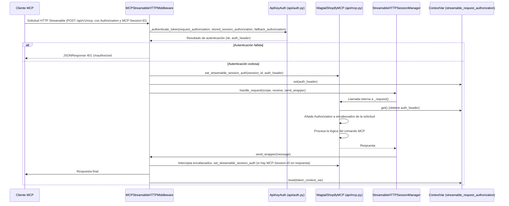
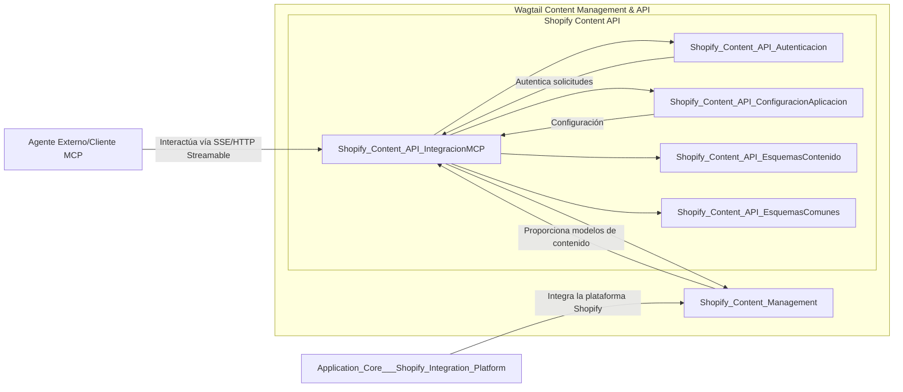

# Integración de la API de Contenido de Shopify con MCP

El módulo `Shopify_Content_API_IntegracionMCP` es fundamental para la integración de la aplicación Wagtail-Shopify con la plataforma de comunicación de agentes (MCP, del inglés "Multi-Agent Communication Protocol"). Este módulo permite que los clientes de MCP interactúen con la API de contenido de Shopify, facilitando la sincronización y gestión de contenido a través de interfaces de comunicación SSE (Server-Sent Events) y HTTP "streamable".

## Propósito y Funcionalidad Principal

El objetivo principal de este módulo es proporcionar los mecanismos de transporte y autenticación necesarios para que el servidor MCP se comunique con la aplicación Wagtail-Shopify. Esto incluye:

1.  **Gestión de Conexiones SSE**: Permite que los clientes de MCP establezcan conexiones persistentes para recibir eventos y enviar mensajes.
2.  **Manejo de Solicitudes HTTP "Streamable"**: Soporta un protocolo HTTP específico para MCP que permite la transmisión de datos en tiempo real de manera eficiente.
3.  **Autenticación y Autorización**: Asegura que todas las comunicaciones de MCP estén debidamente autenticadas, reenviando los encabezados de autorización de las sesiones a las llamadas internas de la API.
4.  **Integración con el Servidor MCP**: Proporciona la infraestructura para montar y configurar el servidor MCP dentro de la aplicación Django Ninja.

## Arquitectura y Relaciones entre Componentes

El módulo `Shopify_Content_API_IntegracionMCP` se compone de dos clases principales: `AuthForwardingSseTransport` y `WagtailShopifyMCP`, ubicadas en `api/mcp.py`, y el middleware `MCPStreamableHTTPMiddleware` en `api/mcp_asgi.py`.

### `api/mcp.py::AuthForwardingSseTransport`

Este componente extiende `DjangoSseServerTransport` y es responsable de gestionar las conexiones SSE. Su característica distintiva es la capacidad de almacenar y reenviar los encabezados de autorización HTTP para cada sesión de cliente SSE. Esto es crucial para mantener el contexto de autenticación en las llamadas internas que el servidor MCP pueda realizar.

*   **`_session_auth: dict[UUID, str]`**: Almacena los encabezados de autorización por `session_id` para las conexiones SSE.
*   **`connect_sse(self, request: HttpRequest)`**: Establece una nueva conexión SSE, genera un `session_id` único, extrae y almacena el encabezado de autorización de la solicitud, y configura las transmisiones de lectura/escritura para la sesión.
*   **`handle_post_message(self, session_id: UUID, message: types.JSONRPCMessage)`**: Recibe mensajes JSONRPC vía POST y los envía a la transmisión de lectura (entrada) del servidor MCP para la sesión correspondiente.

### `api/mcp.py::WagtailShopifyMCP`

Esta clase extiende `NinjaMCP` y actúa como el orquestador principal del servidor MCP dentro de la aplicación. Gestiona la lógica de montaje de los endpoints de MCP y asegura que la autenticación se propague correctamente a las llamadas de la API interna.

*   **`_active_session_id: UUID | None`**: Rastrea el ID de la sesión SSE activa actualmente.
*   **`_active_streamable_session_id: str | None`**: Rastrea el ID de la sesión HTTP "streamable" activa.
*   **`_streamable_session_auth: dict[str, str]`**: Almacena los encabezados de autorización por `session_id` para las conexiones HTTP "streamable".
*   **`default_auth_header`**: Proporciona un encabezado de autorización predeterminado, típicamente basado en una clave API configurada en los ajustes de Django (`settings.MCP_DEFAULT_API_KEY`).
*   **`mount(self, router: NinjaAPI | Router | None = None, mount_path: str = "/mcp")`**: Configura los endpoints para la conexión SSE (`/mcp`) y para el manejo de mensajes POST (`/mcp/{session_id}`). Integra `AuthForwardingSseTransport`.
*   **`_request(self, ...)`**: Sobrescribe el método `_request` para inyectar el encabezado de autorización correcto (obtenido de `_session_auth`, `_streamable_session_auth` o `streamable_request_authorization`) en las solicitudes salientes del cliente MCP.

### `api/mcp_asgi.py::MCPStreamableHTTPMiddleware`

Este middleware ASGI intercepta las solicitudes HTTP "streamable" destinadas a `/api/v1/mcp`. Su función principal es autenticar estas solicitudes antes de que lleguen a la aplicación Django y configurar el contexto de autorización para el servidor MCP.

*   **`_is_streamable_http_request(self, scope) -> bool`**: Determina si una solicitud HTTP entrante es una solicitud MCP "streamable" basándose en la ruta y el método HTTP.
*   **`_authenticate_scope(self, scope) -> tuple[bool, str]`**: Autentica la solicitud utilizando `ApiKeyAuth` (de `api/auth.py`). Si la autenticación es exitosa, devuelve el encabezado de autorización resuelto. Si falla, prepara una respuesta 401.
*   **`_handle_streamable(self, scope, receive, send)`**: Procesa las solicitudes HTTP "streamable". Llama a `_authenticate_scope`, si es exitoso, establece el encabezado de autorización en el contexto de la aplicación y pasa el control a `StreamableHTTPSessionManager`.
*   **`_start_session_manager()` / `_stop_session_manager()`**: Gestiona el ciclo de vida de `StreamableHTTPSessionManager` durante los eventos de inicio y apagado del servidor ASGI.
*   **`send_wrapper(message)`**: Un "wrapper" para la función `send` de ASGI que permite interceptar los encabezados de respuesta para almacenar el `mcp-session-id` y su correspondiente encabezado de autorización.

### Diagrama de Arquitectura de Integración MCP

El siguiente diagrama ilustra la arquitectura general y el flujo de comunicación para la integración de MCP.

**Explicación del Diagrama:**

*   **A (Cliente MCP)**: Inicia la comunicación con la aplicación, ya sea a través de una conexión SSE o una solicitud HTTP "streamable".
*   **B (Servidor ASGI)**: La capa de servidor web que recibe todas las solicitudes entrantes.
*   **C (MCPStreamableHTTPMiddleware)**: Un middleware ASGI que intercepta solicitudes específicas de MCP (`/api/v1/mcp`). Es el primer punto de entrada para estas solicitudes.
*   **D (API de Autenticación - api/auth.py)**: Responsable de validar las credenciales de autenticación proporcionadas en la solicitud.
*   **E (WagtailShopifyMCP - api/mcp.py)**: La implementación principal del servidor MCP, que extiende NinjaMCP. Gestiona la lógica de las sesiones y la inyección de encabezados de autorización en las llamadas API internas.
*   **F (StreamableHTTPSessionManager)**: Componente de la biblioteca MCP que maneja la lógica de las sesiones HTTP "streamable".
*   **G (AuthForwardingSseTransport - api/mcp.py)**: El transporte SSE que se encarga de las conexiones SSE y el reenvío de la autenticación para estas sesiones.
*   **H (API Interna de la Aplicación)**: Representa cualquier otra parte de la aplicación que la `WagtailShopifyMCP` pueda necesitar consultar como parte del procesamiento de un comando MCP.

### Flujo de Datos para la Autenticación Streamable HTTP

**Explicación del Flujo de Autenticación:**

1.  El **Cliente MCP** envía una solicitud HTTP "streamable" al endpoint `/api/v1/mcp`, incluyendo encabezados de `Authorization` y `MCP-Session-ID`.
2.  El **MCPStreamableHTTPMiddleware** intercepta la solicitud.
3.  El middleware utiliza `ApiKeyAuth` (u otra lógica de autenticación) para validar la solicitud. Considera el encabezado de autorización de la solicitud, un posible encabezado almacenado para el `session_id`, y un encabezado de respaldo.
4.  Si la autenticación falla, el middleware devuelve una respuesta 401 `Unauthorized`.
5.  Si la autenticación es exitosa, el middleware realiza las siguientes acciones:
    *   Almacena el encabezado de autorización en la instancia de `WagtailShopifyMCP` asociado al `session_id` para futuras referencias.
    *   Establece el encabezado de autorización en un `ContextVar` (`streamable_request_authorization`) para que sea accesible en el hilo de ejecución actual.
    *   Delega el manejo de la solicitud a `StreamableHTTPSessionManager`.
6.  Cuando `StreamableHTTPSessionManager` realiza llamadas internas a través de `WagtailShopifyMCP` (por ejemplo, para ejecutar comandos de agente), el método `_request` de `WagtailShopifyMCP` recupera el encabezado de autorización del `ContextVar` o de sus sesiones almacenadas y lo inyecta en la solicitud saliente.
7.  Después de que la solicitud ha sido procesada por el servidor MCP, el middleware se asegura de restablecer el `ContextVar` a su estado original.

## Integración en el Sistema General

El módulo `Shopify_Content_API_IntegracionMCP` se integra estrechamente con la [API de Contenido de Shopify](../Shopify_Content_API.md) como parte del sistema de gestión de contenido basado en Wagtail. Su función es exponer las capacidades de la API de Contenido de Shopify a través del protocolo MCP, lo que permite que agentes externos o herramientas específicas de MCP interactúen con el contenido de Shopify de manera programática y segura.

Se ubica lógicamente dentro de la capa `Wagtail_Content_Management___API`, sirviendo como un punto de comunicación clave para la gestión de contenido. Las entidades de contenido gestionadas por [Shopify Content Management](../Shopify_Content_Management.md) (como artículos, productos, colecciones, etc.) pueden ser manipuladas y consultadas a través de los comandos expuestos por el servidor MCP que este módulo habilita.

Este módulo también depende de la [Configuración de la Aplicación](Shopify_Content_API_ConfiguracionAplicacion.md) para sus ajustes y de la [Autenticación](Shopify_Content_API_Autenticacion.md) para asegurar las interacciones con el cliente MCP. Los [Esquemas de Contenido](Shopify_Content_API_EsquemasContenido.md) y [Esquemas Comunes](Shopify_Content_API_EsquemasComunes.md) definen las estructuras de datos que se intercambian a través de esta integración.

En resumen, este módulo actúa como el conducto seguro y robusto para que la lógica de la API de Contenido de Shopify sea accesible y operable dentro de un ecosistema multi-agente.

**Explicación:**

*   **ExternalAgent**: Representa cualquier cliente o sistema externo que desea interactuar con el contenido de Shopify a través del protocolo MCP.
*   **Shopify_Content_API_IntegracionMCP (SCA)**: Es el módulo actual, el punto de entrada para las comunicaciones MCP. Gestiona las conexiones y la autenticación.
*   **Shopify_Content_API_Autenticacion (SCA_Auth)**: Proporciona los mecanismos para autenticar las solicitudes entrantes de MCP.
*   **Shopify_Content_API_ConfiguracionAplicacion (SCA_Config)**: Contiene la configuración necesaria para el funcionamiento de la API, incluyendo la de MCP.
*   **Shopify_Content_API_EsquemasContenido (SCA_Schemas)** y **Shopify_Content_API_EsquemasComunes (SCA_Common_Schemas)**: Definen los formatos de los datos (schemas Pydantic) utilizados para la comunicación entre el cliente MCP y la API de contenido.
*   **Shopify_Content_Management (SCM)**: Representa el módulo que gestiona los modelos de contenido de Wagtail para Shopify (Artículos, Productos, Colecciones, etc.). `Shopify_Content_API_IntegracionMCP` interactúa con este módulo para realizar operaciones de CRUD en el contenido.
*   **Application_Core___Shopify_Integration_Platform (AppCore)**: La plataforma de integración con Shopify subyacente que `Shopify_Content_Management` utiliza para interactuar con Shopify.

Este diagrama muestra cómo `Shopify_Content_API_IntegracionMCP` se sitúa en el centro de la comunicación entre los agentes externos de MCP y el sistema de gestión de contenido Wagtail, asegurando una interacción autenticada y estructurada.