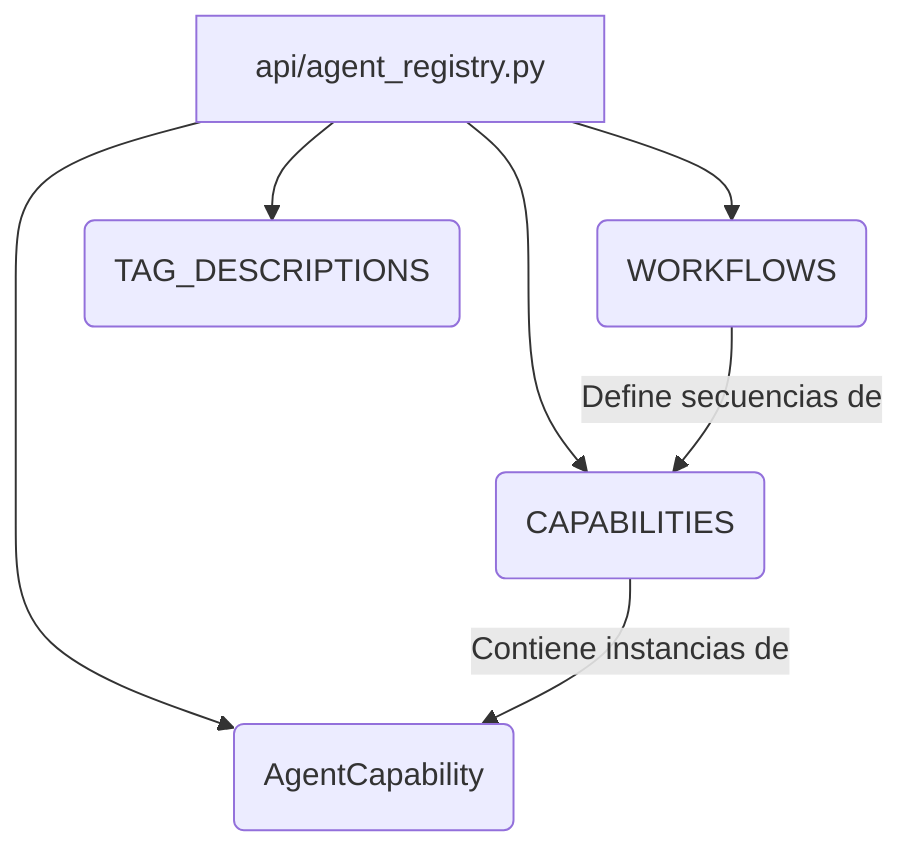

# Registro de Agentes de la API de Contenido de Shopify

Este módulo (`api/agent_registry.py`) es fundamental para definir y registrar las capacidades que los agentes externos pueden utilizar para interactuar con la API de Contenido de Shopify. Actúa como un catálogo declarativo de todas las operaciones disponibles, sus detalles, requisitos previos y los flujos de trabajo recomendados.

## Arquitectura y Relaciones de Componentes

El módulo `Shopify_Content_API_RegistroAgente` centraliza la definición de las interacciones permitidas con el sistema de gestión de contenido (Wagtail) y su sincronización con Shopify. Los componentes clave son:

*   **`AgentCapability`**: Una dataclass que define una capacidad individual de un agente, incluyendo detalles como el `operation_id`, el método HTTP, la ruta, el tipo de capacidad (e.g., `discover`, `read`, `create`, `update`, `delete`, `sync_inbound`, `sync_outbound`), el recurso afectado, un resumen, cuándo usarla, sus requisitos previos, el esquema de respuesta y las siguientes herramientas sugeridas.
*   **`CAPABILITIES`**: Un diccionario que mapea `operation_id` a instancias de `AgentCapability`, sirviendo como el registro completo de todas las capacidades que un agente puede invocar.
*   **`WORKFLOWS`**: Un diccionario que agrupa `operation_id` en secuencias lógicas para tareas comunes, facilitando la orquestación de operaciones complejas.
*   **`TAG_DESCRIPTIONS`**: Un diccionario que proporciona descripciones detalladas para los grupos de capacidades (tags), ayudando a contextualizar el propósito de cada conjunto de herramientas.

### Diagrama de Relación de Componentes

## Cómo Encaja el Módulo en el Sistema General

El módulo `Shopify_Content_API_RegistroAgente` es la puerta de entrada para cualquier agente automatizado o herramienta que necesite interactuar programáticamente con el contenido gestionado en Wagtail y sincronizado con Shopify.

1.  **Interacción de Agentes**: Proporciona un contrato claro y legible por máquina para que los agentes descubran y ejecuten operaciones de contenido (crear, leer, actualizar, eliminar) en diversos recursos como productos, colecciones, blogs, artículos, ubicaciones, glosarios y páginas de inicio.
2.  **Sincronización de Contenido**: Facilita tanto la sincronización de entrada (`shopify_to_wagtail`) para importar contenido desde Shopify (e.g., productos, colecciones, blogs, artículos, términos de glosario) como la sincronización de salida (`wagtail_to_shopify`) para publicar contenido creado o modificado en Wagtail hacia Shopify (e.g., páginas de productos, colecciones, blogs, artículos, ubicaciones, términos de glosario, páginas de inicio como metaobjetos).
3.  **Requisitos Previos y Contexto**: Las capacidades detallan requisitos previos (`prerequisites`) como la existencia de `ShopConfig` o `ShopifyRootPage`, lo que indica una dependencia directa en la configuración del sistema principal y la estructura de páginas de Wagtail, definidas en el módulo [Application_Core___Shopify_Integration_Platform.md](../../Application_Core___Shopify_Integration_Platform.md) y [Wagtail_Content_Management___API/Shopify_Content_Management.md](../Shopify_Content_Management.md) respectivamente.
4.  **Esquemas de Datos**: Los esquemas de respuesta (`response_schema`) referenciados en `AgentCapability` (como `ProductOut`, `ImportResultSchema`, `SyncResultSchema`) están definidos en [Shopify_Content_API_EsquemasCapacidades.md](Shopify_Content_API_EsquemasCapacidades.md) y [Shopify_Content_API_EsquemasComunes.md](Shopify_Content_API_EsquemasComunes.md), asegurando una interfaz de datos consistente.

En resumen, este módulo establece el "lenguaje" y las "habilidades" que los agentes utilizan para operar dentro del ecosistema de gestión de contenido de Shopify y Wagtail, asegurando interacciones controladas y bien definidas.
