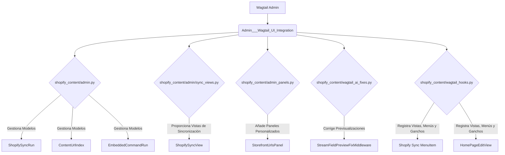

# Integración de la UI de Administración de Wagtail

Este módulo, `Admin___Wagtail_UI_Integration`, se encarga de extender y personalizar la interfaz de administración de Wagtail para gestionar contenido relacionado con Shopify. Proporciona funcionalidades clave para la sincronización de contenido, la visualización de URLs de escaparate, la ejecución de comandos embebidos y mejoras en la experiencia de edición de Wagtail.

## Arquitectura

El módulo se integra directamente con el panel de administración de Wagtail, utilizando clases `ModelAdmin` para la gestión de modelos, `Panel` para la personalización de la interfaz de edición de páginas y ganchos (`hooks`) para inyectar funcionalidades y vistas personalizadas. También incluye middleware para corregir y mejorar el comportamiento de los campos `StreamField` en la previsualización.

## Funcionalidad de Alto Nivel

Este módulo extiende la UI de administración de Wagtail para ofrecer las siguientes funcionalidades:

*   **[Administración de Modelos](Admin___Wagtail_UI_Integration/Admin___Wagtail_UI_Integration_administracion_modelos.md)**: Permite la visualización y gestión de las ejecuciones de sincronización de contenido, índices de URLs de contenido y comandos embebidos.
*   **[Vistas de Sincronización de Shopify](Admin___Wagtail_UI_Integration/Admin___Wagtail_UI_Integration_Admin___Wagtail_UI_Integration_vistas_sincronizacion_shopify.md)**: Ofrece una vista dedicada en la administración de Wagtail para iniciar manualmente la importación de contenido desde Shopify.
*   **[Paneles de Administración](Admin___Wagtail_UI_Integration/Admin___Wagtail_UI_Integration_paneles_administracion.md)**: Integra paneles de información en las páginas de Wagtail para mostrar las URLs correspondientes en el escaparate de Shopify.
*   **[Correcciones de Wagtail AI](Admin___Wagtail_UI_Integration/Admin___Wagtail_UI_Integration_correcciones_ai_wagtail.md)**: Implementa middleware para asegurar que los campos `StreamField` se comporten correctamente durante la previsualización en el editor de Wagtail.
*   **[Ganchos de Wagtail](Admin___Wagtail_UI_Integration/Admin___Wagtail_UI_Integration_ganchos_wagtail.md)**: Registra URLs, elementos de menú y ganchos `after_publish_page` y `after_bulk_action` para notificaciones de sincronización y personalización del editor de `HomePage`.

---
