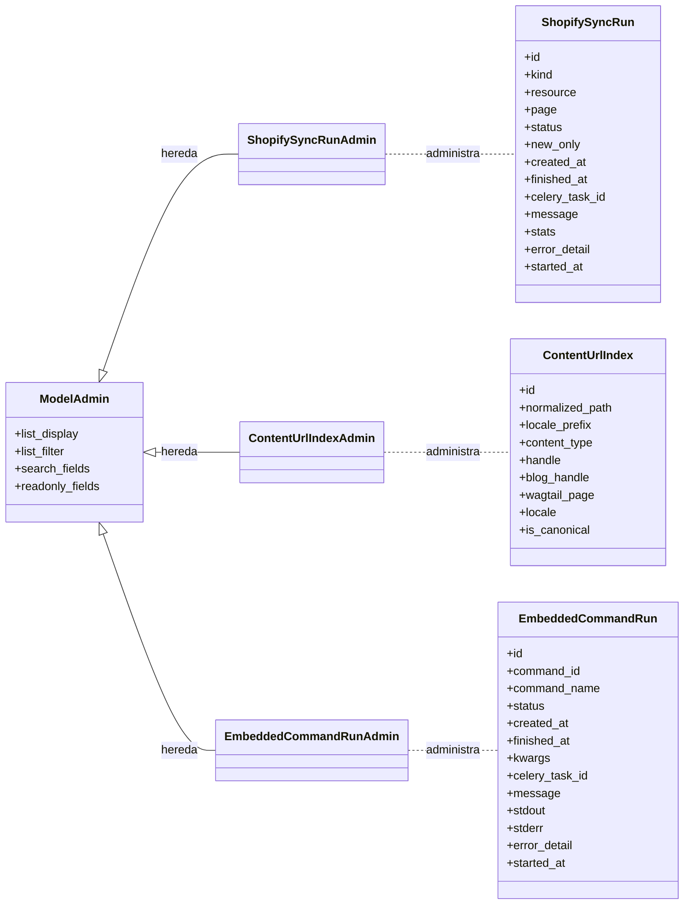

# Administración de Modelos en la Integración de UI de Wagtail

Este módulo, `Admin___Wagtail_UI_Integration_administracion_modelos`, se encarga de la integración y administración de modelos específicos relacionados con la sincronización de contenido y la ejecución de comandos incrustados dentro del entorno de administración de Wagtail. Proporciona interfaces de administración para monitorear y gestionar los procesos de sincronización con Shopify, el índice de URLs de contenido y las ejecuciones de comandos integrados.

## Componentes del Módulo

Este módulo incluye los siguientes componentes principales para la administración en Django/Wagtail:

*   [`ContentUrlIndexAdmin`](#contenturlindexadmin)
*   [`EmbeddedCommandRunAdmin`](#embeddedcommandrunadmin)
*   [`ShopifySyncRunAdmin`](#shopifysyncrunadmin)

### ShopifySyncRunAdmin

La clase `ShopifySyncRunAdmin` (`shopify_content/admin.py::ShopifySyncRunAdmin`) registra el modelo `ShopifySyncRun` en la interfaz de administración de Django, permitiendo a los administradores visualizar y gestionar las operaciones de sincronización de contenido con Shopify. Este modelo representa una única ejecución de sincronización, rastreando su estado y detalles.

*   **Propósito:** Monitorear y gestionar las ejecuciones de sincronización entre Wagtail y Shopify.
*   **`list_display`**: Muestra los campos `id`, `kind`, `resource`, `page`, `status`, `new_only`, `created_at`, y `finished_at` en la vista de lista del administrador.
*   **`list_filter`**: Permite filtrar por `kind`, `status`, `resource`, y `new_only`.
*   **`search_fields`**: Permite buscar por `celery_task_id`, `message`, y `error_detail`.
*   **`readonly_fields`**: Los campos `kind`, `resource`, `page`, `new_only`, `celery_task_id`, `status`, `message`, `stats`, `error_detail`, `created_at`, `started_at`, y `finished_at` son de solo lectura.

### ContentUrlIndexAdmin

La clase `ContentUrlIndexAdmin` (`shopify_content/admin.py::ContentUrlIndexAdmin`) registra el modelo `ContentUrlIndex`, que gestiona el índice de URLs para el contenido. Esto es crucial para el enrutamiento y la resolución de URLs en el sistema de gestión de contenido.

*   **Propósito:** Administrar y visualizar las entradas del índice de URLs de contenido.
*   **`list_display`**: Muestra los campos `id`, `normalized_path`, `locale_prefix`, `content_type`, `handle`, `blog_handle`, `wagtail_page`, `locale`, y `is_canonical`.
*   **`list_filter`**: Permite filtrar por `content_type`, `locale`, y `is_canonical`.
*   **`search_fields`**: Permite buscar por `normalized_path`, `handle`, y `blog_handle`.
*   **`readonly_fields`**: Los campos `normalized_path`, `wagtail_page`, `content_type`, `handle`, `blog_handle`, `locale`, `locale_prefix`, y `is_canonical` son de solo lectura.

### EmbeddedCommandRunAdmin

La clase `EmbeddedCommandRunAdmin` (`shopify_content/admin.py::EmbeddedCommandRunAdmin`) se encarga de la administración de las ejecuciones de comandos incrustados. Estos comandos pueden ser operaciones personalizadas que se ejecutan dentro del sistema y cuyos resultados necesitan ser monitoreados.

*   **Propósito:** Monitorear y gestionar las ejecuciones de comandos incrustados.
*   **`list_display`**: Muestra los campos `id`, `command_id`, `command_name`, `status`, `created_at`, y `finished_at`.
*   **`list_filter`**: Permite filtrar por `status` y `command_name`.
*   **`search_fields`**: Permite buscar por `command_id`, `command_name`, `celery_task_id`, `message`, y `error_detail`.
*   **`readonly_fields`**: Los campos `command_id`, `command_name`, `kwargs`, `celery_task_id`, `status`, `message`, `stdout`, `stderr`, `error_detail`, `created_at`, `started_at`, y `finished_at` son de solo lectura.

## Arquitectura y Relaciones

El siguiente diagrama ilustra la relación entre las clases `ModelAdmin` y los modelos de datos subyacentes que administran. Todas estas clases extienden `django.contrib.admin.ModelAdmin` para proporcionar una interfaz de administración en el panel de Wagtail/Django.

## Encaje en el Sistema General

Estos modelos de administración son una parte fundamental de la interfaz de usuario de Wagtail, proporcionando las herramientas necesarias para que los administradores del CMS supervisen y mantengan la integridad del contenido sincronizado con Shopify y el estado de las operaciones internas. Se integran en el área de administración de Django/Wagtail, lo que permite un control granular sobre aspectos críticos de la gestión de contenido y la ejecución de tareas en segundo plano. Son componentes clave para la depuración, el monitoreo y la resolución de problemas relacionados con la sincronización y la funcionalidad de comandos incrustados.