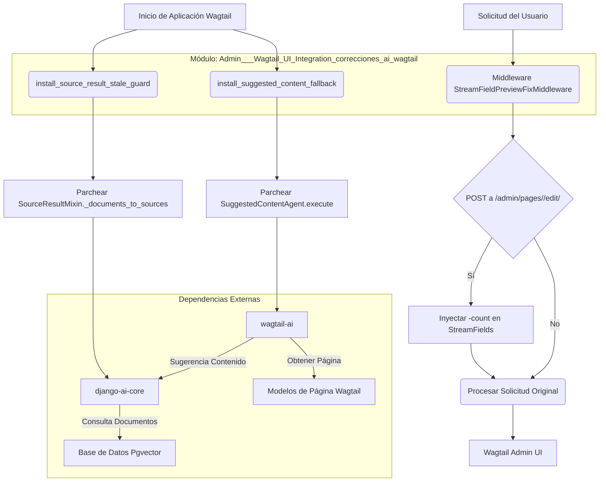

# Correcciones de Integración de IA en la UI de Wagtail

Este módulo, `Admin___Wagtail_UI_Integration_correcciones_ai_wagtail`, contiene correcciones y mejoras esenciales para la integración de funcionalidades de inteligencia artificial con la interfaz de usuario de administración de Wagtail, especialmente en el contexto de la gestión de contenido de Shopify. Su propósito principal es asegurar la estabilidad y el correcto funcionamiento de las características de IA al interactuar con el editor de Wagtail y los datos de contenido.

## Arquitectura y Componentes Clave

El módulo se compone de una pieza de middleware y dos funciones de instalación que aplican parches en tiempo de ejecución a bibliotecas externas (`django-ai-core` y `wagtail-ai`).

### Diagrama de Arquitectura de Componentes

### Componentes

#### `StreamFieldPreviewFixMiddleware`

*   **Propósito:** Este middleware está diseñado para resolver un problema específico en la interfaz de usuario de Wagtail donde las previsualizaciones de `StreamField` pueden fallar durante las solicitudes POST. Inyecta claves `-count` faltantes en los datos POST para los campos `StreamField` en las páginas de edición de Wagtail.
*   **Funcionamiento:**
    1.  Intercepta todas las solicitudes HTTP POST.
    2.  Verifica si la solicitud es para una página de edición de Wagtail (ruta `*/admin/pages/<pk>/edit/`).
    3.  Si es así, recupera la página correspondiente.
    4.  Itera a través de los `StreamField` de la página y, si falta la clave `-count` para un `StreamField` en los datos POST, la calcula (basándose en el número de bloques existentes) y la inyecta.
    5.  Asegura que la solicitud POST modificada se propague correctamente.

#### `install_source_result_stale_guard()`

*   **Propósito:** Esta función aborda una vulnerabilidad en `django-ai-core` que podía provocar fallos cuando la base de datos `pgvector` contenía incrustaciones para páginas de Wagtail que ya habían sido eliminadas. Evita que `django-ai-core` falle al procesar documentos vectoriales huérfanos.
*   **Funcionamiento:**
    1.  Modifica el método `_documents_to_sources` de `SourceResultMixin` de la biblioteca `django-ai-core`.
    2.  La versión parcheada del método filtra los documentos vectoriales que no tienen una página de Wagtail correspondiente (es decir, que son "obsoletos").
    3.  Registra una advertencia cuando se omiten documentos obsoletos, sugiriendo ejecutar el comando `index_pages_batch` para limpiar los huérfanos.

#### `install_suggested_content_fallback()`

*   **Propósito:** Mejora el agente de contenido sugerido de `wagtail-ai` (`SuggestedContentAgent`) al proporcionar un mecanismo de respaldo para el contenido vacío y una lógica de filtrado más robusta basada en tipos de página y sobre-búsqueda (`overfetch`).
*   **Funcionamiento:**
    1.  Primero, llama a `install_source_result_stale_guard()` para asegurar que se aplique la corrección de los documentos obsoletos.
    2.  Envuelve el método `execute` de `SuggestedContentAgent`.
    3.  **Manejo de Contenido Vacío:** Si la consulta de contenido sugerido no proporciona contenido (`content` está vacío pero `exclude_pks` está presente), utiliza el texto de la primera página excluida como contenido de respaldo para la sugerencia.
    4.  **Sobre-búsqueda (Overfetch) para Tipos de Página:** Si se especifican `allowed_types` para la sugerencia, el límite de búsqueda se multiplica por un factor (`SEMANTIC_LINKS_TYPE_OVERFETCH` de la configuración de Django, por defecto 10) para asegurar que haya suficientes candidatos después de filtrar por tipo.
    5.  **Filtrado por Tipo de Página:** Después de obtener los resultados del agente, filtra los elementos para incluir solo aquellos que coincidan con los `allowed_types` solicitados, hasta el límite original.

## Relación con el Sistema General

Este módulo es un componente crítico dentro de la [Integración de la UI de Administración de Wagtail](../Admin___Wagtail_UI_Integration.md) en el sistema de [Gestión de Contenido de Shopify](../../Shopify_Content_Management.md). Asegura que la experiencia del editor en Wagtail sea fluida y robusta, especialmente al trabajar con contenido enriquecido y características impulsadas por IA.

*   **Dependencia en Wagtail:** Interactúa directamente con el marco de Wagtail, utilizando `Page.objects` y `StreamField` para sus operaciones.
*   **Integración con Shopify Content:** Al ser parte de `shopify_content`, estas correcciones son vitales para la gestión y previsualización de contenido sincronizado o creado para las tiendas Shopify.
*   **Dependencia de Bibliotecas de IA:** Se basa en y extiende funcionalidades de `django-ai-core` y `wagtail-ai`, asegurando que estas bibliotecas funcionen correctamente dentro del ecosistema de Wagtail y manejen situaciones de datos anómalos.

El módulo contribuye a una experiencia de usuario más estable y confiable en el panel de administración de Wagtail, mitigando errores relacionados con la inconsistencia de datos y mejorando la calidad de las sugerencias de contenido impulsadas por IA.