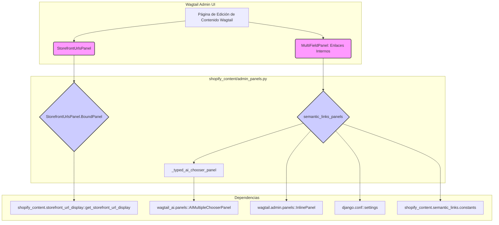

# Paneles de Administración para la Integración de la UI de Wagtail

Este módulo, `Admin___Wagtail_UI_Integration_paneles_administracion`, es fundamental para extender la interfaz de usuario de administración de Wagtail, proporcionando paneles personalizados que mejoran la gestión del contenido relacionado con Shopify. Su objetivo principal es facilitar la visualización de las URLs de la tienda (storefront) y la administración de enlaces semánticos internos, integrándose directamente en las páginas de edición de contenido de Wagtail.

## Propósito y Funcionalidad Principal

El módulo introduce dos funcionalidades clave en la interfaz de administración de Wagtail:

1.  **Visualización de URLs de Storefront**: A través del panel `StorefrontUrlsPanel`, los editores pueden ver las rutas públicas de sus contenidos en la tienda Shopify. Esta información es crucial para tareas de SEO y para correlacionar el contenido del CMS con las URLs reales expuestas al público.

2.  **Gestión de Enlaces Semánticos Internos**: La función `semantic_links_panels` proporciona un mecanismo para gestionar enlaces internos entre diferentes piezas de contenido. Esta funcionalidad puede potenciarse con capacidades de inteligencia artificial si la integración con `wagtail-ai` está activa, ofreciendo sugerencias inteligentes de enlaces.

## Arquitectura y Relaciones de Componentes

Este módulo se integra con el sistema de paneles de Wagtail para añadir elementos personalizados a las páginas de edición.

### StorefrontUrlsPanel

El `StorefrontUrlsPanel` es una subclase de `wagtail.admin.panels.Panel` que se encarga de mostrar las URLs de la tienda Shopify asociadas a la página actual. No permite la edición, sino que ofrece una vista de solo lectura de estas rutas.

*   `StorefrontUrlsPanel`: Define el panel en la interfaz de administración, estableciendo su título (`Storefront URLs`), clase CSS y texto de ayuda.
*   `StorefrontUrlsPanel.BoundPanel`: Es la implementación que renderiza el panel. Utiliza la plantilla `shopify_content/panels/storefront_urls.html` y obtiene las URLs a mostrar a través de la función `get_storefront_url_display` del módulo `shopify_content.storefront_url_display`.

### Paneles de Enlaces Semánticos

La función `semantic_links_panels` genera un `MultiFieldPanel` que contiene paneles para gestionar enlaces internos. Su comportamiento es condicional:

*   **Con Wagtail AI**: Si la configuración de Django `settings.WAGTAIL_AI_PGVECTOR` es `True`, se utilizan paneles `AIMultipleChooserPanel` de `wagtail_ai.panels`. Estos paneles, generados por la función auxiliar `_typed_ai_chooser_panel`, permiten la selección de páginas relacionadas con soporte de IA, filtrando por tipo de contenido.
*   **Sin Wagtail AI**: Si `settings.WAGTAIL_AI_PGVECTOR` es `False`, se utilizan `InlinePanel`s estándar de Wagtail, que permiten añadir enlaces internos de forma manual.

### Diagrama de Componentes



## Dependencias

Este módulo depende de las siguientes partes del sistema:

*   **Wagtail**: Para la creación de paneles de administración (`wagtail.admin.panels`).
*   **Módulo `shopify_content/storefront_url_display`**: Utilizado por `StorefrontUrlsPanel.BoundPanel` para obtener y formatear las URLs de la tienda.
*   **Módulo `shopify_content/semantic_links/constants`**: Proporciona configuraciones para los tipos de relaciones de enlaces semánticos.
*   **`wagtail_ai`**: Opcionalmente, para la funcionalidad de sugerencia de enlaces internos asistida por IA (`wagtail_ai.panels.AIMultipleChooserPanel`).
*   **Django `settings`**: Para verificar la activación de la funcionalidad de Wagtail AI (`settings.WAGTAIL_AI_PGVECTOR`).

Para más detalles sobre la gestión de URLs, consulte la documentación de [Content_URL___Link_Management.md](../Content_URL___Link_Management.md).

## Integración en el Sistema General

Este módulo se integra directamente con el subsistema de [Admin___Wagtail_UI_Integration.md](../Admin___Wagtail_UI_Integration.md) dentro de [Shopify_Content_Management.md](../../Shopify_Content_Management.md). Su propósito es enriquecer la experiencia de edición de contenido en Wagtail, proporcionando a los administradores y editores herramientas esenciales para gestionar la visibilidad del contenido en Shopify y la interconexión entre diferentes páginas dentro del CMS.

## Flujo de Datos (StorefrontUrlsPanel)

El flujo de datos para la visualización de las URLs de storefront es el siguiente:

```mermaid
graph LR
    A[Página de Contenido Wagtail] --> B{Instancia de la Página}
    B --> C[StorefrontUrlsPanel.BoundPanel]
    C --> D{shopify_content.storefront_url_display::get_storefront_url_display(instancia)}
    D --> E[Datos de URLs de Storefront]
    E --> C
    C --> F[Renderiza shopify_content/panels/storefront_urls.html]
    F --> G[Interfaz de Usuario de Wagtail]
```

## Flujo de Proceso (semantic_links_panels)

El proceso para la creación de los paneles de enlaces semánticos es condicional:

```mermaid
graph TD
    A[Llamada a semantic_links_panels()] --> B{¿settings.WAGTAIL_AI_PGVECTOR es True?}
    B -- Sí --> C[Iterar sobre SEMANTIC_LINK_RELATION_NAMES]
    C --> D{Crear _typed_ai_chooser_panel}
    D --> E[Añadir AIMultipleChooserPanel a la lista]
    B -- No --> F[Iterar sobre SEMANTIC_LINK_RELATION_NAMES]
    F --> G{Crear InlinePanel}
    G --> H[Añadir InlinePanel a la lista]
    E --> I[Crear MultiFieldPanel con la lista de paneles]
    H --> I
    I --> J[Retornar MultiFieldPanel]
```
