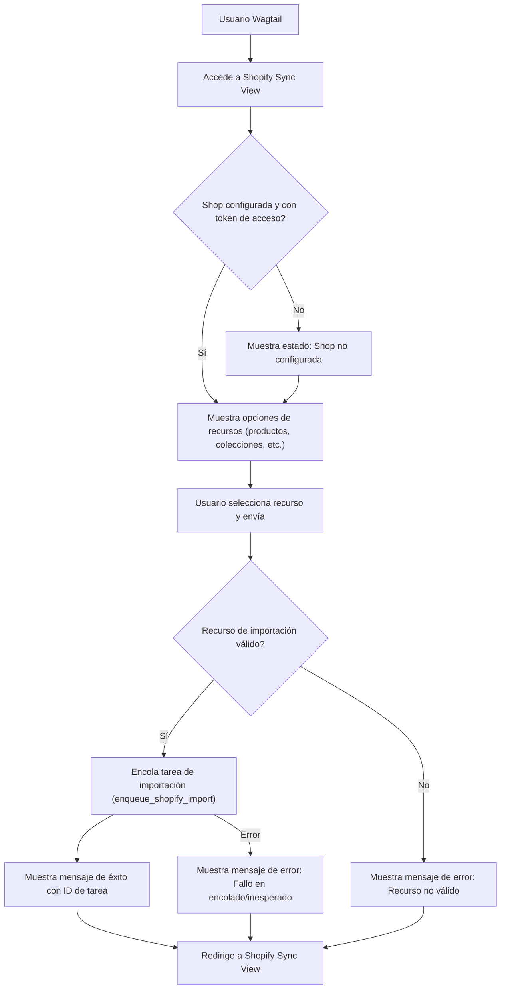

# Vistas de Sincronización de Shopify

El submódulo `Admin___Wagtail_UI_Integration_vistas_sincronizacion_shopify` proporciona la funcionalidad para la sincronización manual de contenido entrante desde Shopify a Wagtail. La pieza central de este submódulo es la vista `ShopifySyncView`.

## `ShopifySyncView`

Esta vista se encarga de mostrar una página de configuración en la interfaz de administración de Wagtail, permitiendo a los usuarios iniciar manualmente el proceso de importación de contenido de Shopify. Incluye la siguiente funcionalidad:

*   **Verificación de Configuración**: Comprueba si la tienda Shopify está configurada correctamente y tiene un token de acceso válido utilizando `get_shop_config` y `shop_has_access_token` del módulo `Application_Core___Shopify_Integration_Platform/Core_Application___Shopify_Embedded_App`.
*   **Recursos de Importación**: Presenta una lista de recursos disponibles para importar (productos, colecciones, blogs, glosario o todos) definidos en `VALID_IMPORT_RESOURCES` del módulo `Wagtail_Content_Management___API/Shopify_Content_Management/Content_Synchronization_Services`.
*   **Encolado de Tareas**: Cuando el usuario envía una solicitud de importación (POST), la vista encola una tarea de importación utilizando `enqueue_shopify_import` del módulo `Wagtail_Content_Management___API/Shopify_Content_Management/Content_Synchronization_Services`.
*   **Retroalimentación al Usuario**: Muestra mensajes de éxito o error en la interfaz de administración de Wagtail utilizando `wagtail.admin.messages` para informar al usuario sobre el estado de la operación de sincronización.

### Diagrama de Flujo de Sincronización Manual

---
